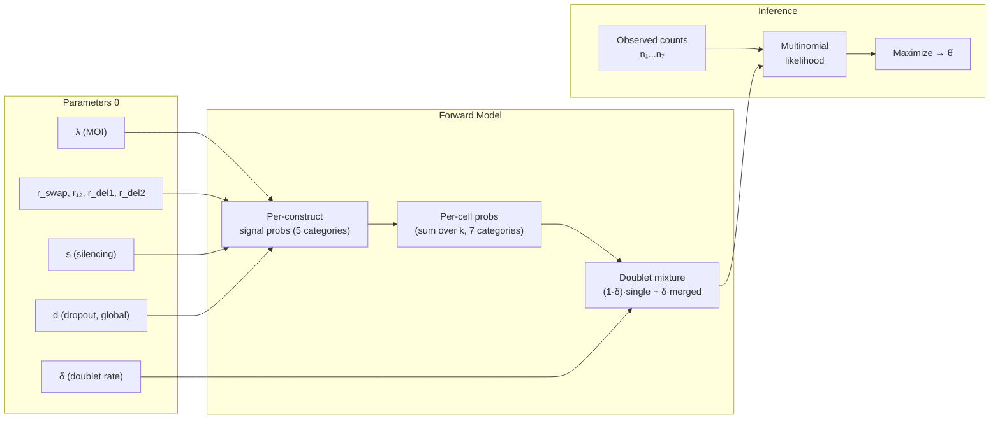

# Q2: Guide Recombination Rate Estimation — Model Design (v4)

## Background

Each cell receives lentiviral constructs with `[pos1_grna–ibar1]–[pos2_grna–ibar2]`. After blasticidin selection (**all uninfected cells killed**), per-cell readout detects gRNAs and iBARs. Q2 estimates the guide recombination rate by modeling all stochastic processes that produce unexpected combinations.

---

## Generative Model Overview

The model is a **forward simulation**: given parameters θ, we can generate synthetic cells and classify them into observable categories. The likelihood of observed category counts given θ drives parameter estimation.



### Simulation Pseudocode

```python
def simulate_cell(θ):
    """Generate one observed cell from parameters."""
    # 1. Infection (conditioned on k≥1 by selection)
    k = sample_truncated_poisson(λ, min=1)

    signals = []  # list of (pair_id_set, detection) per construct

    for each of k constructs:
        # 2. Recombination (mutually exclusive)
        event = sample_categorical([p_intact, r_swap_pos1, r_swap_pos2, r₁₂, r_del1, r_del2])

        # 3. Silencing
        if random() < s:
            continue  # construct contributes nothing

        # 4. Dropout (per guide)
        #    Determine which guides remain based on event + dropout
        signal = apply_dropout(event, d)
        if signal is not empty:
            signals.append(signal)

    # 5. Split-pool doublet
    if random() < δ:
        signals += simulate_cell(θ, no_doublet=True).signals

    # Classify based on merged signals
    return classify(signals)
```

---

## Process Details

### Process 1: Lentiviral Infection

`k ~ Poisson(λ)` conditioned on `k ≥ 1` (blasticidin kills k=0).

| k | P(k\|k≥1) at λ=0.3 | Role |
|---|---|---|
| 1 | 87.4% | Expected majority |
| 2 | 11.3% | Source of true multiplets |
| 3+ | 1.3% | Rare higher-order |

### Process 2: Guide Recombination

Each construct carries `[pos1_A, pos2_B]` where **A** and **B** are position-specific stem variants for the same `pair_id`. Per construct, **mutually exclusive** outcomes:

| Outcome | Prob | Physical construct | After pipeline pairing logic |
|---|---|---|---|
| **Intact** | `p_int = 1-2r_swap-r₁₂-r_del1-r_del2` | `[pos1_A, pos2_B]` — original pair | Single `pair_id` |
| **Pos1 swapped** | `r_swap` | `[pos1_A_foreign, pos2_B]` — foreign guide unit at pos1 | 2 incompatible `pair_id`s |
| **Pos2 swapped** | `r_swap` | `[pos1_A, pos2_B_foreign]` — foreign guide unit at pos2 | 2 incompatible `pair_id`s |
| **Cross-pos swap**| `r₁₂` | `[pos1_B, pos2_A]` — guide units swap positions; pos2-type at pos1 and vice versa | 2 incompatible `pair_id`s |
| **Pos1 deleted** | `r_del1` | `[_, pos2_B]` — only pos2 guide unit remains | Single `pair_id`, pos1 missing |
| **Pos2 deleted** | `r_del2` | `[pos1_A, _]` — only pos1 guide unit remains | Single `pair_id`, pos2 missing |

> [!IMPORTANT]
> **Guide unit = gRNA + stem + iBAR**. The pipeline resolves `pair_id` from the combined `(grna_name, ibar_seq)` identity via the reference. Therefore, `r_swap` as estimated by the model conflates **true recombination swaps** (a foreign guide unit physically replaces the original) **with gRNA-iBAR decoupling** (the gRNA and iBAR from the same position become separated, failing to map to the original `pair_id`).
>
> The decoupling rate can be estimated separately from `analyze_grna_ibar_pairing()` (Part B.2), which counts reads where the observed `(grna_name, ibar_seq)` combination is absent from the reference. This rate should be reported alongside `r_swap` to help interpret how much of the MLE-estimated swap rate is attributable to physical recombination vs. molecular decoupling.

> [!NOTE]
> **Swap Observability**: Because `assign_dual_guide_pairs` groups observations by `pair_id`, a swapped construct with *both* guides physically detected produces **two half-detected (inferred) pair records** (one per `pair_id`). It does *not* produce a mismatched complete pair. Some gRNA sequences are shared across positions; the pipeline uses iBAR matching and stem-variant disambiguation (Step 3) to resolve the correct `grna_name` and thus `pair_id` before this stage.

### Process 3: Construct Silencing

Rate `s`: entire construct silenced → **no pos1 AND no pos2**.

### Process 4: Single-Guide Dropout

Rate `d` per guide (same both positions). Applied independently to each guide on each active construct.

### Process 5: Split-Pool Doublets

Rate `δ` (default 3%). A "cell" barcode actually contains **two independent cells** — their signals merge. Modeled as mixture over final observables.

---

## Per-Construct Signal Probabilities

Tracing each outcome through silencing `s` (prob construct invisible) and global dropout `d` (prob guide independently drops out). Let `q = 1-s`, `p = 1-d`. The resulting 5 signal states for a single construct are:

| Signal | Symbol | Expression | Sources |
|---|---|---|---|
| **Complete** | `P_C` | `q · p_int · p²` | Intact + both detected |
| **Inf. (pos1 miss)** | `P_I₁` | `q·p·[(p_int + 2r_swap + r₁₂)d + r_del1]`| Only pos2 detected (from intact, swap, or pos1_del) |
| **Inf. (pos2 miss)** | `P_I₂` | `q·p·[(p_int + 2r_swap + r₁₂)d + r_del2]`| Only pos1 detected (from intact, swap, or pos2_del) |
| **Multiplet signal** | `P_M` | `q · (2r_swap + r₁₂) · p²` | Both sides of swap detected (yields 2 inferred pairs) |
| **Invisible** | `P_X` | `1 - P_C - P_I₁ - P_I₂ - P_M` | Silenced, double dropout, or del+dropout |

**Verification**: `P_C + P_I₁ + P_I₂ + P_M + P_X = 1` ✓

---

## Single-Cell Classification (no doublet)

Each of $k$ independent constructs produces one signal from $\{C, I_1, I_2, M, X\}$. The 7 cell-level categories depend on how many constructs are visible and their types.

### Event Definitions
- **perfect_singlet**: 1 $C$ visible, all rest $X$
- **inferred_singlet_pos1_missing**: 1 $I_1$ visible, all rest $X$
- **inferred_singlet_pos2_missing**: 1 $I_2$ visible, all rest $X$
- **multiplet_all_complete**: $\ge2$ $C$ visible, no $I/M$ (true MOI)
- **multiplet_all_inferred**: $\ge1$ $M$ visible OR $\ge2$ $I$ visible, no $C$ (swap/del products)
- **multiplet_mixed**: $\ge1$ $C$ visible AND $\ge1$ $I/M$ visible
- **unassigned**: All $k$ constructs are $X$

### k=2

### General $k$ Formulas

```text
Pₖ(perfect_singlet)         = k · P_C · P_X^(k-1)
Pₖ(inf_pos1_missing)        = k · P_I₁ · P_X^(k-1)
Pₖ(inf_pos2_missing)        = k · P_I₂ · P_X^(k-1)
Pₖ(multi_all_complete)      = (P_C + P_X)^k - k·P_C·P_X^(k-1) - P_X^k
Pₖ(multi_all_inferred)      = (1 - P_C)^k - P_X^k - k·(P_I₁ + P_I₂)·P_X^(k-1)
Pₖ(multi_mixed)             = 1 - (P_C + P_X)^k - (1 - P_C)^k + P_X^k
Pₖ(unassigned)              = P_X^k
```

For practical purposes, the model truncates the sum at $k_{max}=4$.

### Marginalizing over k

```
P_single(cat) = Σ_{k=1}^{K_max} P(k|k≥1) · Pₖ(cat)
```

where `P(k|k≥1) = (λᵏe^{-λ}/k!) / (1-e^{-λ})`.

---

## Split-Pool Doublet Integration

With probability `δ`, a barcode represents **two independent cells** merged. Each cell is an independent draw from `P_single`. The merged classification depends on how their signals combine:

### Doublet Convolution Rules

Two independent cells merge. For 7 categories, let `ps, pi1, pi2, mc, mi, mm, pu` be the single-cell probabilities, and let `pi = pi1 + pi2`.

```text
P_dbl(perfect_singlet)     = 2·ps·pu
P_dbl(inf_pos1_missing)    = 2·pi1·pu
P_dbl(inf_pos2_missing)    = 2·pi2·pu
P_dbl(multi_all_complete)  = ps² + 2·ps·mc + mc² + 2·mc·pu
P_dbl(multi_all_inferred)  = pi² + 2·pi·mi + mi² + 2·mi·pu
P_dbl(multi_mixed)         = 1 - [sum of all above] - pu²
P_dbl(unassigned)          = pu²
```

### Final Observable Probabilities

```
P_obs(cat) = (1-δ) · P_single(cat) + δ · P_doublet(cat)
```

> [!IMPORTANT]
> **Why this matters**: Without doublet correction, excess multiplets would be over-attributed to recombination. The doublet term specifically inflates the multiplet count by `δ · P_doublet(multiplet)`, which must be subtracted before estimating `r`.

---

## Observable Categories for Counting

7 categories parsed from the `grna_cell_assignment.csv`:

| # | Category | Pipeline Definition |
|---|---|---|
| n₁ | **perfect_singlet** | `combo_type='singlet'` + `detection_status='complete'` |
| n₂ | **inferred_pos1_miss** | `combo_type='singlet'` + `detection_status='inferred'` + `pos1_umi=0` |
| n₃ | **inferred_pos2_miss** | `combo_type='singlet'` + `detection_status='inferred'` + `pos2_umi=0` |
| n₄ | **multiplet_all_comp** | `combo_type='multiplet'` + all pairs `detection_status='complete'` |
| n₅ | **multiplet_all_inf** | `combo_type='multiplet'` + all pairs `detection_status='inferred'` |
| n₆ | **multiplet_mixed** | `combo_type='multiplet'` + mix of complete/inferred |
| n₇ | **unassigned** | GEX cell with no gRNA assignments |

**Total**: $N = \sum_{i=1}^7 n_i$.

Degrees of freedom: 7 categories - 1 constraint = 6. 
Parameters: `d, s, r_swap, r12, r_del1, r_del2` = 6.
Model is exactly identified.

---

## Parameter Estimation

### Step-Wise (initialization)

**Step 1 — Dropout `d`** from perfect vs inferred singlet ratio:

At low recombination, k=1 dominates singlets. Intact construct: P(perfect) = p², P(inferred) = 2pd.

```
n₁/(n₁+n₂) ≈ p²/(p² + 2pd) = (1-d)/(1+d)

d ≈ (1 - R)/(1 + R),  where R = n₁/(n₁+n₂)
```

**Step 2 — Silencing `s`** from unassigned fraction:

```
P(unassigned) ≈ P(k=1|k≥1)·P_X + P(k=2|k≥1)·P_X² + ...

At low r:  P_X ≈ s + (1-s)·d²

s ≈ (P_X_est - d²)/(1 - d²),   where P_X_est from n₄/N corrected for k≥2
```

**Step 3 — Recombination `r`** from multiplet surplus:

```
n₃_expected_no_recomb = N · [Σ_k P(k|k≥1)·Pₖ(multiplet)|_{r=0}  +  δ·P_doublet(multiplet)|_{r=0}]

r ≈ (n₃_observed - n₃_expected_no_recomb) / (N · P(k=1|k≥1) · q · p²)
```

### Full MLE

Multinomial likelihood for the 7 categories:
```
L(θ | n₁...n₇) = N! / (n₁!...n₇!) · Π_i P_obs(cat_i | θ)^{nᵢ}
```

Maximize log-likelihood with `scipy.optimize.minimize`, initialized from heuristic step-wise estimates (d from singlet ratio, r_del asymmetry from n₂/n₃ ratio, r from multiplet surplus). Model comparison against a 4-category legacy model evaluates BIC to confirm usefulness of granular extension.

---

## Proposed Code Changes

### [MODIFY] [qc_q1_guide_efficacy.py](file:///Volumes/Jiahao/TIMI/CSM_ccperturbseq/scripts/qc_q1_guide_efficacy.py)

- Add `count_model_categories(adata, ref_df)` → returns `{n₁, n₂, n₃, n₄}` per sample

### [MODIFY] [qc_q2_decoupling.py](file:///Volumes/Jiahao/TIMI/CSM_ccperturbseq/scripts/qc_q2_decoupling.py)

- **Remove** Part C (KD comparison — now in Q1)
- **Keep** Part A (pairing stats), Part B (fitness)
- **Add** Part C — Recombination Model:
  - `per_construct_probs(d, s, r_swap, r12, r_del)` → `(P_C, P_I, P_M, P_X)`
  - `cell_probs_single(P_C, P_I, P_M, P_X, moi, k_max=3)` → 4-vector
  - `doublet_convolution(p_single)` → 4-vector
  - `observable_probs(θ, moi, δ)` → `[P(n₁), ..., P(n₄)]`
  - `neg_log_likelihood(θ, counts, moi, δ)` → scalar
  - `estimate_stepwise(counts, moi, δ)` → initial `(d, s, r)`
  - `fit_mle(counts, moi, δ, extended=False)` → `θ̂ ± CI`
  - `simulate_cells(θ, moi, δ, N)` → synthetic counts (for validation)
  - `plot_observed_vs_expected(...)`, `plot_sensitivity(...)`

### Outputs
1. Parameter table CSV: `d, s, r_swap, r₁₂, r_del` (± CI) per sample
2. Observed vs expected bar chart
3. Sensitivity plot: `r` vs assumed MOI/δ
4. Simulation validation: recovery of known parameters

---

## Verification

- **Simulation test**: Generate N=50,000 cells from known θ; verify MLE recovers parameters within CI
- **Cross-sample consistency**: `r` should be similar between Control and Treatment (recombination is pre-selection)
- **Sensitivity analysis**: Sweep MOI ± 0.1 and δ ± 0.02; report effect on `r̂`
- **Residual diagnostics**: Observed − expected category fractions
