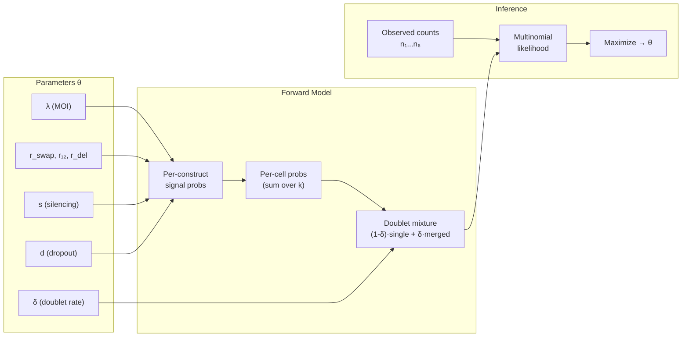

# Q2: Guide Recombination Rate Estimation — Model Design (v4)

## Background

Each cell receives lentiviral constructs with `[pos1_grna–ibar1]–[pos2_grna–ibar2]`. After blasticidin selection (**all uninfected cells killed**), per-cell readout detects gRNAs and iBARs. Q2 estimates the guide recombination rate by modeling all stochastic processes that produce unexpected combinations.

---

## Generative Model Overview

The model is a **forward simulation**: given parameters θ, we can generate synthetic cells and classify them into observable categories. The likelihood of observed category counts given θ drives parameter estimation.



### Simulation Pseudocode

```python
def simulate_cell(θ):
    """Generate one observed cell from parameters."""
    # 1. Infection (conditioned on k≥1 by selection)
    k = sample_truncated_poisson(λ, min=1)

    signals = []  # list of (pair_id_set, detection) per construct

    for each of k constructs:
        # 2. Recombination (mutually exclusive)
        event = sample_categorical([p_intact, r_swap, r_swap, r₁₂, r_del, r_del])

        # 3. Silencing
        if random() < s:
            continue  # construct contributes nothing

        # 4. Dropout (per guide)
        #    Determine which guides remain based on event + dropout
        signal = apply_dropout(event, d)
        if signal is not empty:
            signals.append(signal)

    # 5. Split-pool doublet
    if random() < δ:
        signals += simulate_cell(θ, no_doublet=True).signals

    # Classify based on merged signals
    return classify(signals)
```

---

## Process Details

### Process 1: Lentiviral Infection

`k ~ Poisson(λ)` conditioned on `k ≥ 1` (blasticidin kills k=0).

| k | P(k\|k≥1) at λ=0.3 | Role |
|---|---|---|
| 1 | 87.4% | Expected majority |
| 2 | 11.3% | Source of true multiplets |
| 3+ | 1.3% | Rare higher-order |

### Process 2: Guide Recombination

Per construct, **mutually exclusive** outcomes (gRNA–iBAR move as unit when `c=0`):

| Outcome | Prob | Result |
|---|---|---|
| Intact | `p_int = 1-2r_swap-r₁₂-2r_del` | Original `[pos1, pos2]` |
| Pos1 swapped | `r_swap` | `[pos1_foreign, pos2_orig]` — 2 pair_ids |
| Pos2 swapped | `r_swap` | `[pos1_orig, pos2_foreign]` — 2 pair_ids |
| Cross-pos swap | `r₁₂` | Both units from wrong positions — 2 pair_ids |
| Pos1 deleted | `r_del` | Only pos2 remains |
| Pos2 deleted | `r_del` | Only pos1 remains |

Simple model: single `r = 2r_swap + r₁₂ + 2r_del`.

### Process 3: Construct Silencing

Rate `s`: entire construct silenced → **no pos1 AND no pos2**.

### Process 4: Single-Guide Dropout

Rate `d` per guide (same both positions). Applied independently to each guide on each active construct.

### Process 5: Split-Pool Doublets

Rate `δ` (default 3%). A "cell" barcode actually contains **two independent cells** — their signals merge. Modeled as mixture over final observables.

---

## Per-Construct Signal Probabilities

For one construct, define the probability of each observable **signal type**:

| Signal | Symbol | Expression |
|---|---|---|
| **Complete** (1 correct pair, both pos) | `P_C` | `q · p_int · p²` |
| **Inferred** (1 pair_id, one pos) | `P_I` | `q · [p_int·2pd + 2r_swap·pd + r₁₂·2pd + 2r_del·p]` |
| **Multiplet signal** (2 pair_ids) | `P_M` | `q · (2r_swap + r₁₂) · p²` |
| **Invisible** (nothing detected) | `P_X` | `1 - P_C - P_I - P_M` |

Where `q = 1-s`, `p = 1-d`.

> [!NOTE]
> `P_I` aggregates multiple origins: intact+one-dropout, swap+swapped-guide-dropout (swap hidden), cross-swap+one-dropout, and deletion. `P_X` includes silencing, double-dropout, and deletion+dropout.

**Verification**: `P_C + P_I + P_M + P_X = 1` ✓

---

## Single-Cell Classification (no doublet)

### k=1

| Observable | Probability |
|---|---|
| Perfect singlet | `P_C` |
| Inferred singlet | `P_I` |
| Multiplet | `P_M` |
| Unassigned | `P_X` |

### k=2

Two independent constructs. Classification depends on the **combination** of signals:

| Construct 1 | Construct 2 | Classification | Prob (unordered) |
|---|---|---|---|
| C | X | **Perfect singlet** | `2·P_C·P_X` |
| I | X | **Inferred singlet** | `2·P_I·P_X` |
| C | C | **Multiplet** | `P_C²` |
| C | I | **Multiplet** | `2·P_C·P_I` |
| I | I | **Multiplet** | `P_I²` |
| C | M | **Multiplet** | `2·P_C·P_M` |
| I | M | **Multiplet** | `2·P_I·P_M` |
| M | X | **Multiplet** | `2·P_M·P_X` |
| M | M | **Multiplet** | `P_M²` |
| X | X | **Unassigned** | `P_X²` |

Aggregated:

```
P₂(singlet_perfect)  = 2·P_C·P_X
P₂(singlet_inferred) = 2·P_I·P_X
P₂(multiplet)        = (P_C + P_I + P_M)² - (2·P_C·P_X + 2·P_I·P_X + P_X²)
                      = 1 - 2(P_C+P_I)·P_X - P_X²     [since P_C+P_I+P_M+P_X=1]
P₂(unassigned)        = P_X²
```

### General k

```
Pₖ(singlet_perfect)  = k · P_C · P_X^(k-1)
Pₖ(singlet_inferred) = k · P_I · P_X^(k-1)
Pₖ(multiplet)        = 1 - k·(P_C+P_I)·P_X^(k-1) - (k choose 1)·P_M·P_X^(k-1) ... 
```

For practical purposes, truncate at k=3 (k≥4 negligible at λ≤0.5).

### Marginalizing over k

```
P_single(cat) = Σ_{k=1}^{K_max} P(k|k≥1) · Pₖ(cat)
```

where `P(k|k≥1) = (λᵏe^{-λ}/k!) / (1-e^{-λ})`.

---

## Split-Pool Doublet Integration

With probability `δ`, a barcode represents **two independent cells** merged. Each cell is an independent draw from `P_single`. The merged classification depends on how their signals combine:

### Doublet Convolution Table

Let S = singlet (perfect or inferred), M = multiplet, U = unassigned for brevity.

| Cell A | Cell B | Merged Classification |
|---|---|---|
| Perfect singlet | Unassigned | **Perfect singlet** |
| Inferred singlet | Unassigned | **Inferred singlet** |
| Perfect singlet | Perfect singlet | **Multiplet** |
| Perfect singlet | Inferred singlet | **Multiplet** |
| Inferred singlet | Inferred singlet | **Multiplet** |
| Any visible | Multiplet | **Multiplet** |
| Multiplet | Unassigned | **Multiplet** |
| Unassigned | Unassigned | **Unassigned** |

### Doublet Category Probabilities

Define shorthand: `p_s = P_single(perfect)`, `p_i = P_single(inferred)`, `p_m = P_single(multiplet)`, `p_u = P_single(unassigned)`.

```
P_doublet(perfect_singlet)  = 2·p_s·p_u
P_doublet(inferred_singlet) = 2·p_i·p_u
P_doublet(multiplet)        = 1 - 2·p_s·p_u - 2·p_i·p_u - p_u²
P_doublet(unassigned)        = p_u²
```

### Final Observable Probabilities

```
P_obs(cat) = (1-δ) · P_single(cat) + δ · P_doublet(cat)
```

> [!IMPORTANT]
> **Why this matters**: Without doublet correction, excess multiplets would be over-attributed to recombination. The doublet term specifically inflates the multiplet count by `δ · P_doublet(multiplet)`, which must be subtracted before estimating `r`.

---

## Observable Categories for Counting

| # | Category | Pipeline Definition |
|---|---|---|
| n₁ | **Perfect singlet** | 1 pair_id, both pos detected |
| n₂ | **Inferred singlet** | 1 pair_id, one pos detected |
| n₃ | **Multiplet** | ≥2 pair_ids detected |
| n₄ | **Unassigned** | No gRNA detected |

**Total**: N = n₁ + n₂ + n₃ + n₄

---

## Parameter Estimation

### Step-Wise (initialization)

**Step 1 — Dropout `d`** from perfect vs inferred singlet ratio:

At low recombination, k=1 dominates singlets. Intact construct: P(perfect) = p², P(inferred) = 2pd.

```
n₁/(n₁+n₂) ≈ p²/(p² + 2pd) = (1-d)/(1+d)

d ≈ (1 - R)/(1 + R),  where R = n₁/(n₁+n₂)
```

**Step 2 — Silencing `s`** from unassigned fraction:

```
P(unassigned) ≈ P(k=1|k≥1)·P_X + P(k=2|k≥1)·P_X² + ...

At low r:  P_X ≈ s + (1-s)·d²

s ≈ (P_X_est - d²)/(1 - d²),   where P_X_est from n₄/N corrected for k≥2
```

**Step 3 — Recombination `r`** from multiplet surplus:

```
n₃_expected_no_recomb = N · [Σ_k P(k|k≥1)·Pₖ(multiplet)|_{r=0}  +  δ·P_doublet(multiplet)|_{r=0}]

r ≈ (n₃_observed - n₃_expected_no_recomb) / (N · P(k=1|k≥1) · q · p²)
```

### Full MLE

Multinomial likelihood:
```
L(θ | n₁,n₂,n₃,n₄) = N! / (n₁!n₂!n₃!n₄!) · Π_i P_obs(cat_i | θ)^{nᵢ}
```

Maximize log-likelihood with `scipy.optimize.minimize`, initialized from step-wise estimates. Confidence intervals from Fisher information matrix or profile likelihood.

---

## Proposed Code Changes

### [MODIFY] [qc_q1_guide_efficacy.py](file:///Volumes/Jiahao/TIMI/CSM_ccperturbseq/scripts/qc_q1_guide_efficacy.py)

- Add `count_model_categories(adata, ref_df)` → returns `{n₁, n₂, n₃, n₄}` per sample

### [MODIFY] [qc_q2_decoupling.py](file:///Volumes/Jiahao/TIMI/CSM_ccperturbseq/scripts/qc_q2_decoupling.py)

- **Remove** Part C (KD comparison — now in Q1)
- **Keep** Part A (pairing stats), Part B (fitness)
- **Add** Part C — Recombination Model:
  - `per_construct_probs(d, s, r_swap, r12, r_del)` → `(P_C, P_I, P_M, P_X)`
  - `cell_probs_single(P_C, P_I, P_M, P_X, moi, k_max=3)` → 4-vector
  - `doublet_convolution(p_single)` → 4-vector
  - `observable_probs(θ, moi, δ)` → `[P(n₁), ..., P(n₄)]`
  - `neg_log_likelihood(θ, counts, moi, δ)` → scalar
  - `estimate_stepwise(counts, moi, δ)` → initial `(d, s, r)`
  - `fit_mle(counts, moi, δ, extended=False)` → `θ̂ ± CI`
  - `simulate_cells(θ, moi, δ, N)` → synthetic counts (for validation)
  - `plot_observed_vs_expected(...)`, `plot_sensitivity(...)`

### Outputs
1. Parameter table CSV: `d, s, r_swap, r₁₂, r_del` (± CI) per sample
2. Observed vs expected bar chart
3. Sensitivity plot: `r` vs assumed MOI/δ
4. Simulation validation: recovery of known parameters

---

## Verification

- **Simulation test**: Generate N=50,000 cells from known θ; verify MLE recovers parameters within CI
- **Cross-sample consistency**: `r` should be similar between Control and Treatment (recombination is pre-selection)
- **Sensitivity analysis**: Sweep MOI ± 0.1 and δ ± 0.02; report effect on `r̂`
- **Residual diagnostics**: Observed − expected category fractions
