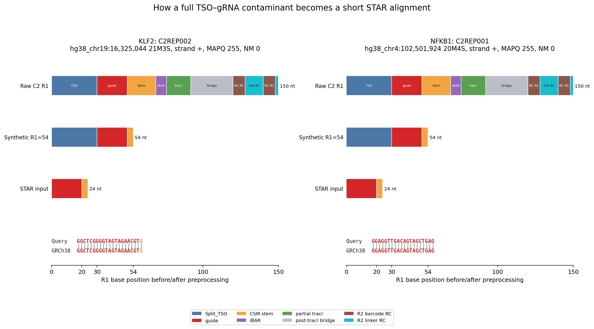
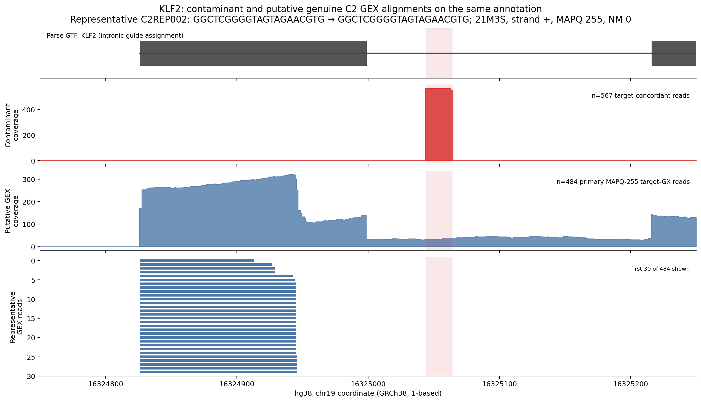
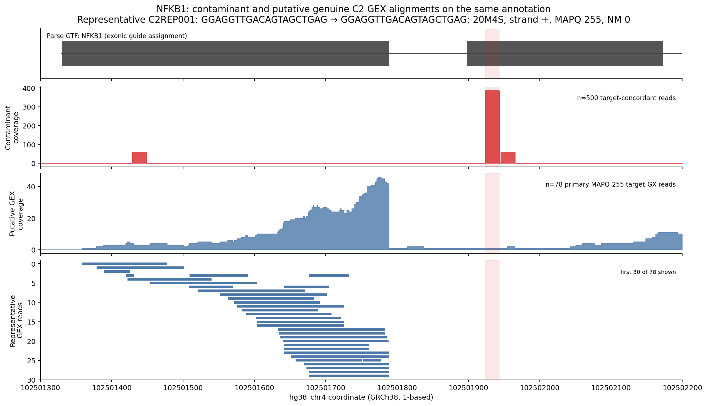

# C2 gRNA-to-GEX Misalignment Case Study

## Result

C2 contained 11,683 full-length structural gRNA contaminants among 363,646,678
raw GEX pairs (32.13 per million). The separate cell-associated pre-alignment
molecular-family estimate is 42.47–69.66 CPM; the denominators must not be
interchanged. In the controlled synthetic-54 experiment, 2,431/10,559 known
contaminants (23.02%) were assigned to their guide's target gene. The largest
complementary examples were promoter-proximal intronic KLF2 and exonic NFKB1.

## Controlled experiment

Both arms contain the same 10,559 corrected-barcode contaminants and use the
same STAR reference and options. Only the short arm truncates raw R1 to 54 nt
before identical Split_TSO preprocessing.

| Outcome | Full R1 | Synthetic 54-nt R1 |
|---|---:|---:|
| Input structural contaminants | 10,559 | 10,559 |
| Mapped primary reads | 0 | 8,113 |
| Unique MAPQ-255 reads | 0 | 6,965 |
| False gene-assigned reads | 0 | 4,008 |
| Intended-target assignments | 0 | 2,431 |

Target counts use the quote-normalized annotation; literal quotes in the older
controlled CSV had produced incorrect `is_guide_target=False` values.

## Representative read transformation

Both reads begin with the exact 30-nt Split_TSO
`AAGCAGTGGTATCAACGCAGAGTGAATGGG`. After 54-nt truncation, split-pipe removes
that TSO and sends a guide-dominated 24-mer to STAR. STAR aligns all 20 guide
bases; KLF2 also aligns one matching stem base.

The 150-nt reads resolve the CSM stem, 7-nt iBAR, partial tracr, post-tracr
bridge, and opposite-end barcode read-through. Bases 121–128 and 141–148 match
the expected reverse-complement BC1/BC2 positions; bases 129–140 are
`GAGGTGGTTGGA`, the reverse complement of the Parse-v3 R2 linker. This is
paired-end overlap within one library fragment, not concatenation of the R2
FASTQ record. STAR uses the same sequence for 3-prime adapter clipping.

The Query and GRCh38 letters inherit the source annotation colors: guide bases
are red, and any aligned stem-derived base is orange.

| Gene | Ensembl ID | Dominant guide(s), by position | Contaminant position(s) (reads) | Parse annotation | Target-concordant reads | Removed false molecules | Putative genuine GEX reads in window | Representative STAR alignment / strand |
|---|---|---|---|---|---:|---:|---:|---|
| KLF2 | ENSG00000127528 | `GGCTCGGGGTAGTAGAACGT` | `hg38_chr19:16,325,044` (567) | intronic | 567 | 484 | 484 | `hg38_chr19:16,325,044` / `21M3S` / + |
| NFKB1 | ENSG00000109320 | `GCTTCCCCTGCCCTTCCCGT` `GGAGGTTGACAGTAGCTGAG` `GCACATGGGATTAGCGACAG` | `hg38_chr4:102,501,429` (57) `hg38_chr4:102,501,924` (386) `hg38_chr4:102,501,946` (57) | exonic | 500 | 414 | 78 | `hg38_chr4:102,501,924` / `20M4S` / + |

## Locus views

Red shows the controlled short54 contaminants; blue shows the original C2 GEX
BAM on the same GRCh38 axis. “Putative genuine GEX” denotes a primary MAPQ-255
target-`GX` read that overlaps the locus and lacks a complete residual gRNA
signature; it is not independent proof of origin. Block-aware filtering
excluded 75 KLF2 and 11 NFKB1 reads whose outer spans crossed a window only
through a splice.

### KLF2

Representative `C2REP002` contains guide `GGCTCGGGGTAGTAGAACGT` followed by
the `GTTT` stem boundary. STAR aligned the trimmed 24-mer at
`hg38_chr19:16,325,044` (`21M3S`, MAPQ 255, NM 0); the corresponding processed
full-length contaminant had no mapped primary record.

### NFKB1

Representative `C2REP001` contains guide `GGAGGTTGACAGTAGCTGAG` followed by
the `GTTT` stem boundary. STAR aligned the trimmed 24-mer at
`hg38_chr4:102,501,924` (`20M4S`, MAPQ 255, NM 0); the corresponding processed
full-length contaminant had no mapped primary record.

## Interpretation and limitations

- The 23.02% result is conditional on a known contaminant, not the whole GEX
  library.
- The contaminant-only controlled arm measures alignment potential without
  competition from genuine GEX reads. Native-library UMI collapse can merge or
  redistribute molecules, so the controlled false-molecule counts are not a
  direct correction to the expression matrix.
- The production-BAM structural classifier recognizes complete residual gRNA
  constructs. A guide-only contaminant can lack that signature, so the blue
  tracks are putative native GEX evidence, not guaranteed contamination-free
  expression.
- The original 150-cycle contaminant arm produced zero mapped reads. The
  failure appears only after shortening the same molecules and performing the
  same TSO preprocessing.
- The query-name-sorted, unindexed production BAM required one complete
  streaming pass for genuine-read recovery.

## Reproducibility

The sanitized evidence bundle in `assets/c2_gex_grna_misalignment/data/`
records UGER job `60033760`, truth-panel token
`5bbee5a9d61a3937b96fee7b868fa583`, provenance, sizes, and SHA-256 digests.
Read IDs are pseudonymized; cell, barcode, UMI, unused native-GEX sequence, and
absolute source paths are omitted. No STAR or full contamination scan was
repeated.

The extraction and rendering entry point is
`../scripts/c2_gex_grna_case_study.py`; the bound UGER wrapper is
`../submit/submit_c2_gex_grna_case_study.sh`. Its `publish` command validates
the internal extraction hashes and writes the scientific-minimum bundle; its
`render` command consumes only that sanitized bundle.
