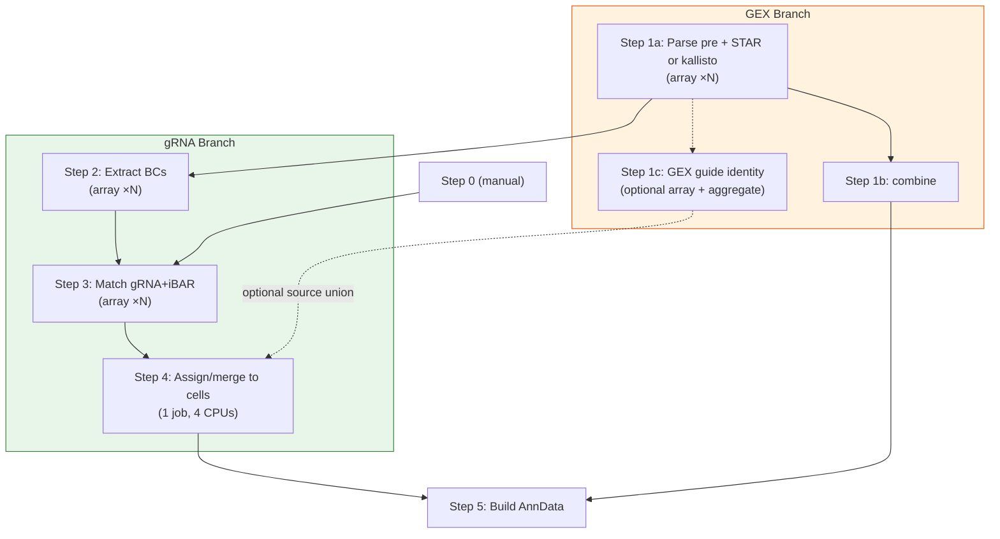
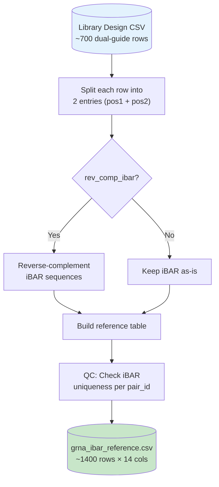
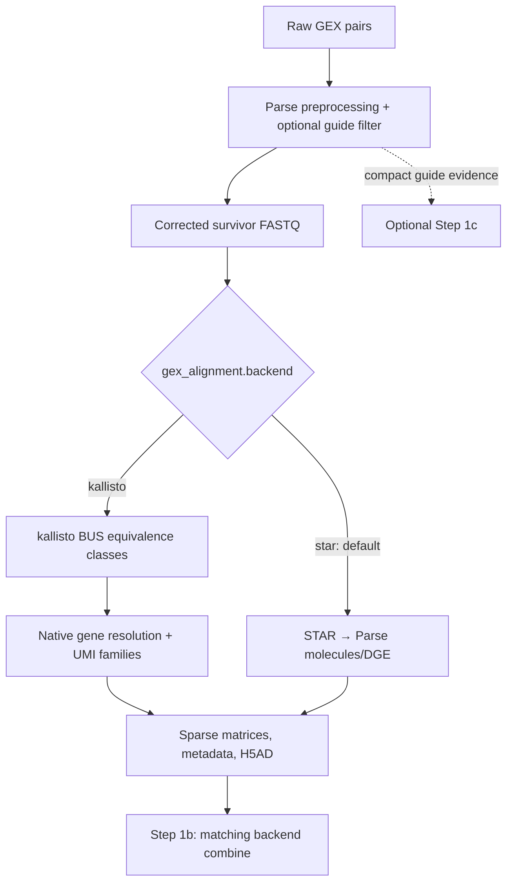
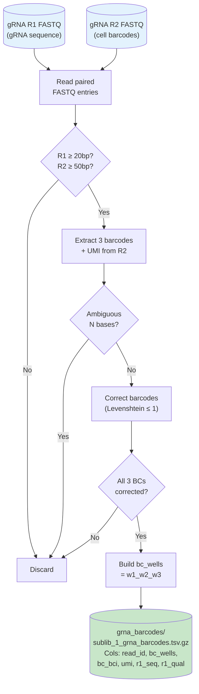
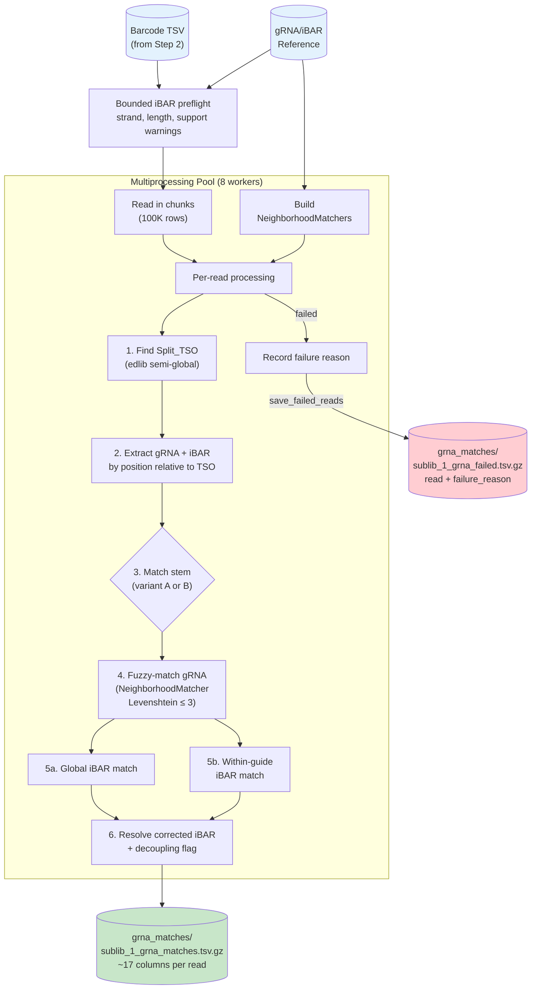
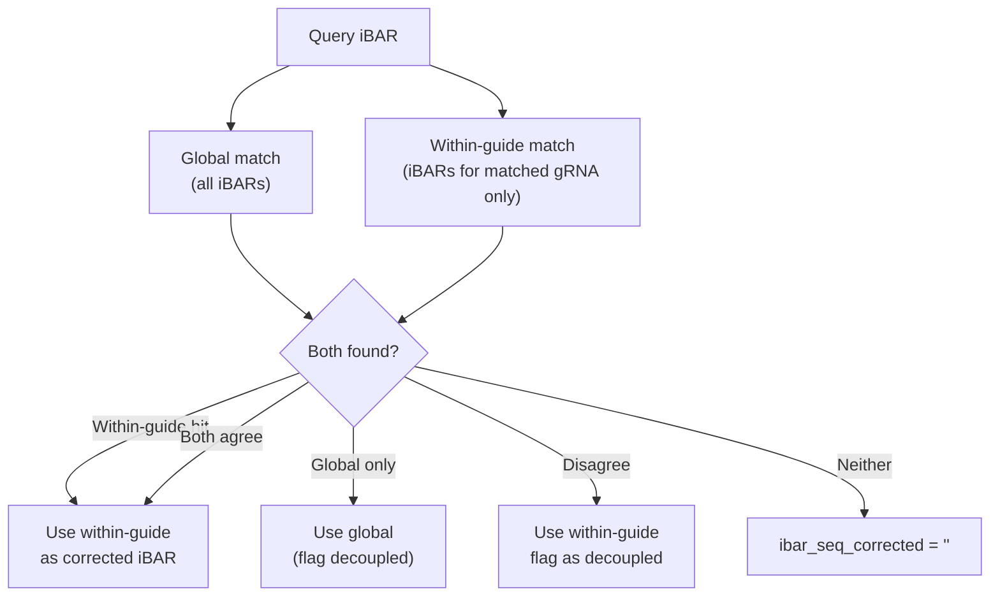
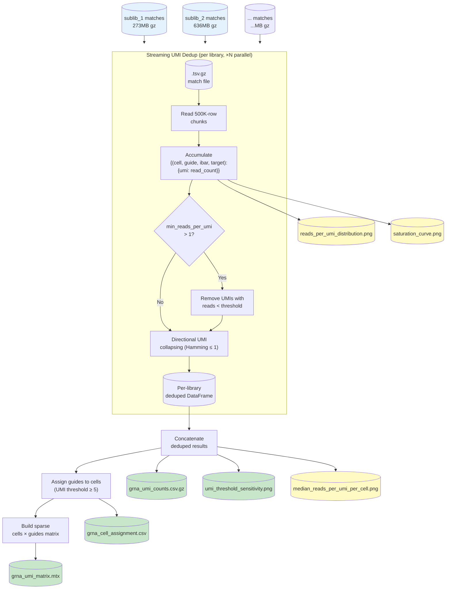
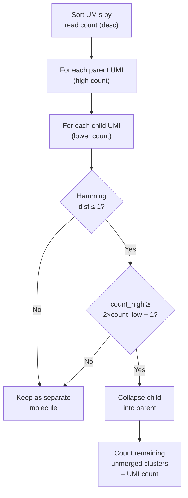
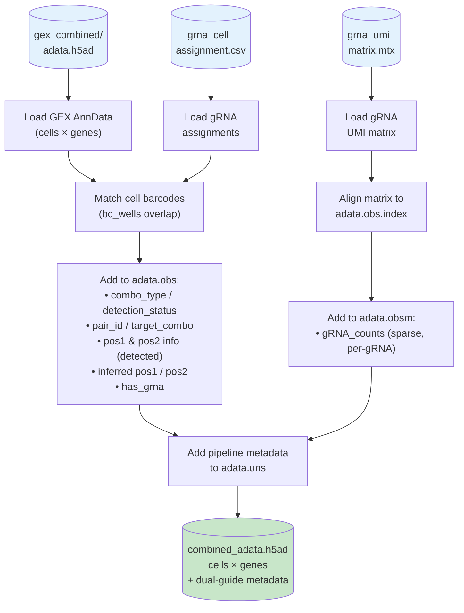

# v2.0 detailed workflow

Resource requests for every maintained stage are optional YAML settings; see
[UGER resources](UGER_RESOURCES.md) for CPU/RAM/time defaults, array limits,
site configuration and examples of increasing resources.

This document describes each stage's inputs, outputs and counting logic. Start
with the [quick start](QUICKSTART.md) for a new run; use the
[configuration reference](CONFIGURATION.md) and [execution runbook](RUNNING.md)
for settings, portable execution and restarts. Parse split-pipe 1.6.4 remains a
dependency for both GEX backends and its installation stays unchanged.
[Release notes](../RELEASE_NOTES.md) track historical changes.

## UGER Job Dependency Chain

The supplied `submit/` wrappers and the graph below target the Broad
Institute's UGER cluster. The processing stages are reusable elsewhere, but
another scheduler requires a translated submission and dependency layer.



> [!TIP]
> When Steps 1 and 2 are submitted together, the launcher makes Step 2 wait for
> Step 1a. Step 1b and the guide branch can then progress independently; optional
> Step 1c also joins Step 4 when enabled. Matching/assignment changes generally
> require rebuilding Steps 3–5, not relabeling the old outputs.

---

## Step 0: Format Reference

**Script**: [00_format_reference.py](../scripts/00_format_reference.py)

**Run**: Manual (one-time)

Converts the dual-guide library design file into the gRNA/iBAR reference lookup used by downstream steps.



| Input column | Output (Position 1) | Output (Position 2) |
|---|---|---|
| `spacer_1` | `grna_seq` | — |
| `spacer_2` | — | `grna_seq` |
| `iBAR_1` | `ibar_seq` (rev-comp) | — |
| `iBAR_2` | — | `ibar_seq` (rev-comp) |
| `target` | `target_combo` | `target_combo` |
| — | `stem_variant = A` | `stem_variant = B` |

#### Reference overlap check

When run with `--config`, Step 0 automatically checks whether the configured `max_lev_dist` and `max_lev_dist_ibar` could cause **ambiguous matching** in Step 3. The check computes all pairwise Levenshtein distances between gRNA sequences and between iBARs within each gRNA, classifying pairs into three zones:

| Zone | Condition | Impact |
|------|-----------|--------|
| **CRITICAL** | d(A,B) ≤ max_lev_dist | References are close enough for errors to create competing or incorrect nearest matches; review thresholds/reference identity. |
| **WARNING** | max_lev_dist < d(A,B) ≤ 2×max_lev_dist | Error balls partially overlap — some error-prone reads may fall in the overlap region and be lost. |
| **SAFE** | d(A,B) > 2×max_lev_dist | No overlap possible. |

The check reports the minimum pairwise distance and a **safe limit** for each parameter (the largest distance that guarantees no overlap: `⌊(min_dist - 1) / 2⌋`).

To run the overlap check on an existing reference without reformatting:

```bash
# Using config distances
python scripts/00_format_reference.py --check-only references/grna_ibar_reference.csv --config config.yaml

# With custom distances
python scripts/00_format_reference.py --check-only references/grna_ibar_reference.csv --max-lev-dist 2 --max-lev-dist-ibar 2
```

> [!NOTE]
> Step 3 reports ties at the best distance as ambiguous. A unique nearest match
> is not proof of the true biological source if sequencing errors move a read
> closer to another reference. Review reference separation, orientation and
> matching QC rather than treating an overlap warning as harmless.


---

## Step 1: GEX preprocessing, alignment and counting

**Entry points:** [Step 1a worker](../submit/submit_step1a_gex_array.sh) →
[Step 1b combine worker](../submit/submit_step1b_gex_combine.sh), plus optional
Step 1c. Submit with `submit/submit_pipeline.sh --step 1`. The historical
`01_run_gex_splitpipe.sh` delegates to that UGER launcher; it is not a portable
local runner. [Portable execution](RUNNING.md#another-scheduler-or-an-existing-linux-allocation).

### Step 1a: shared Parse preprocessing

Parse supplies kit/chemistry definitions, R2 barcode correction, RT/barcode-index
identity and sample information. The optional GEX gRNA filter acts in this
preprocessing pass before either transcriptomic backend. It requires a full/fuzzy
TSO near the GEX R1 start and a complete reference-supported guide; TSO alone
never causes removal. Survivors use the full-TSO-endpoint trim when detected,
otherwise Parse's exact terminal-17-mer fallback.

Valid corrected-barcode filter positives are written as compact evidence, with
synchronized raw rejected pairs retained according to config. No second barcode
calibration is performed on rejected reads. The validated runtime overlay does
not modify Parse source files. [Full filter policy](GEX_DECONTAMINATION_V1_4.md).

### Step 1a: select the transcriptomic backend



The defaults are `backend: star`, `umi_correction: parse`. On either backend:

| Flavor | GEX neighbor correction |
| --- | --- |
| `parse` | Parse 1.6.4 strict abundance, Hamming one, non-transitive; ties stay separate. |
| `directional` | Fixed-count Hamming-one graph using `n_high >= 2*n_low - 1`, with bustools-compatible traversal. |
| `none` | Exact UMI grouping only; no merging between different UMI strings. |

These settings do not change Step 4 gRNA correction. With STAR, the default
kernel is original Parse; alternative flavors override its function in memory.
With kallisto, `run_kallisto_gex.py` consumes native BUS evidence and retains
Parse's initialized sample masks and cell-calling algorithm through a runtime
DGE callback. It never projects pseudoalignments into a BAM for gene counting.

Kallisto defaults to unique gene assignment. Optional fractional assignment
resolves compatible candidate genes and apportions unresolved molecules equally.
`output_level: both` adds a target matrix while keeping genes primary;
`transcript` selects targets as the primary expression matrix. Whole gene-molecule
totals drive cell calling, with fractional roundoff excluded from cutoffs.
Molecules with unresolved target intersections may still have valid gene counts.
[Detailed semantics](KALLISTO_BACKEND.md#molecule-semantics).

The native counter shards complete corrected barcodes across allocated workers,
caches reference/EC annotations, and merges in original barcode order. Primer/
barcode-index identities remain separate until molecule collapse is complete.
`count_threads: 0` uses allocated cores; a positive cap or serial `1` can be
selected. Scientific counts are preserved across serial/parallel execution.

### Step 1b: combine and validate

The combine worker selects the backend automatically. STAR uses the existing
Parse combine wrapper, including in-memory compatibility handling for sample
pools/list initialization. Kallisto uses `combine_kallisto_gex.py`, preserving
sparse feature order and fractional values. Completion/policy checks reject
mixed or stale backend/UMI/reference outputs. Both supply
`gex_combined/<sample>/DGE_filtered/anndata.h5ad` for Step 5. The kallisto backend
also exports unfiltered and optional target products; it does not fabricate
STAR BAMs, coordinate QC, or exonic fractions.

### Optional Step 1c and historical STAR reuse

Step 1c runs the ordinary Step 3 matcher on compact filter evidence, then applies
stricter acceptance before the GEX-only/combined guide products. At 54–60 nt R1,
standard dual-guide GEX reads can support contaminant removal but do not reach
the full stem+iBAR needed for identity. Keep Step 1c/source merging disabled
for that identity model. Single-guide/no-iBAR recovery has separate short-read
logic. [Sequencing scenarios](ILLUMINA_100_CYCLE_SEQUENCING.md).

Compatible historical STAR BAMs can be harmonized in a new sandbox and resumed
at Parse `mol`, without rerunning STAR. Raw FASTQs are still required; new
survivor trimming cannot be applied retroactively to already aligned reads.
This route is STAR-only and cannot be combined with kallisto.
[Historical-BAM instructions](GEX_DECONTAMINATION_V1_4.md#existing-split-pipe-runs).

---

## Step 2: Extract gRNA Barcodes

**Script**: [02_extract_grna_barcodes.py](../scripts/02_extract_grna_barcodes.py)

**UGER**: Array ×N, 1 CPU and 4 GB per task. The current per-library FASTQ loop
is serial; `barcode_extraction.n_processes` does not make it an eight-worker job.

Extracts cell barcodes from gRNA library R2 using Parse Biosciences barcode correction logic, producing a TSV linking each read to its cell identity.



---

## Step 3: Match gRNA + iBAR

**Script**: [03_match_grna_ibar.py](../scripts/03_match_grna_ibar.py)

**UGER**: Array ×N, 8 worker processes, 32GB requested memory (4GB/slot),
12 hours by default. Optional `uger.step3` overrides change the request without
editing the worker script.

The most complex step — locates the gRNA and iBAR within each R1 read, then fuzzy-matches against the reference.

Before production matching, an automatic preflight samples up to 10,000 input
reads and warns about possible reversed iBAR references, reference-length
mismatches, and low support. It writes `<library>_preflight.yaml` beside the
matching products. `--preflight-only --preflight-fastq` supports an earlier
check directly on raw gRNA R1, before Step 2. The worker pool bounds queued
chunks to twice the worker count and prints progress after the first completed
chunk. See [preflight and scaling](SCALABILITY_AND_PREFLIGHT.md) for details.



### R1 Read Structure

The leading N7 is introduced only when the size-selected gRNA fraction is
further amplified by circularization capture. It lies between the Illumina
sequencing-primer/index side of the library molecule and the TSO, placing the
TSO at R1 offset 7. GEX carry-over escaped size selection before this separate
amplification and therefore begins at the TSO rather than N7.

```
┌──────────────────────────────────────────────────────────┐
│ N7 random prefix │ Split_TSO (30bp) │ gRNA (20-21bp) │ stem (19bp) │ iBAR (7bp) │ tracr │
│ var  │ AAGCAGT...GAATGGG │   <variable>  │ GTTTGAGAG.. │  <7bp>     │ GACT  │
│ off  │                   │               │     or      │            │  or   │
│      │                   │               │ GTTTCAGAG.. │            │ AACA  │
└──────────────────────────────────────────────────────────┘
```

### Dual iBAR Matching Logic


> [!IMPORTANT]
> **iBAR correction requires unique-best matching by design.** The within-guide iBAR match (`_match_ibar_within_guide`) finds the single closest reference iBAR (by Levenshtein distance) among the iBARs associated with the resolved gRNA. If two or more reference iBARs tie at the same best distance, the match is rejected — no correction is applied. This conservative approach is intentional: since each iBAR is unique to a specific construct (pair_id), an ambiguous correction could silently assign reads to the wrong construct, introducing noise into downstream analysis. It is better to leave a read uncorrected (and flag it as decoupled) than to guess.

> [!NOTE]
> **Shared gRNA disambiguation also requires unique-best iBAR matching.** When a gRNA sequence is shared across positions (e.g., control guides), disambiguation tries iBAR matching per candidate. If exactly one candidate's iBAR set contains a unique-best match, that candidate is chosen. If multiple candidates match (both have an iBAR within the edit distance threshold), disambiguation falls back to stem variant identity. This prevents false assignment when the short iBAR length (7bp) and permissive edit distance threshold create overlapping Hamming balls across candidates.

---

## Step 4: Assign gRNAs to Cells

**Script**: [04_assign_grna_to_cells.py](../scripts/04_assign_grna_to_cells.py)

**UGER**: 1 job, 4 CPUs at 32 GB per slot (**128 GB total**). Dedicated-only
libraries can run independently; guide-source union and final assignment have
serial phases.

Collapses read-level matches to cell-level gRNA assignments via **streaming UMI deduplication**.



### UMI Directional Collapsing Algorithm

Uses the UMI-tools directional method (Smith et al., 2017). A child UMI is only collapsed into a parent if its read count is consistent with being a PCR error offspring — i.e., the parent's count is at least 2× the child's count minus 1. This prevents over-collapsing of genuinely distinct molecules that happen to be close in sequence space.



### Cell Assignment Logic (Dual Guide Mode)

In dual-guide mode (`dual_guide_mode: true`), the pipeline determines pair completion rather than independent guides.

1.  **Pair Grouping**: Reads are assigned to a reference `pair_id` via the detected `pos1` or `pos2` guide and their associated `ibar_seq`.
2.  **iBAR Inference**: If a cell has reads for `pos1` but not `pos2`, the pipeline uses the detected `pos1_ibar` to infer the missing expected `pos2` guide based on the dual-guide library design. (Or vice versa for observed `pos2`).
3.  **Thresholding** (two-tier):
    -   **Complete pairs** (both positions detected): `pos1_umi + pos2_umi >= min_umi_threshold` (pair-level sum). Example: pos1=3, pos2=3 → sum=6 ≥ 5 → **passes**.
    -   **Half-detected pairs** (one position only): `single_position_umi >= min_umi_threshold` (guide-level). Example: pos1=3, pos2=undetected → 3 < 5 → **fails**.
4.  **Classification**:
    -   `combo_type` (**cell-level**, each cell counted once):
        -   **`singlet`**: Cell contains exactly one unique guide pair above threshold.
        -   **`multiplet`**: Cell contains >1 unique guide pair above threshold (could indicate true multiplet infection, or potential recombination).
    -   `detection_status` (**per pair-assignment**, one row per pair):
        -   **`complete`**: Both `pos1` and `pos2` gRNAs were explicitly detected.
        -   **`inferred`**: Only one position was detected; the partner is inferred via iBAR mapping from the known pair design.

---

## Step 5: Build Combined AnnData

**Script**: [05_build_anndata.py](../scripts/05_build_anndata.py)

**UGER**: 1 job, 1 CPU and 32 GB RAM

Merges GEX expression data with gRNA assignments into a single analysis-ready AnnData.

Step 5 validates the expression backend/policy and combined-output contract,
loads each configured sample's called-cell matrix and maps sample-local barcode
suffixes back to the configured sublibrary order. It adds guide calls and aligns
sparse guide matrices to those cells. It does not convert STAR output to
kallisto or recompute expression molecules. Fractional native counts remain
fractional. Primary feature level follows the Step 1 gene/target choice.



### AnnData Structure

| Layer | Content |
|---|---|
| `adata.X` | Expression matrix (cells × primary genes/targets); native kallisto values are raw UMI weights |
| `adata.obs` | Dual-guide metadata: `target_combo`, `pair_id`, `combo_type`, `detection_status`, `pos1_grna`, `pos2_grna`, `inferred_pos*_grna`, `has_grna` |
| `adata.obs` | Sublibrary metadata: `sublib_index` (Parse combinatorial ID), `sublibrary` (e.g., C1/T1/C2), `sample_specific` |
| `adata.obsm['gRNA_counts']` | Sparse UMI count matrix (cells × independent gRNAs) |
| `adata.uns['gRNA_names']` | Guide name list matching matrix columns |
| `adata.uns['guide_annotations']` | Design-level annotations per individual guide |
| `adata.layers['counts']` | Native kallisto raw expression counts, preserved through integration |
| `adata.uns['ccperturbseq_pipeline']` | Pipeline snapshot, including `gex_alignment_backend`, `gex_umi_correction`, `gex_output_level` and guide-source choices |

---

## Configuration Reference

The [configuration reference](CONFIGURATION.md) is the complete current guide.
Public templates are [dual](../config_dual.yaml) and [single](../config_single.yaml);
replace their example paths and library entries. Key sections:

| Section | Key Parameters |
|---|---|
| `gex_alignment` | STAR/kallisto backend, common GEX UMI flavor, native gene/target assignment and worker cap |
| `gex_decontamination` | pre-alignment removal for both backends, TSO/guide thresholds, raw reject retention, optional Step 1c/source merge, and existing-alignment sandbox |
| `grna_structure` | `fixed_seq_1` (TSO), `fixed_seq_2/3` (stems), `grna_lengths: [20, 21]`, `ibar_length: 7` |
| `grna_matching` | `max_lev_dist: 3`, `max_lev_dist_ibar: 2`, `save_failed_reads: false` |
| `guide_assignment` | `dual_guide_counting_mode: true`, `min_umi_threshold: 5`, `umi_dedup_ibar: true`, `max_umi_edits: 1`, `min_reads_per_umi: 1`, `compute_saturation_curve: true` |
| `barcode_extraction` | `bc_max_edit_dist: 1`, `n_processes: 8` (legacy; current Step 2 is serial) |
| `libraries` | Any configured library count; public C1/C2/T1/T2 entries are examples, not a fixed requirement |

## UGER Resource Allocations

| Step | Memory | CPUs | Runtime | Job Type |
|---|---|---|---|---|
| 1a (GEX) | 8GB/slot (128GB at default) | 16 | 48h | Array ×N |
| 1b (Combine) | 16GB/slot | 4 | 4h | Single |
| 1c (optional match) | 4GB/slot | 1 | 12h | Array ×N |
| 1c (optional aggregate) | 32GB/slot | 4 | 8h | Single |
| 2 (Barcodes) | 4GB | 1 | 12h | Array ×N |
| 3 (Matching) | 4GB/slot | 8 | 12h | Array ×N |
| 4 (Assignment) | 32GB/slot | 4 | 4h | Single |
| 5 (AnnData) | 32GB | 1 | 4h | Single |

These are backward-compatible defaults. Every row is tunable through
`uger.<profile>.slots`, `memory_per_slot_gb` and `runtime_hours`; arrays also
accept `max_concurrent`. Profiles are `step1a`, `step1b`, `step1c`,
`step1c_aggregate`, `step2`, `step3`, `step4` and `step5`. Common queue, OS,
parallel environment and accounting settings use the same interface. See
[UGER resources](UGER_RESOURCES.md) for complete YAML examples, QC/reference
profiles, inherited configs, submission records and tuning decisions.

The launcher binds the requested cores and workers consume `NSLOTS` where
parallelism exists. Step 2's FASTQ loop and most of Step 5 remain serial;
requesting extra slots there does not automatically parallelize them. Increase
memory/time independently for a larger dataset. `splitpipe.threads` and
`barcode_extraction.n_processes` are retained legacy fields, not scheduler
requests. Verify every resolved request using `submit_pipeline.sh --dry-run`.


---

For current submission/portable examples, per-slot memory totals, success checks
and restart decisions, use [the execution runbook](RUNNING.md). Historical
STAR preprocessing measurements do not characterize native kallisto counting.
