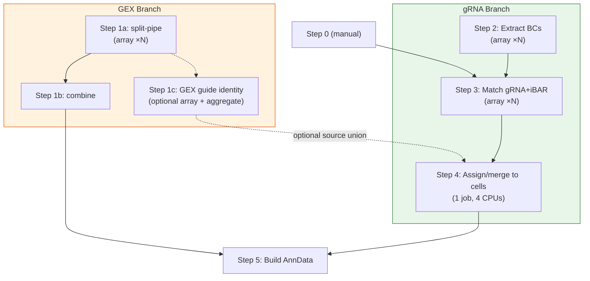
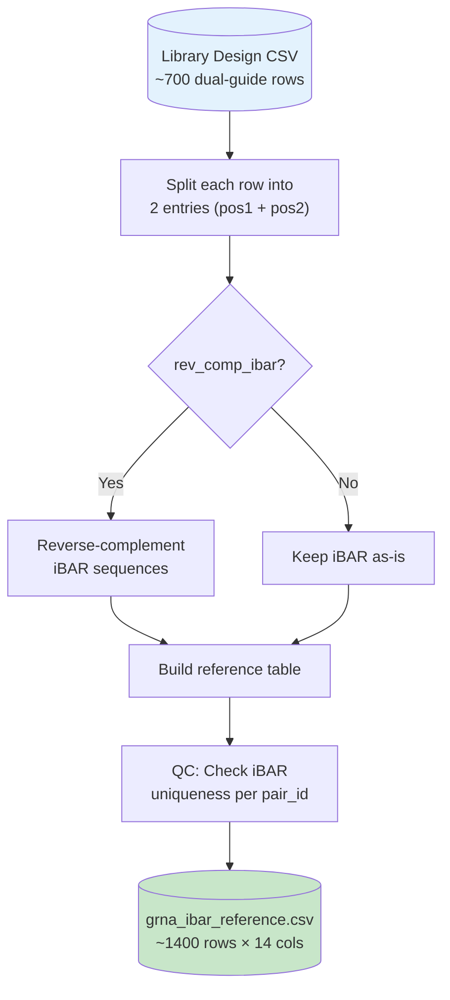
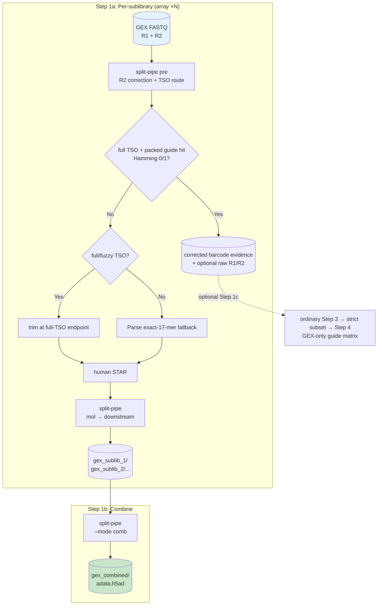
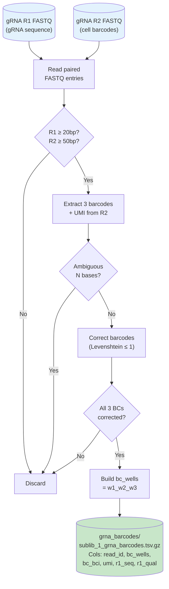
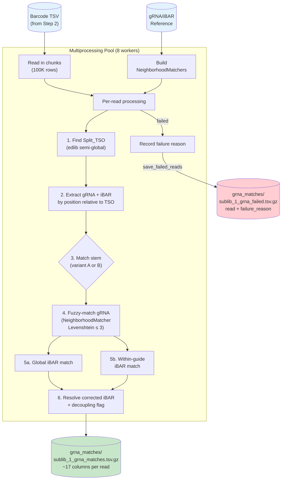
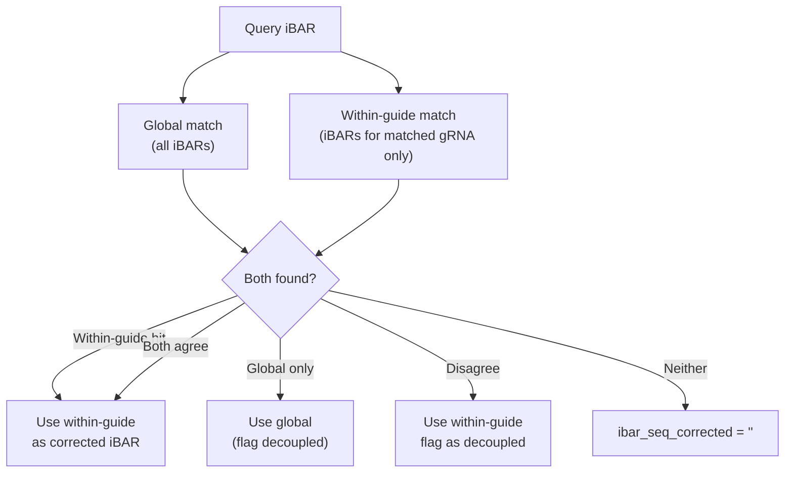
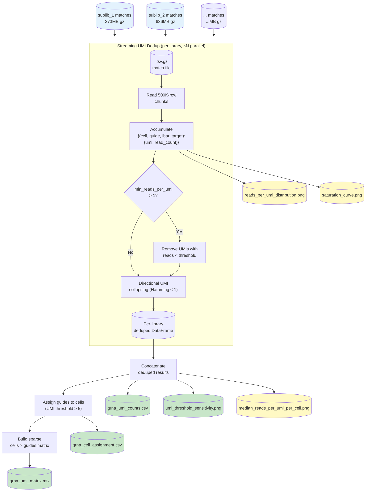
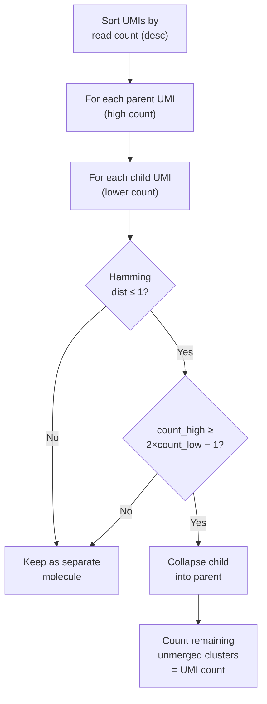
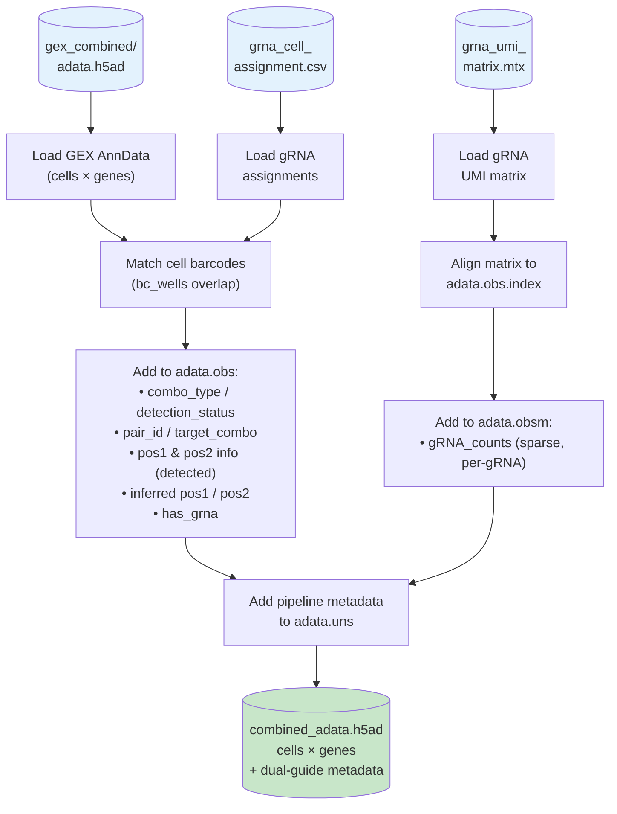

# Detailed Step-by-Step Workflow

This document describes each processing stage, its inputs and outputs, matching
and assignment decisions, and the UGER dependency graph. For setup and
submission commands, begin with the [quick start](../pipeline_overview.md).
Versioned behavior changes are tracked in the [release notes](../RELEASE_NOTES.md),
and operational details for GEX decontamination are in the
[v1.4 guide](GEX_DECONTAMINATION_V1_4.md). Read-recipe constraints and matching
configurations are summarized in the
[100-cycle Illumina sequencing note](ILLUMINA_100_CYCLE_SEQUENCING.md).

## UGER Job Dependency Chain



> [!TIP]
> GEX and gRNA branches run in **parallel** — they only merge at Step 5.
> You can test guide extraction and assignment with different parameters by re-runing Step 3, 4 and 5 with modified `config.yaml`.

---

## Step 0: Format Reference

**Script**: [00_format_reference.py](../scripts/00_format_reference.py)

**Run**: Manual (one-time)

Converts the dual-guide library design file into the gRNA/iBAR reference lookup used by downstream steps.



| Input column | Output (Position 1) | Output (Position 2) |
|---|---|---|
| `spacer_1` | `grna_seq` | — |
| `spacer_2` | — | `grna_seq` |
| `iBAR_1` | `ibar_seq` (rev-comp) | — |
| `iBAR_2` | — | `ibar_seq` (rev-comp) |
| `target` | `target_combo` | `target_combo` |
| — | `stem_variant = A` | `stem_variant = B` |

#### Reference overlap check

When run with `--config`, Step 0 automatically checks whether the configured `max_lev_dist` and `max_lev_dist_ibar` could cause **ambiguous matching** in Step 3. The check computes all pairwise Levenshtein distances between gRNA sequences and between iBARs within each gRNA, classifying pairs into three zones:

| Zone | Condition | Impact |
|------|-----------|--------|
| **CRITICAL** | d(A,B) ≤ max_lev_dist | A read from ref A with ≤max_lev_dist errors matches ref B equally → **guaranteed ambiguity**. Read is **discarded** (not mis-assigned). |
| **WARNING** | max_lev_dist < d(A,B) ≤ 2×max_lev_dist | Error balls partially overlap — some error-prone reads may fall in the overlap region and be lost. |
| **SAFE** | d(A,B) > 2×max_lev_dist | No overlap possible. |

The check reports the minimum pairwise distance and a **safe limit** for each parameter (the largest distance that guarantees no overlap: `⌊(min_dist - 1) / 2⌋`).

To run the overlap check on an existing reference without reformatting:

```bash
# Using config distances
python scripts/00_format_reference.py --check-only references/grna_ibar_reference.csv --config config.yaml

# With custom distances
python scripts/00_format_reference.py --check-only references/grna_ibar_reference.csv --max-lev-dist 2 --max-lev-dist-ibar 2
```

> [!NOTE]
> Step 3's `NeighborhoodMatcher` always returns the **unique best match**. When multiple references tie at the same best distance, the read is marked **ambiguous** and discarded — there is no risk of wrong assignment, only data loss. Users can safely proceed with overlapping references if they accept some ambiguous-read loss (visible in Step 3 QC as "% ambiguous").


---

## Step 1: GEX Processing (split-pipe)

**Script**: [01_run_gex_splitpipe.sh](../scripts/01_run_gex_splitpipe.sh)

**UGER**: Step 1a (array ×N) → Step 1b (combine), plus optional Step 1c

The assay's universal reverse-transcription reaction contains both poly(A)
probes and gRNA probes. Long gene-transcript cDNA and short gRNA products are
therefore created together and separated later by size. Step 1a decontamination
targets the small amount of short gRNA product that escapes into the GEX size
fraction. Pilot C1/C2 raw scans measured approximately 32–37 structural
contaminants per million reads; this is low in absolute terms but can materially
bias a target gene expressed at a similar or lower rate if STAR assigns the
guide-derived sequence to that gene.

When enabled, Step 1a installs a checksum-validated runtime overlay over the
pristine split-pipe 1.6.4 preprocessing and molinfo modules; it does not edit
the Parse installation. TSO-bearing reads are screened with a packed guide
index. A complete guide match at Hamming distance 0 or 1 is removed before the
human STAR input is written. For filter-negative reads, a detected full/fuzzy
TSO is trimmed at its full endpoint; without a full-TSO call, Parse's original
exact terminal 17-mer rule remains the fallback. The full-TSO call alone never
causes removal.

Step 1a is deliberately removal-only, but it emits a compact table for every
valid-barcode filter positive using split-pipe's already-corrected cell
barcode, pB, UMI, R1 sequence, and quality. Optional Step 1c runs ordinary
Step 3 only on that table, applies stricter guide/iBAR acceptance thresholds,
and can pass the conservative subset to Step 4. It never rescans the full GEX
FASTQs or recalibrates barcodes from rejected reads. The array size N follows
`config.yaml`.



At 54-bp R1, a 30-bp TSO plus a complete 20/21-bp guide is observable, so
removal remains supported. An intact GEX-derived contaminant starts at offset
0; the configured offsets 1–2 only tolerate rare 5' damage/sequencing error.
A standard dual-guide stem plus 7-bp iBAR is not observable at that length;
Step 1c warns and does not invent identity. Single-guide/no-iBAR mode uses the
existing v1.2 short-read logic.

For a historical compatible split-pipe BAM, Step 1a can instead preprocess raw
reads in a new sandbox, remove all records for filter-positive QNAMEs from the
name-sorted/annotated source BAM, and resume at `--mode mol`. This route avoids
STAR but cannot retroactively apply the new full/fuzzy-TSO survivor trimming;
that benefit requires a fresh alignment. See the
[v1.4 guide](GEX_DECONTAMINATION_V1_4.md#existing-split-pipe-runs).

---

## Step 2: Extract gRNA Barcodes

**Script**: [02_extract_grna_barcodes.py](../scripts/02_extract_grna_barcodes.py)

**UGER**: Array ×N, 32GB RAM, 8 processes

Extracts cell barcodes from gRNA library R2 using Parse Biosciences barcode correction logic, producing a TSV linking each read to its cell identity.



---

## Step 3: Match gRNA + iBAR

**Script**: [03_match_grna_ibar.py](../scripts/03_match_grna_ibar.py)

**UGER**: Array ×N, 64GB RAM, 8 processes (multiprocessing)

The most complex step — locates the gRNA and iBAR within each R1 read, then fuzzy-matches against the reference.



### R1 Read Structure

The leading N7 is introduced only when the size-selected gRNA fraction is
further amplified by circularization capture. It lies between the Illumina
sequencing-primer/index side of the library molecule and the TSO, placing the
TSO at R1 offset 7. GEX carry-over escaped size selection before this separate
amplification and therefore begins at the TSO rather than N7.

```
┌──────────────────────────────────────────────────────────┐
│ N7 random prefix │ Split_TSO (30bp) │ gRNA (20-21bp) │ stem (19bp) │ iBAR (7bp) │ tracr │
│ var  │ AAGCAGT...GAATGGG │   <variable>  │ GTTTGAGAG.. │  <7bp>     │ GACT  │
│ off  │                   │               │     or      │            │  or   │
│      │                   │               │ GTTTCAGAG.. │            │ AACA  │
└──────────────────────────────────────────────────────────┘
```

### Dual iBAR Matching Logic


> [!IMPORTANT]
> **iBAR correction requires unique-best matching by design.** The within-guide iBAR match (`_match_ibar_within_guide`) finds the single closest reference iBAR (by Levenshtein distance) among the iBARs associated with the resolved gRNA. If two or more reference iBARs tie at the same best distance, the match is rejected — no correction is applied. This conservative approach is intentional: since each iBAR is unique to a specific construct (pair_id), an ambiguous correction could silently assign reads to the wrong construct, introducing noise into downstream analysis. It is better to leave a read uncorrected (and flag it as decoupled) than to guess.

> [!NOTE]
> **Shared gRNA disambiguation also requires unique-best iBAR matching.** When a gRNA sequence is shared across positions (e.g., control guides), disambiguation tries iBAR matching per candidate. If exactly one candidate's iBAR set contains a unique-best match, that candidate is chosen. If multiple candidates match (both have an iBAR within the edit distance threshold), disambiguation falls back to stem variant identity. This prevents false assignment when the short iBAR length (7bp) and permissive edit distance threshold create overlapping Hamming balls across candidates.

---

## Step 4: Assign gRNAs to Cells

**Script**: [04_assign_grna_to_cells.py](../scripts/04_assign_grna_to_cells.py)

**UGER**: 1 job, 32GB RAM, 4 CPUs (parallelized per library)

Collapses read-level matches to cell-level gRNA assignments via **streaming UMI deduplication**.



### UMI Directional Collapsing Algorithm

Uses the UMI-tools directional method (Smith et al., 2017). A child UMI is only collapsed into a parent if its read count is consistent with being a PCR error offspring — i.e., the parent's count is at least 2× the child's count minus 1. This prevents over-collapsing of genuinely distinct molecules that happen to be close in sequence space.



### Cell Assignment Logic (Dual Guide Mode)

In dual-guide mode (`dual_guide_mode: true`), the pipeline determines pair completion rather than independent guides.

1.  **Pair Grouping**: Reads are assigned to a reference `pair_id` via the detected `pos1` or `pos2` guide and their associated `ibar_seq`.
2.  **iBAR Inference**: If a cell has reads for `pos1` but not `pos2`, the pipeline uses the detected `pos1_ibar` to infer the missing expected `pos2` guide based on the dual-guide library design. (Or vice versa for observed `pos2`).
3.  **Thresholding** (two-tier):
    -   **Complete pairs** (both positions detected): `pos1_umi + pos2_umi >= min_umi_threshold` (pair-level sum). Example: pos1=3, pos2=3 → sum=6 ≥ 5 → **passes**.
    -   **Half-detected pairs** (one position only): `single_position_umi >= min_umi_threshold` (guide-level). Example: pos1=3, pos2=undetected → 3 < 5 → **fails**.
4.  **Classification**:
    -   `combo_type` (**cell-level**, each cell counted once):
        -   **`singlet`**: Cell contains exactly one unique guide pair above threshold.
        -   **`multiplet`**: Cell contains >1 unique guide pair above threshold (could indicate true multiplet infection, or potential recombination).
    -   `detection_status` (**per pair-assignment**, one row per pair):
        -   **`complete`**: Both `pos1` and `pos2` gRNAs were explicitly detected.
        -   **`inferred`**: Only one position was detected; the partner is inferred via iBAR mapping from the known pair design.

---

## Step 5: Build Combined AnnData

**Script**: [05_build_anndata.py](../scripts/05_build_anndata.py)

**UGER**: 1 job, 16GB RAM

Merges GEX expression data with gRNA assignments into a single analysis-ready AnnData.

> [!NOTE]
> **Split-Pipe Combine Fixes (Wrapper Script)**
> The `split-pipe` tool has two bugs/limitations when combining sublibraries:
> 1. It initializes an empty well list with `[] * 3` instead of `[[], [], []]`, causing an `IndexError` when merging mismatching sublibrary setups.
> 2. Re-defining sample pools (e.g. pooling C1 and C2 into "Control") normally requires a complete Step 1a rerun; retain the configurable 48-hour UGER limit for large inputs.
>
> The pipeline bypasses both issues using the [splitpipe_wrapper.py](../scripts/splitpipe_wrapper.py) script. This wrapper dynamically patches `run_proc_def.json` files on the fly to sync sample names with `config.yaml`, and then monkey-patches `spsamp.SpSamp.__init__` in memory before launching `split-pipe`, saving roughly 24 hours of re-computation.



### AnnData Structure

| Layer | Content |
|---|---|
| `adata.X` | GEX count matrix (cells × genes) |
| `adata.obs` | Dual-guide metadata: `target_combo`, `pair_id`, `combo_type`, `detection_status`, `pos1_grna`, `pos2_grna`, `inferred_pos*_grna`, `has_grna` |
| `adata.obs` | Sublibrary metadata: `sublib_index` (Parse combinatorial ID), `sublibrary` (e.g., C1/T1/C2), `sample_specific` |
| `adata.obsm['gRNA_counts']` | Sparse UMI count matrix (cells × independent gRNAs) |
| `adata.uns['gRNA_names']` | Guide name list matching matrix columns |
| `adata.uns['guide_annotations']` | Design-level annotations per individual guide |
| `adata.uns['ccperturbseq_pipeline']` | Pipeline parameters snapshot |

---

## Configuration Reference

Key sections of [config.yaml](../config.yaml):

| Section | Key Parameters |
|---|---|
| `gex_decontamination` | pre-STAR removal, TSO/guide thresholds, raw reject retention, optional Step 1c/source merge, and existing-alignment sandbox |
| `grna_structure` | `fixed_seq_1` (TSO), `fixed_seq_2/3` (stems), `grna_lengths: [20, 21]`, `ibar_length: 7` |
| `grna_matching` | `max_lev_dist: 3`, `max_lev_dist_ibar: 2`, `save_failed_reads: false` |
| `guide_assignment` | `dual_guide_counting_mode: true`, `min_umi_threshold: 5`, `umi_dedup_ibar: true`, `max_umi_edits: 1`, `min_reads_per_umi: 1`, `compute_saturation_curve: true` |
| `barcode_extraction` | `bc_max_edit_dist: 1`, `n_processes: 8` |
| `libraries` | 4 sublibraries: C1, C2, T1, T2 (2 Control + 2 Treatment) |

## UGER Resource Allocations

| Step | Memory | CPUs | Runtime | Job Type |
|---|---|---|---|---|
| 1a (GEX) | 8GB/slot (128GB at default) | 16 | 48h | Array ×N |
| 1b (Combine) | 16GB/slot | 4 | 4h | Single |
| 1c (optional match) | 4GB/slot | 8 | 12h | Array ×N |
| 1c (optional aggregate) | 32GB/slot | 4 | 8h | Single |
| 2 (Barcodes) | 4GB | 1 | 12h | Array ×N |
| 3 (Matching) | 4GB/slot | 8 | 12h | Array ×N |
| 4 (Assignment) | 32GB/slot | 4 | 4h | Single |
| 5 (AnnData) | 32GB | 1 | 4h | Single |

Step 1a values come from `uger.step1a.slots`,
`uger.step1a.memory_per_slot_gb`, and `uger.step1a.runtime_hours`. The launcher
uses the slot count for both `-pe smp` and `-binding linear`, and split-pipe
derives its thread count from `NSLOTS`.

The 48-hour default is recommended for large or multi-lane GEX inputs. Verify
the resolved `-pe`, `-binding`, `h_vmem`, and `h_rt` values with
`submit/submit_pipeline.sh --dry-run`. More than 16 slots is not recommended:
the full-C2 evidence used eight Parse workers, averaged about 5.2 cores, and
already had ample memory headroom.

---
