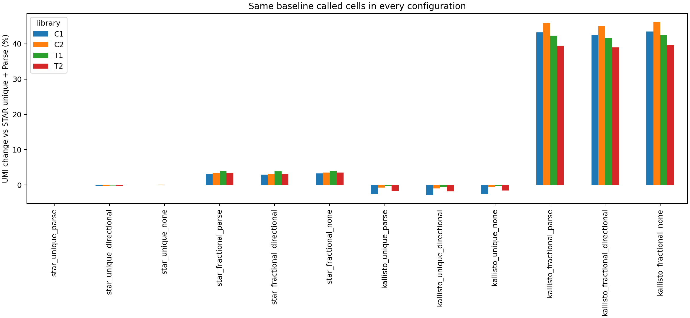
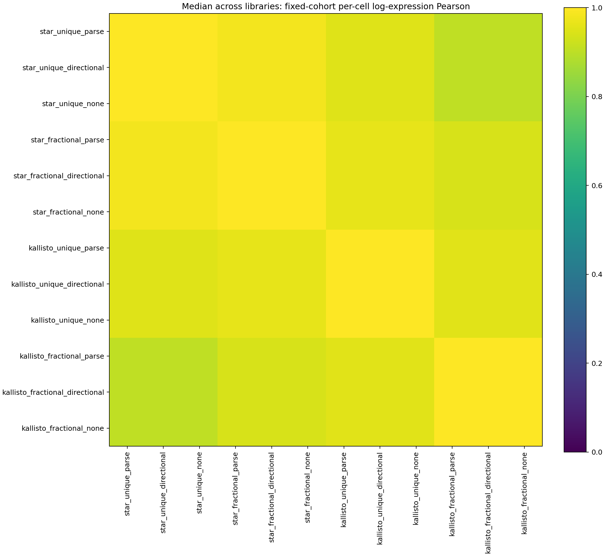
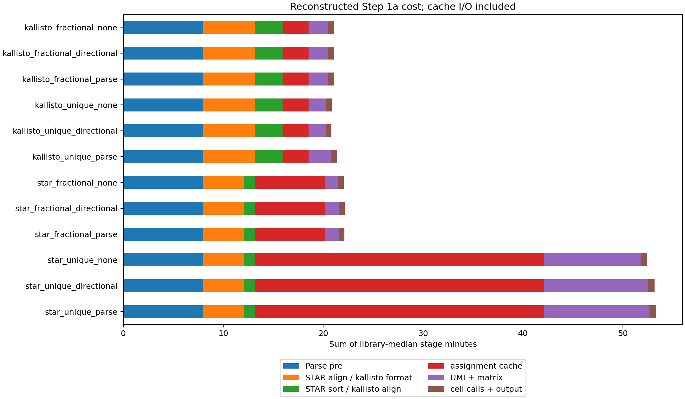

# v2 Step 1a benchmark: 50,000,000 GEX read pairs per sublibrary

Completed C1/C2/T1/T2 comparison of all twelve configurations. Each library uses one fixed Parse 1.6.4 barcode-extraction/decontamination result, one STAR alignment and one kallisto alignment. Gene assignment caches feed the three UMI policies. All 264 library/configuration-pair comparisons use the same STAR unique + Parse called-cell cohort within each library. Fractional gene weights are retained.

Assignment choice accounts for most observed yield differences. Holding Parse correction fixed, unique → fractional assignment increases fixed-cohort UMIs by **3.43% for STAR** and **44.8% for kallisto** (median across libraries, relative to each aligner's unique setting). Median per-cell log-expression Pearson against STAR unique + Parse is **0.983** for STAR fractional + Parse and **0.904** for kallisto fractional + Parse. Omitting correction adds **at most 0.212%** versus Parse in any library/assignment comparison. Directional correction slightly reduces yields here; it is an alternative correction graph rather than a guaranteed relaxation. Additional counted UMIs do not establish biological recovery.

Reconstructed median times are **53.24 min** for STAR unique + Parse, **22.13 min** for STAR fractional + Parse and **21.40 min** for kallisto unique + Parse. Their additional cached-policy costs are **11.21, 1.95 and 2.87 min**, respectively.

**Timing scope:** these paths include cache materialization. STAR unique annotation uses one streaming process; production Parse annotates inside parallel molecule workers. The reconstructed totals describe this cache experiment and do not establish production backend speedups.

| arm | called_cells | fixed_umis | median_gain_percent | reconstructed_step1a_seconds | cached_policy_seconds |
| --- | --- | --- | --- | --- | --- |
| star_unique_parse | 37339 | 4.4e+07 | 0 | 3.19e+03 | 673 |
| star_unique_directional | 37211 | 4.4e+07 | -0.211 | 3.18e+03 | 667 |
| star_unique_none | 37323 | 4.41e+07 | 0.0539 | 3.14e+03 | 620 |
| star_fractional_parse | 37208 | 4.56e+07 | 3.43 | 1.33e+03 | 117 |
| star_fractional_directional | 37201 | 4.55e+07 | 3.19 | 1.33e+03 | 121 |
| star_fractional_none | 37210 | 4.56e+07 | 3.5 | 1.33e+03 | 115 |
| kallisto_unique_parse | 37096 | 4.35e+07 | -1.14 | 1.28e+03 | 172 |
| kallisto_unique_directional | 37100 | 4.34e+07 | -1.36 | 1.26e+03 | 138 |
| kallisto_unique_none | 37090 | 4.35e+07 | -1.07 | 1.26e+03 | 141 |
| kallisto_fractional_parse | 37026 | 6.28e+07 | 42.8 | 1.28e+03 | 154 |
| kallisto_fractional_directional | 37012 | 6.26e+07 | 42.1 | 1.28e+03 | 153 |
| kallisto_fractional_none | 37028 | 6.29e+07 | 42.9 | 1.29e+03 | 155 |

Successful Step 1a work (shared stages counted once): 7.569 summed task-hours, 31.706 CPU-hours, 121.107 reserved core-hours. Recorded failed command attempts add 0.039 task-hours, 0.026 CPU-hours and 0.623 reserved core-hours. These summed task-hours are not elapsed makespan. Sampling and scheduler/setup overhead are separate; the scheduler accounting files retain complete job costs, including dependency failures before a command starts.

The initial shared-filesystem SQLite counting measurements were retained as a storage baseline and replaced by consistent job-local staging timings. Retired successful command measurements add 1.664 task-hours, 1.066 CPU-hours and 26.619 reserved core-hours to actual experiment costs; they are excluded from the final per-configuration timings. All 8 completed baseline molecule products match the retimed products exactly, including matrices, ordered metadata, scientific counters and molecule-assignment bytes. Local cache-copy time and disk space are included in the final molecule phases. The STAR unique annotation cache uses one streaming process; ordinary Parse production annotates inside parallel molecule workers, so reconstructed totals describe this cache experiment rather than a direct production throughput test.

## What the assignment cache contains

An assignment cache is reusable **read-to-gene annotation evidence between alignment and molecule counting**. It avoids repeating gene-annotation work for each UMI policy. The alignment cache is the original BAM/BUS output; the assignment cache adds gene information. Final corrected UMIs, molecule counts, fractional weights and cell calls are computed afterward.

Both STAR assignment caches read the **same complete, queryname-sorted BAM from one STAR alignment**. They retain different information:

| Aspect | STAR unique cache | STAR fractional cache |
| --- | --- | --- |
| Eligible alignments | Primary records passing native Parse's mapped-read/MAPQ gate; secondary alignments are excluded | Primary plus all retained secondary hits, requiring one primary per original read and an `NH` tag matching the complete hit set; the multimapping limit is 3 loci in this experiment |
| Gene annotation | Installed Parse `get_gene` selects one stranded, fully containing gene, or leaves the read unassigned. For overlapping genes, its ranking favors protein-coding status, gene-name preference and exonic overlap | Retains the union of all strand-compatible genes whose genomic spans contain each alignment, across every admitted locus. It preserves multiple candidates instead of selecting Parse's preferred overlapping gene; the unique-only MAPQ gate is not applied |
| UMI identities | Preserves native Parse UMI handling | Excludes empty or non-ACGT UMIs with diagnostics, matching the BUS/shared-counter representation |
| Saved representation | `cache/<library>/star_unique/assigned.bam`: primary reads with `GX` containing the chosen gene (empty if unassigned) and `RE` containing the binary exonic flag | `cache/<library>/star_fractional/reads.sqlite`: corrected barcode, observed UMI, candidate-class ID and read support; `evidence.pickle` maps those classes to gene sets and stores feature/barcode metadata and diagnostics |
| Decisions made later | Native Parse molecule grouping, the chosen UMI correction policy, count-matrix assembly and cell calling. A small adapter reads the saved `GX/RE` tags instead of rerunning `get_gene` | Exact-UMI evidence/collision resolution, refinement of candidate sets, the chosen UMI correction policy, and allocation of each retained molecule across its remaining candidate genes |

The fractional spool records each original read once, regardless of how many alignment hits it has. It rejects incomplete hit sets rather than treating a primary-only BAM as complete evidence. The unique cache has already removed alternative alignments and resolved overlapping-gene choices, so it cannot supply the missing evidence needed to reconstruct the fractional cache. STAR fractional changes both multimapping admission and overlapping-gene handling, including for reads with only one genomic alignment. It does not report native Parse exonic-fraction metadata.

For example, a high-confidence alignment contained in overlapping genes **A and B** may become `GX=A` in the unique cache, while the fractional cache retains **{A,B}**. If another read from the same cell and exact UMI supports **A** alone, the shared counter can resolve the compatible molecule to A. If a retained molecule remains ambiguous between A and B after resolution/correction, it contributes **0.5 to A and 0.5 to B**, conserving one whole molecule. A read with two admitted genomic alignments at A/B can also enter the fractional cache even when the native unique MAPQ gate excludes it.

Each STAR cache feeds the three `parse`, `directional` and `none` UMI policies. Kallisto instead caches BUS equivalence-class evidence and its gene annotations once, then reuses that evidence for all six assignment/UMI combinations. The measured `*.assign` phases include cache construction and serialization; `*.molecules` and `*.publish` measure the additional per-policy work. The serial STAR unique cache builder includes Parse's gene-ranking/exon calculations and BAM writing; the fractional builder uses gene-span compatibility sets and a SQLite spool. Their cache-construction times therefore describe different work and formats. In this run, cache construction took a median **28.88 min per library for STAR unique** and **6.95 min for STAR fractional**; each cache was built once per library and reused across its three UMI policies.

## Measured stages

Wall time is the median of four libraries; CPU/core-hours sum the four libraries, and RSS is the maximum. Sampling is shown separately from Step 1a.

| stage | median_wall_seconds | cpu_hours | reserved_core_hours | peak_process_rss_gb |
| --- | --- | --- | --- | --- |
| kallisto.align | 163 | 1.81 | 2.91 | 15.1 |
| kallisto.assign | 156 | 0.156 | 2.82 | 1.52 |
| kallisto.format | 315 | 0.331 | 5.6 | 0.279 |
| kallisto_fractional_directional.molecules | 118 | 0.685 | 2.11 | 4.11 |
| kallisto_fractional_directional.publish | 35.5 | 0.0477 | 0.633 | 2.08 |
| kallisto_fractional_none.molecules | 116 | 0.556 | 2.07 | 4.11 |
| kallisto_fractional_none.publish | 39.1 | 0.0478 | 0.716 | 2.08 |
| kallisto_fractional_parse.molecules | 114 | 0.68 | 2.07 | 4.11 |
| kallisto_fractional_parse.publish | 38.5 | 0.0478 | 0.686 | 2.08 |
| kallisto_unique_directional.molecules | 104 | 0.464 | 1.82 | 3.35 |
| kallisto_unique_directional.publish | 33.3 | 0.037 | 0.604 | 1.73 |
| kallisto_unique_none.molecules | 107 | 0.424 | 1.91 | 3.35 |
| kallisto_unique_none.publish | 33.2 | 0.0384 | 0.593 | 1.77 |
| kallisto_unique_parse.molecules | 137 | 0.465 | 2.46 | 3.3 |
| kallisto_unique_parse.publish | 35.2 | 0.0371 | 0.623 | 1.76 |
| preprocess | 478 | 2.05 | 8.6 | 2.34 |
| sample | 645 | 0.681 | 11.5 | 0.0303 |
| star.align | 246 | 2.04 | 4.35 | 18.8 |
| star.fractional.assign | 417 | 0.455 | 7.37 | 1.34 |
| star.sort | 68.9 | 0.236 | 1.22 | 11.6 |
| star.unique.assign | 1.73e+03 | 1.9 | 30.7 | 1.27 |
| star_fractional_directional.molecules | 84.5 | 0.309 | 1.49 | 2.91 |
| star_fractional_directional.publish | 34.8 | 0.0379 | 0.64 | 1.79 |
| star_fractional_none.molecules | 80.5 | 0.256 | 1.44 | 2.91 |
| star_fractional_none.publish | 33.9 | 0.0412 | 0.604 | 1.78 |
| star_fractional_parse.molecules | 83.7 | 0.304 | 1.49 | 2.91 |
| star_fractional_parse.publish | 33.5 | 0.0394 | 0.6 | 1.78 |
| star_unique_directional.molecules | 627 | 6.1 | 11.2 | 1.48 |
| star_unique_directional.publish | 38.7 | 0.0462 | 0.697 | 1.89 |
| star_unique_none.molecules | 581 | 5.83 | 10.3 | 1.48 |
| star_unique_none.publish | 38.6 | 0.0452 | 0.69 | 1.88 |
| star_unique_parse.molecules | 634 | 6.15 | 11.4 | 1.48 |
| star_unique_parse.publish | 39 | 0.0452 | 0.705 | 1.88 |

## Agreement with STAR unique + Parse

These are library medians on the same baseline-called cells. The complete table contains every one of the 66 configuration pairs per library.

| second | median_cell_call_jaccard | median_fixed_umi_spearman | median_cell_expression_log_pearson | minimum_library_expression_agreement |
| --- | --- | --- | --- | --- |
| kallisto_fractional_directional | 0.967 | 0.98 | 0.904 | 0.894 |
| kallisto_fractional_none | 0.967 | 0.98 | 0.904 | 0.894 |
| kallisto_fractional_parse | 0.967 | 0.98 | 0.904 | 0.894 |
| kallisto_unique_directional | 0.993 | 0.999 | 0.952 | 0.949 |
| kallisto_unique_none | 0.993 | 0.999 | 0.952 | 0.949 |
| kallisto_unique_parse | 0.993 | 0.999 | 0.952 | 0.949 |
| star_fractional_directional | 0.995 | 1 | 0.983 | 0.981 |
| star_fractional_none | 0.996 | 1 | 0.983 | 0.981 |
| star_fractional_parse | 0.996 | 1 | 0.983 | 0.981 |
| star_unique_directional | 0.999 | 1 | 1 | 1 |
| star_unique_none | 1 | 1 | 1 | 1 |

## Changes from assignment and UMI settings

Absolute deltas sum the four fixed cohorts; percentage columns summarize library-specific changes. Parse → directional is an alternative graph comparison, not a guaranteed relaxation.

| factor | first | second | total_delta_umis | median_library_gain_percent | min_library_gain_percent | max_library_gain_percent |
| --- | --- | --- | --- | --- | --- | --- |
| assignment | star_unique_parse | star_fractional_parse | 1.55e+06 | 3.43 | 3.2 | 4 |
| assignment | star_unique_directional | star_fractional_directional | 1.55e+06 | 3.43 | 3.2 | 4 |
| assignment | star_unique_none | star_fractional_none | 1.55e+06 | 3.43 | 3.2 | 4 |
| umi_policy | star_unique_parse | star_unique_directional | -9.19e+04 | -0.211 | -0.257 | -0.16 |
| umi_policy | star_unique_parse | star_unique_none | 2.53e+04 | 0.0539 | 0.0345 | 0.0901 |
| umi_policy | star_unique_directional | star_unique_none | 1.17e+05 | 0.265 | 0.195 | 0.348 |
| umi_policy | star_fractional_parse | star_fractional_directional | -9.54e+04 | -0.211 | -0.258 | -0.162 |
| umi_policy | star_fractional_parse | star_fractional_none | 2.62e+04 | 0.0539 | 0.0343 | 0.0902 |
| umi_policy | star_fractional_directional | star_fractional_none | 1.22e+05 | 0.265 | 0.196 | 0.349 |
| assignment | kallisto_unique_parse | kallisto_fractional_parse | 1.94e+07 | 44.8 | 41.7 | 47 |
| assignment | kallisto_unique_directional | kallisto_fractional_directional | 1.92e+07 | 44.4 | 41.5 | 46.6 |
| assignment | kallisto_unique_none | kallisto_fractional_none | 1.94e+07 | 44.9 | 41.8 | 47.2 |
| umi_policy | kallisto_unique_parse | kallisto_unique_directional | -9.13e+04 | -0.21 | -0.26 | -0.164 |
| umi_policy | kallisto_unique_parse | kallisto_unique_none | 2.49e+04 | 0.0535 | 0.0344 | 0.0897 |
| umi_policy | kallisto_unique_directional | kallisto_unique_none | 1.16e+05 | 0.264 | 0.199 | 0.35 |
| umi_policy | kallisto_fractional_parse | kallisto_fractional_directional | -2.84e+05 | -0.448 | -0.561 | -0.356 |
| umi_policy | kallisto_fractional_parse | kallisto_fractional_none | 8.41e+04 | 0.123 | 0.0792 | 0.212 |
| umi_policy | kallisto_fractional_directional | kallisto_fractional_none | 3.68e+05 | 0.574 | 0.436 | 0.777 |

Runtime paths are reconstructed sums of measured stages, including cache I/O, process startup and reference initialization. They are not independent end-to-end runs or cold-cache aligner speed tests. cached_policy_seconds measures only molecule correction/matrix assembly and cell calling/publication with existing assignment caches. wait4 max_process_rss_kb is the largest individual process RSS high-water mark. peak_tree_rss_gb is sampled every two seconds and sums worker RSS, counting shared pages more than once. Sampled peak_temp_bytes and peak_working_file_bytes describe apparent file sizes; the latter includes linked input caches and is not extra physical disk allocation. Resource requests are recorded; qacct maxvmem is virtual memory. Scheduler accounting should be retained alongside these measurements.

[Per-stage resources](assets/gex_benchmark_v2_50m_20261023/stage_resources.csv), [stage summaries](assets/gex_benchmark_v2_50m_20261023/stage_summary.csv), [per-configuration runtime](assets/gex_benchmark_v2_50m_20261023/runtime.csv), [yield](assets/gex_benchmark_v2_50m_20261023/library_summary.csv), [all 66 configuration pairs per library](assets/gex_benchmark_v2_50m_20261023/agreement.csv), [factor-matched signed UMI changes](assets/gex_benchmark_v2_50m_20261023/umi_gains.csv), [failed command attempts](assets/gex_benchmark_v2_50m_20261023/failed_attempts.csv), [retired storage measurements](assets/gex_benchmark_v2_50m_20261023/cache_storage_baseline.csv), [exact staging equality](assets/gex_benchmark_v2_50m_20261023/count_staging_equality.csv).

UMI gains are changes in counted molecules, not proven biological recovery. Unique-to-fractional changes include assignment/collision-policy effects. Parse and directional correction are alternative graphs with no guaranteed yield ordering; negative deltas are retained. No correction still deduplicates exact UMIs. Called-cell totals and fixed-cohort totals are reported separately. One observation per stage/library provides no timing confidence interval; libraries are distinct datasets, not technical replicates. Reference construction, sampling and Step 1b are outside reconstructed Step 1a time.

## Input depth and fixed cohorts

Both aligners received identical post-Parse cDNA records within each library. The requested 50M pairs are measured before barcode extraction/filtering. All 37,339 library-specific baseline-called cells have nonzero counts in every configuration; no zero-UMI cells are omitted from this fixed cohort.

| Library | Raw pairs | Post-Parse cDNA reads to each aligner | Baseline-called cells |
| --- | --- | --- | --- |
| C1 | 50,000,000 | 33,966,275 | 7,227 |
| C2 | 50,000,000 | 33,634,896 | 7,060 |
| T1 | 50,000,000 | 33,579,898 | 11,311 |
| T2 | 50,000,000 | 31,875,632 | 11,741 |

[Input read flow](assets/gex_benchmark_v2_50m_20261023/input_read_flow.csv), [per-configuration zero-UMI checks](assets/gex_benchmark_v2_50m_20261023/fixed_cohort_zero_counts.csv). Per-cell UMI tables and per-gene gain/loss tables remain in the experiment's `comparison/` directory as `C1`/`C2`/`T1`/`T2.fixed_cohort_umis.csv.gz` and `*.gene_gains.csv.gz`.

## Memory and disk peaks

Every scientific-stage worker requested **16 CPU slots × 8 GiB = 128 GiB**, with a 12-hour limit. These are observations across the indicated successful stages, with all UMI modes grouped only in this peak table; the per-stage CSV retains each library/configuration. Summed tree RSS double-counts shared pages and can miss short peaks. Working-file sizes include linked input caches and do not measure extra physical allocation. Native Parse writes temporary BAM chunks in the working directory. `_gb` fields in the original CSVs use binary GiB conversions.

| Phase | Observations | Max process RSS (GiB) | Max summed tree RSS (GiB) | Max TMPDIR (GiB) | Max working files (GiB) |
| --- | --- | --- | --- | --- | --- |
| Raw sampling (outside Step1a) | 4 | 0.030 | 0.030 | 0.000 | 7.173 |
| Parse barcode extraction and filter | 4 | 2.341 | 20.443 | 0.000 | 16.075 |
| STAR alignment | 4 | 18.777 | 19.935 | 0.000 | 16.583 |
| STAR queryname sort | 4 | 11.639 | 12.796 | 0.000 | 4.623 |
| STAR unique annotation cache | 4 | 1.266 | 1.248 | 0.000 | 2.097 |
| STAR fractional evidence cache | 4 | 1.342 | 1.264 | 0.000 | 1.812 |
| Kallisto input formatting | 4 | 0.279 | 0.183 | 0.000 | 12.475 |
| Kallisto pseudoalignment | 4 | 15.114 | 15.114 | 0.000 | 0.861 |
| Kallisto gene evidence cache | 4 | 1.515 | 1.487 | 0.000 | 15.900 |
| STAR unique UMI and matrix | 12 | 1.484 | 18.494 | 0.000 | 14.905 |
| Shared counter UMI and matrix | 36 | 4.113 | 30.763 | 5.297 | 20.320 |
| Cell calling and DGE output | 48 | 2.084 | 2.098 | 0.000 | 20.820 |

[Memory/disk peak summary](assets/gex_benchmark_v2_50m_20261023/resource_peaks.csv). The measured process maximum is 18.777 GiB; the largest sampled sum of worker RSS is 30.763 GiB, with shared-page duplication. The largest sampled isolated TMPDIR is 5.297 GiB, and the largest working-file peak is 20.820 GiB. These metrics describe different scopes and should not be added as a physical-RAM/disk estimate.

## Complete scheduler accounting

The audited ledger covers **37 submitted job IDs and 200 executed tasks**, including preflight validation, cache-hit workers, superseded attempts, repairs, report generation and documentation publication. Totals are **10.898 summed task-hours, 33.877 CPU-hours and 174.352 reserved core-hours**. The scheduler start/end window spans 3.658 hours including repair gaps and verification; it is not a production processing time. These full-job totals already include the scientific-stage work above and must not be added to it.

All executed tasks have accounting. **40 explicitly canceled, unstarted tasks** have no recorded execution and are listed separately. Historical `failed` scheduler statuses include guards and tasks whose successful molecule phase was preserved before a later publication failure; final scientific completion is established by all 48 publication manifests and the checksum-verified success record. Per-command failures and retired storage timings remain separate from final configuration timings.

[Per-task scheduler accounting](assets/gex_benchmark_v2_50m_20261023/scheduler_accounting.csv), [submitted/accounted/canceled task coverage](assets/gex_benchmark_v2_50m_20261023/scheduler_coverage.csv), [accounting totals and exporter hash](assets/gex_benchmark_v2_50m_20261023/scheduler_accounting_summary.json). Original `qacct` records and exact submission commands remain under the experiment's `logs/`. Reproduce the ledger with `submit/collect_gex_benchmark_accounting.sh` and `scripts/benchmark_gex_scheduler_report.py --require-complete` as described in the design guide.

The continuation used the immutable source snapshot `code_revisions/a936e58ba23d90ec` and an equivalent saved `frozen_config.yaml`. All eight storage retimings matched counts, ordered metadata, scientific counters and molecule-assignment bytes exactly. Source revisions, failed-attempt logs and the original shared-storage baseline remain available in the experiment directory. Figures and table dimensions were reviewed after successful publication.

Experiment: `output/gex_benchmark_v2_50m_20261023`. [Design and accounting definitions](GEX_BENCHMARK_V2.md).
