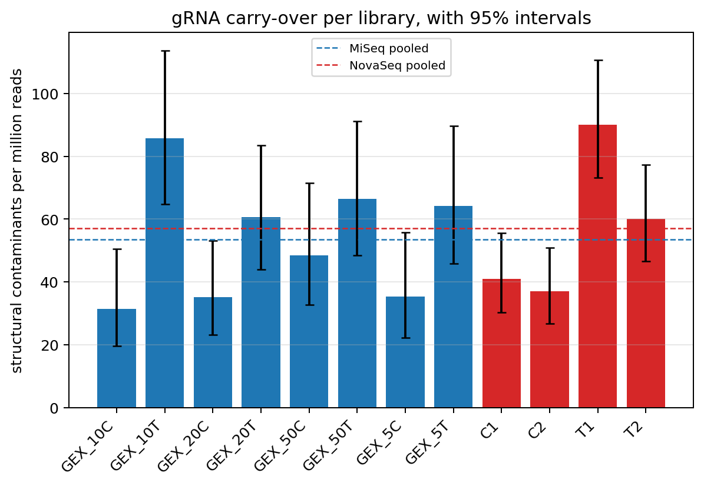

# gRNA construct carry-over in GEX

> **Report scope (v2.0 documentation update).** Results below retain the
> dataset, pipeline version and methods stated in their provenance. For current
> installation and commands, use the [quick start](QUICKSTART.md),
> [configuration reference](CONFIGURATION.md) and [UGER resource guide](UGER_RESOURCES.md).
> Historical counts/timings are not measurements of the new kallisto backend.

## Revised protocol against the four-library pilot

Carry-over is scored with the v1.4 structural definition: a fuzzy Split_TSO near
the read start, a spacer of the expected length, a complete CSM stem, an
iBAR-sized block, and the correctly paired partial tracr. Reference matching of
the spacer and iBAR adds confidence tiers but is not required, so recombined or
unknown constructs still count.

## Executive summary

1. **Per raw read, carry-over is unchanged. No change is resolved: the point estimate is 0.94x and the interval (0.78-1.13) spans 1, so a change smaller than 1.29x can be neither ruled in nor out at this depth.** Pooled, the revised
   protocol shows 53.5 structural
   contaminants per million raw reads against
   57.0 in the pilot: a rate ratio of
   **0.94x (95% CI 0.78-1.13)**.
2. **Per informative read, it is lower — but only because the denominator
   shrank.** Contaminants can only corrupt gene-bearing reads, and the pilot
   spent a third of its reads on rRNA. Against non-rRNA reads the rates are
   53.6 against
   84.6 per million, a ratio of
   **0.63x (95% CI 0.53-0.76)**.
   Nothing about the guide carry-over itself improved; rRNA depletion simply
   diluted it less.
3. **The C-versus-T split reproduces across both experiments.** Section 4 shows
   the T arm running roughly twice the C arm in the revised run *and* in the
   pilot. Whether the two experiments' C/T labels denote the same conditions is
   a question about the bench design, not the data, but the parallel is strong
   enough that arm composition should be matched before any two cohorts are
   compared on carry-over.
4. **The depth resolves this question when pooled, and only when pooled.** At
   the pilot baseline rate the smallest fold change detectable at 80% power is
   **1.29x**. A single library carries roughly
   32 expected events, so no per-library
   claim is made.

## 1. Detection floor

| Quantity | Value |
|---|---:|
| Revised-protocol reads scanned | 4,464,730 |
| Pilot reads scanned | 4,000,000 |
| Expected events at pilot rate, revised cohort | 254 |
| Expected events at pilot rate, pilot cohort | 228 |
| Smallest detectable fold change (80% power) | 1.29x |

## 2. Per library

Per-library rows are shown for completeness and for the variance they display,
not because any one of them supports a conclusion.

| Library | Platform | Reads | Structural | Per million | 95% CI | Complete-reference |
|---|---|---:|---:|---:|---:|---:|
| GEX_5C | MiSeq | 509,428 | 18 | 35.3 | 22.4-55.9 | 18 |
| GEX_10C | MiSeq | 539,322 | 17 | 31.5 | 19.7-50.5 | 17 |
| GEX_20C | MiSeq | 626,786 | 22 | 35.1 | 23.2-53.1 | 19 |
| GEX_50C | MiSeq | 516,268 | 25 | 48.4 | 32.8-71.5 | 23 |
| GEX_5T | MiSeq | 530,076 | 34 | 64.1 | 45.9-89.6 | 30 |
| GEX_10T | MiSeq | 559,824 | 48 | 85.7 | 64.7-113.7 | 42 |
| GEX_20T | MiSeq | 610,819 | 37 | 60.6 | 43.9-83.5 | 34 |
| GEX_50T | MiSeq | 572,207 | 38 | 66.4 | 48.4-91.1 | 33 |
| C1 | NovaSeq | 1,000,000 | 41 | 41.0 | 30.2-55.6 | 36 |
| C2 | NovaSeq | 1,000,000 | 37 | 37.0 | 26.8-51.0 | 31 |
| T1 | NovaSeq | 1,000,000 | 90 | 90.0 | 73.2-110.6 | 82 |
| T2 | NovaSeq | 1,000,000 | 60 | 60.0 | 46.6-77.2 | 55 |

## 3. Pooled by cohort

| Platform | Reads | Structural | Per million | 95% CI | Complete-reference per million |
|---|---:|---:|---:|---:|---:|
| MiSeq | 4,464,730 | 239 | 53.5 | 47.2-60.8 | 48.4 |
| NovaSeq | 4,000,000 | 228 | 57.0 | 50.1-64.9 | 51.0 |

## 4. By arm, in both experiments

| Platform | Arm | Reads | Structural | Per million | 95% CI |
|---|---|---:|---:|---:|---:|
| MiSeq | C | 2,191,804 | 82 | 37.4 | 30.1-46.4 |
| MiSeq | T | 2,272,926 | 157 | 69.1 | 59.1-80.8 |
| NovaSeq | C | 2,000,000 | 78 | 39.0 | 31.3-48.7 |
| NovaSeq | T | 2,000,000 | 150 | 75.0 | 63.9-88.0 |

The arm effect is the largest signal in this data and it is present in both
experiments, so a cohort comparison that did not hold arm composition fixed
could report a difference that is really just a difference in mixture.

## 5. Technical boundaries

- Both cohorts are scanned with identical code, identical structural thresholds,
  and 150-nt R1, so the comparison is not confounded by read length. The
  structural window needs 93 nt and both platforms supply 150.
- Pilot libraries are scanned from a bounded leading block of their R1 files.
  The same block choice was validated for molecule statistics by the contiguity
  control in the UMI saturation report.
- The rate ratio interval conditions on the total event count and inverts a
  Wilson interval on the binomial split, so it stays valid at the few-dozen
  counts this assay yields rather than assuming large-count normality.
- Contamination is quantified as a share of raw GEX reads. The revised
  libraries also carry far less rRNA, so a shift in the denominator composition
  alone would move this rate even with unchanged absolute carry-over; section 3
  reports the complete-reference tier alongside as a cross-check.
- No read identifiers, spacer sequences, iBARs, or barcodes are written to any
  durable product.
