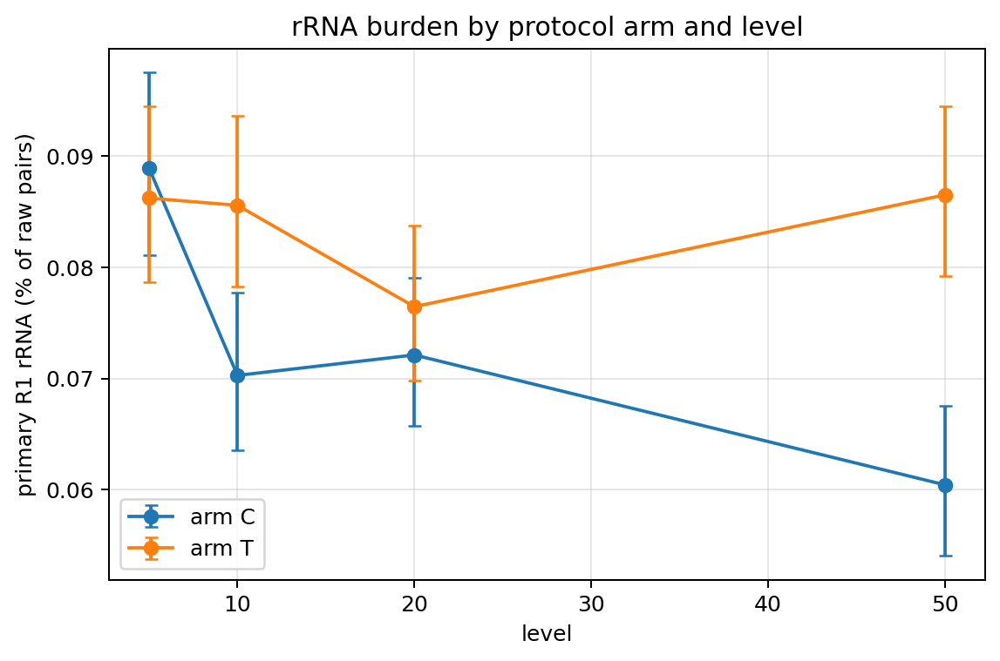
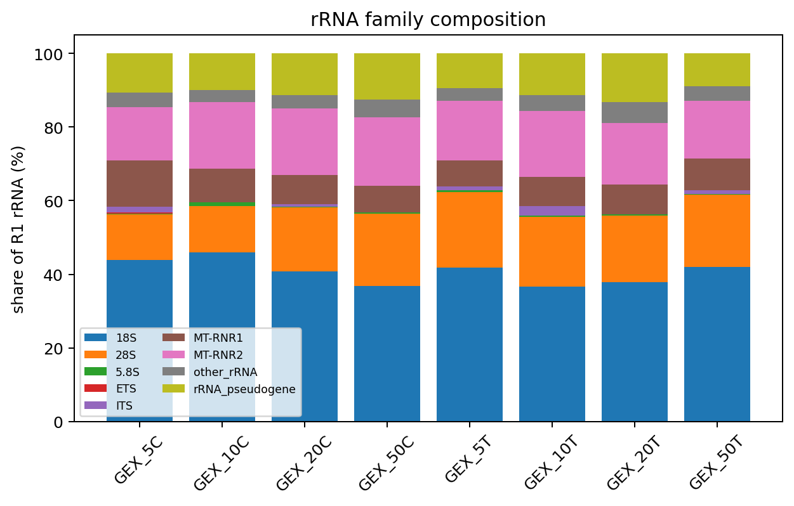
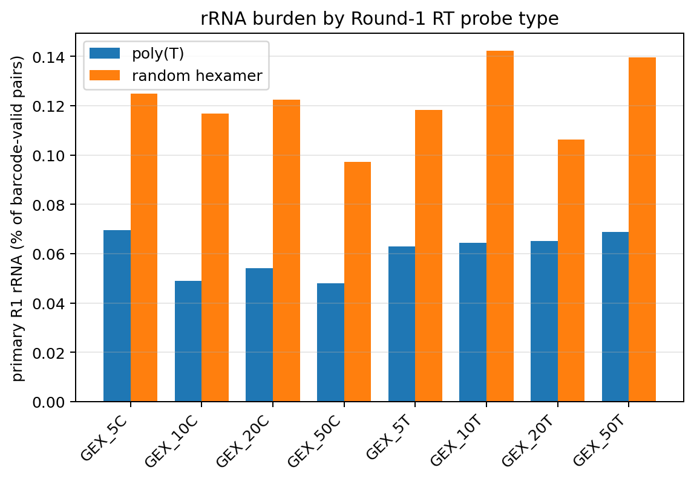
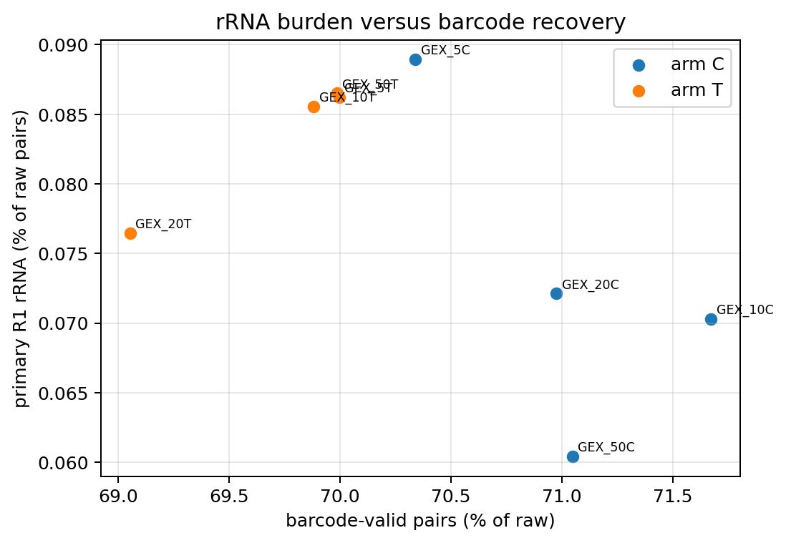

# GEX rRNA protocol test

> **Report scope (v2.0 documentation update).** Results below retain the
> dataset, pipeline version and methods stated in their provenance. For current
> installation and commands, use the [quick start](QUICKSTART.md),
> [configuration reference](CONFIGURATION.md) and [UGER resource guide](UGER_RESOURCES.md).
> Historical counts/timings are not measurements of the new kallisto backend.
> The maintained read-recovery and rRNA entry points are
> `submit/submit_gex_grna_read_recovery.sh` and `submit/submit_gex_rrna_audit.sh`.
> Earlier one-use wrappers are [archived](../archive/audit_workflows/2026_pilot/README.md).
> Raw barcode–UMI recovery is a molecule proxy; it is not automatically
> a gene-resolved expression UMI count under the Step 1a correction/assignment policy.

## Run 260806_M00622_0002_000000000-GY7KW, eight libraries across two arms and four levels

This compares eight complete raw-read censuses, 4,464,730 GEX read pairs in
total. Each sample was audited with the same engine, reference, and rRNA
definitions used for the teloHAEC and THP-1 audits. R1 is 150 nt here, so the
primary fractions are read-length matched to the teloHAEC pilot.

## Executive summary

1. **Every sample is effectively rRNA-free.** Pooled across all eight libraries,
   primary rRNA is 0.078% of raw pairs, ranging from
   0.060% (GEX_50C) to
   0.089% (GEX_5C). That is a
   **416-fold reduction** against the teloHAEC pilot's
   32.59% on identical 150-nt R1 geometry, the same reference, and the
   same audit code.
2. **The result is not an artifact of the reads.** Between
   93.9% and
   95.4% of sampled R1 reads align to
   the full GRCh38 index, so these are ordinary high-quality cDNA libraries in
   which rRNA is genuinely absent, not libraries whose reads failed to align.
   Section 6 sets out the full credibility argument.
3. **Neither the arm nor the level changes the outcome materially.**
   The largest arm-to-arm difference at a matched level is +0.026 percentage points (level 50), against an absolute burden below 0.09%. Differences of this size are resolvable at this depth but are not a meaningful lever on sequencing cost.
4. Every sample reconciled: raw pairs partition into barcode-valid and
   barcode-rejected, rRNA partitions by barcode status, and the rRNA families
   sum to the total.

## 1. Headline rRNA burden

Primary rRNA is at least 50 aligned bases at at least 95% identity in the 150-nt
GEX R1. The sensitivity tier relaxes this to at least 30 aligned bases at at
least 90% identity.

| Sample | Arm | Level | Raw pairs | rRNA pairs | rRNA fraction | 95% CI | Sensitivity |
|---|---|---:|---:|---:|---:|---:|---:|
| GEX_5C | C | 5 | 509,428 | 453 | 0.089% | 0.081%-0.097% | 1.065% |
| GEX_10C | C | 10 | 539,322 | 379 | 0.070% | 0.064%-0.078% | 1.006% |
| GEX_20C | C | 20 | 626,786 | 452 | 0.072% | 0.066%-0.079% | 1.056% |
| GEX_50C | C | 50 | 516,268 | 312 | 0.060% | 0.054%-0.068% | 0.961% |
| GEX_5T | T | 5 | 530,076 | 457 | 0.086% | 0.079%-0.094% | 1.121% |
| GEX_10T | T | 10 | 559,824 | 479 | 0.086% | 0.078%-0.094% | 1.187% |
| GEX_20T | T | 20 | 610,819 | 467 | 0.076% | 0.070%-0.084% | 1.143% |
| GEX_50T | T | 50 | 572,207 | 495 | 0.087% | 0.079%-0.094% | 1.154% |

Primary rRNA fraction as a grid:

| arm | 5 | 10 | 20 | 50 |
|---|---:|---:|---:|---:|
| C | 0.089% | 0.070% | 0.072% | 0.060% |
| T | 0.086% | 0.086% | 0.076% | 0.087% |

## 2. Change against the matched control

| Level | Comparison | Baseline | Arm | Absolute | Relative |
|---:|---|---:|---:|---:|---:|
| 5 | C -> T | 0.089% | 0.086% | -0.003 pp | -3.0% |
| 10 | C -> T | 0.070% | 0.086% | +0.015 pp | +21.8% |
| 20 | C -> T | 0.072% | 0.076% | +0.004 pp | +6.0% |
| 50 | C -> T | 0.060% | 0.087% | +0.026 pp | +43.1% |

## 3. rRNA family composition

| family | GEX_5C | GEX_10C | GEX_20C | GEX_50C | GEX_5T | GEX_10T | GEX_20T | GEX_50T |
|---|---:|---:|---:|---:|---:|---:|---:|---:|
| 18S | 43.93% | 45.91% | 40.71% | 36.86% | 41.79% | 36.74% | 37.90% | 42.02% |
| 28S | 12.36% | 12.66% | 17.48% | 19.55% | 20.57% | 18.79% | 17.99% | 19.60% |
| 5.8S | 0.22% | 1.06% | 0.22% | 0.32% | 0.44% | 0.42% | 0.43% | 0.20% |
| ETS | 0.22% | 0.00% | 0.00% | 0.00% | 0.00% | 0.00% | 0.00% | 0.00% |
| ITS | 1.55% | 0.00% | 0.66% | 0.00% | 1.09% | 2.51% | 0.00% | 1.01% |
| MT-RNR1 | 12.58% | 8.97% | 7.96% | 7.37% | 7.00% | 7.93% | 8.14% | 8.69% |
| MT-RNR2 | 14.57% | 18.21% | 17.92% | 18.59% | 16.19% | 17.95% | 16.70% | 15.56% |
| other_rRNA | 3.97% | 3.17% | 3.76% | 4.81% | 3.50% | 4.38% | 5.57% | 4.04% |
| rRNA_pseudogene | 10.60% | 10.03% | 11.28% | 12.50% | 9.41% | 11.27% | 13.28% | 8.89% |

## 4. rRNA by Round-1 RT probe type

Within barcode-valid pairs only, split by whether the Round-1 well used a
poly(T) or a random-hexamer RT primer.

| Sample | poly(T) rRNA | random hexamer rRNA | N6 / poly(T) |
|---|---:|---:|---:|
| GEX_5C | 0.070% | 0.125% | 1.79x |
| GEX_10C | 0.049% | 0.117% | 2.38x |
| GEX_20C | 0.054% | 0.122% | 2.27x |
| GEX_50C | 0.048% | 0.097% | 2.02x |
| GEX_5T | 0.063% | 0.118% | 1.88x |
| GEX_10T | 0.064% | 0.142% | 2.21x |
| GEX_20T | 0.065% | 0.106% | 1.63x |
| GEX_50T | 0.069% | 0.140% | 2.03x |

## 5. Barcode recovery

| Sample | Barcode-valid | BC1 pass | BC2 pass | BC3 pass |
|---|---:|---:|---:|---:|
| GEX_5C | 70.34% | 80.69% | 89.43% | 95.90% |
| GEX_10C | 71.67% | 80.91% | 89.13% | 96.02% |
| GEX_20C | 70.98% | 80.14% | 88.33% | 95.23% |
| GEX_50C | 71.05% | 80.38% | 88.79% | 95.91% |
| GEX_5T | 70.00% | 80.29% | 90.59% | 95.71% |
| GEX_10T | 69.88% | 80.01% | 90.36% | 95.75% |
| GEX_20T | 69.05% | 79.32% | 89.57% | 94.78% |
| GEX_50T | 69.99% | 80.00% | 90.34% | 95.64% |

**Read the per-round columns, not the barcode-valid column, when comparing
against the production audits.** Production barcode acceptance consults a
calibrated combination-count threshold whenever a read needs error correction,
and that calibration is derived from observed barcode-combination counts. At the
depth of this run those counts are far sparser than in a 400M-pair production
sublibrary, so the barcode-valid rate is depth-sensitive and is not comparable
across runs of different depth. Reads that match all three rounds exactly bypass
the threshold entirely, which is why the per-round pass fractions are the
depth-independent comparator. None of this affects the rRNA fraction, which is
called from R1 alignment alone and is independent of barcode status.

## 6. Why an rRNA fraction this low is believable

A burden 416-fold below the reference audits deserves more than one line
of evidence, because the failure modes that would fake it look similar. Four
independent checks argue against each of them.

| Sample | R1 sampled | Aligned to GRCh38 | Rate |
|---|---:|---:|---:|
| GEX_5C | 358,334 | 337,760 | 94.3% |
| GEX_10C | 386,550 | 365,863 | 94.6% |
| GEX_20C | 444,867 | 419,971 | 94.4% |
| GEX_50C | 366,802 | 349,747 | 95.4% |
| GEX_5T | 371,034 | 348,929 | 94.0% |
| GEX_10T | 391,216 | 367,377 | 93.9% |
| GEX_20T | 421,791 | 397,174 | 94.2% |
| GEX_50T | 400,466 | 377,481 | 94.3% |

1. **The reads align.** If rRNA reads were simply failing to reach the rRNA
   reference, the same reads would fail against the whole genome. They do not:
   roughly 94% align, which is a normal transcriptome rate.
2. **The mates are the ones the audit assumes.** The demultiplex QC verified
   the Parse Round-1/2/3 whitelists against R2, not R1, before any manifest was
   written, so R1 really is the cDNA mate being aligned.
3. **The residual rRNA still has structure.** Random-hexamer wells remain
   enriched for rRNA over poly(T) wells by roughly the ratio the pilot reported.
   A broken rRNA caller would flatten that contrast, not preserve it.
4. **The weak-hit background is unchanged.** The sensitivity tier sits about one
   percentage point above the primary tier here, the same absolute margin the
   teloHAEC pilot showed. What collapsed is the true rRNA signal, not the
   detector.

The remaining caveat is scope, not validity: this run measures the eight
libraries as prepared, and does not by itself establish which step of the
protocol removed the rRNA, since no arm here reproduces the pilot's burden.

## 7. Reference audits

| Audit | Raw pairs | Primary rRNA | R1 length | Length matched to this run |
|---|---:|---:|---:|---|
| teloHAEC pilot (C1/C2/T1/T2) | 1,680,846,154 | 32.59% | 150 nt | yes |
| THP-1 sublibrary 11 | 1,294,325,137 | 16.70% | 54 nt | no |

## 8. Technical boundaries

- Demultiplexing assigned 4,464,730 of 4,579,654 reads (97.49%). The undetermined remainder is 2.51%; an unindexed PhiX spike-in lands there by construction.
- Headline rRNA is called from R1 only. R2 opens with the 58-nt Parse technical
  amplicon, so R2 alignments describe read-through past the barcode and are
  reported in the per-sample products rather than folded into the headline.
- The rRNA reference contains mature nuclear and mitochondrial rRNAs, pre-rRNA
  regions, and an rRNA-pseudogene sensitivity panel. Ribosomal-protein mRNAs are
  excluded.
- Source FASTQs were opened read-only. No read identifiers, barcode sequences,
  or raw sequences are retained in the durable products.
