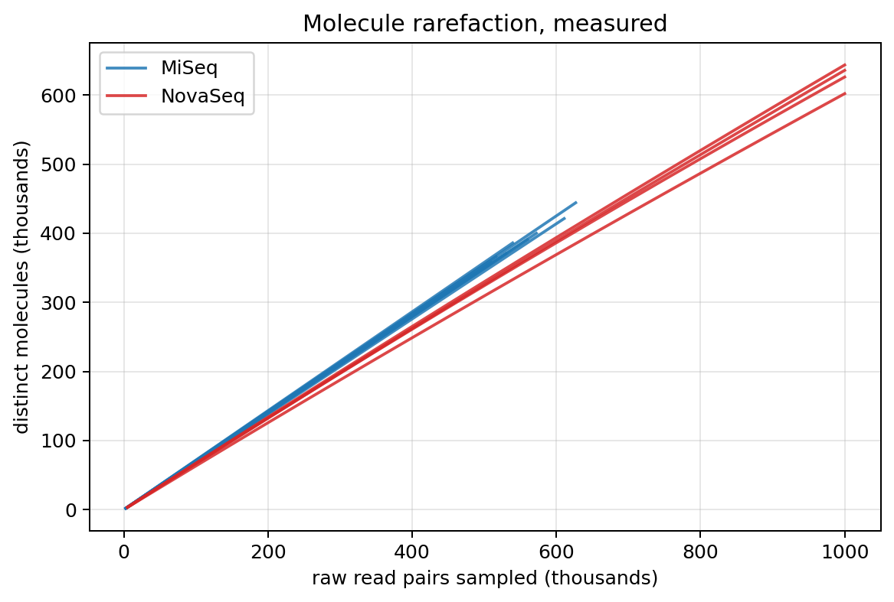
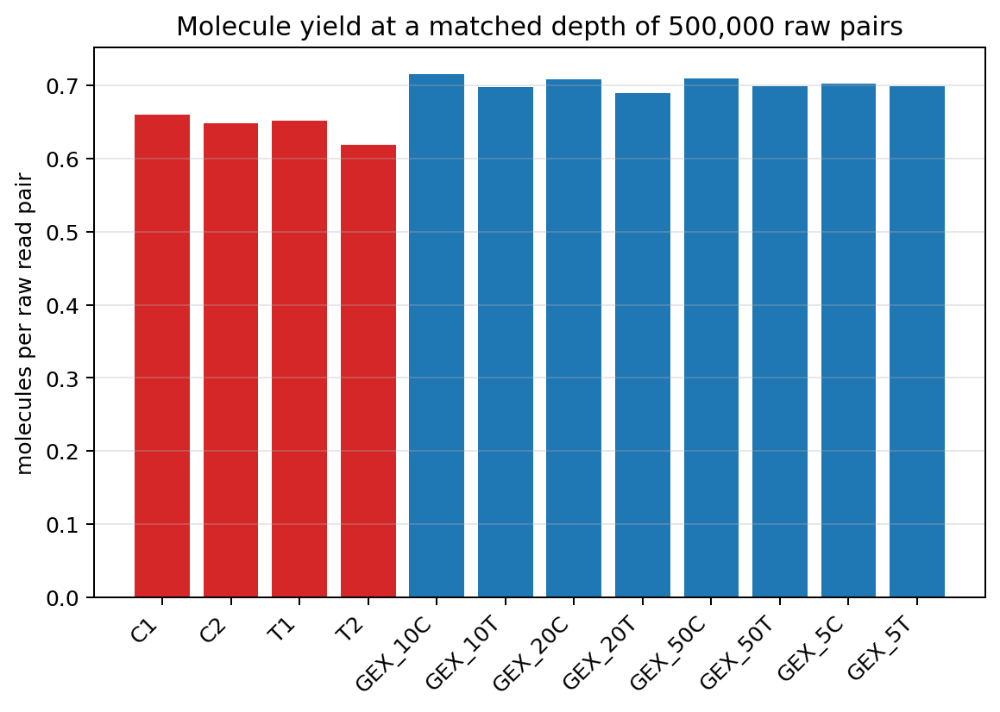
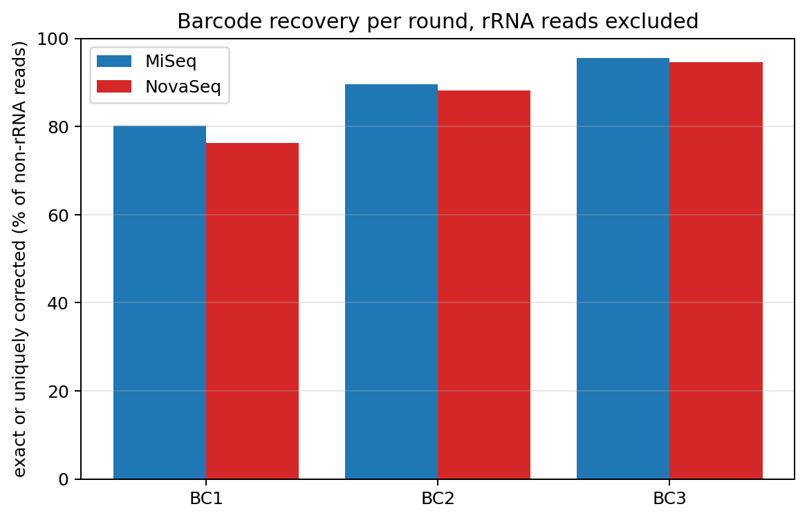

# GEX UMI recovery and sequencing saturation

> **Report scope (v2.0 documentation update).** Results below retain the
> dataset, pipeline version and methods stated in their provenance. For current
> installation and commands, use the [quick start](QUICKSTART.md),
> [configuration reference](CONFIGURATION.md) and [UGER resource guide](UGER_RESOURCES.md).
> Historical counts/timings are not measurements of the new kallisto backend.
> Raw barcode–UMI recovery is a molecule proxy; it is not automatically
> a gene-resolved expression UMI count under the Step 1a correction/assignment policy.

## Eight MiSeq protocol-test libraries against the four-library NovaSeq pilot

Molecules are distinct (cell barcode, UMI) pairs recovered by replaying the
production Parse barcode decode over R2. Rarefaction is computed analytically
from the reads-per-molecule histogram, so every curve is exact in expectation
rather than a single random draw.

## Executive summary

1. **At a matched depth of 500,000 raw read pairs, the protocol-test
   libraries return 0.7023 non-rRNA molecules per read against
   0.4545 for the pilot — a 1.55x gain.** Both sides are
   measured at this depth; neither is extrapolated.
2. **Counting every molecule, including rRNA ones, the gain is only
   1.09x.** rRNA reads still carry a valid barcode and UMI, so they
   still count as molecules. The gain is real only for molecules you can use,
   which is why the headline excludes them.
3. **The gain is read efficiency, not library complexity.** Mean rRNA burden is
   32.61% in the pilot versus 0.078% here, which alone
   predicts 1.48x. The measured 1.55x is that
   effect plus a modest barcode-recovery edge, with no evidence of richer
   libraries.
4. **The MiSeq error rate does not degrade barcode extraction.** Barcode
   recovery is in fact slightly *higher* on every round. Section 5 compares
   outcomes with rRNA reads excluded, so the 400-fold rRNA difference cannot
   confound the platform contrast.
5. **At this depth these libraries are essentially unsaturated**: mean
   saturation is 1.92%, so nearly every
   read still returns a new molecule and the depth-versus-yield relationship is
   still linear. That is exactly why extrapolating it to production depth
   (section 4) is weakly constrained.

## 1. Molecule recovery per library

| Library | Platform | Raw pairs | Barcode-valid | Molecules | Cells | Reads/molecule | Saturation | Median molecules/cell |
|---|---|---:|---:|---:|---:|---:|---:|---:|
| GEX_5C | MiSeq | 509,428 | 70.3% | 357,811 | 93,125 | 1.00 | 0.1% | 2 |
| GEX_10C | MiSeq | 539,322 | 71.7% | 385,981 | 79,334 | 1.00 | 0.1% | 2 |
| GEX_20C | MiSeq | 626,786 | 71.0% | 444,135 | 84,886 | 1.00 | 0.2% | 2 |
| GEX_50C | MiSeq | 516,268 | 71.0% | 366,208 | 77,917 | 1.00 | 0.2% | 2 |
| GEX_5T | MiSeq | 530,076 | 70.0% | 370,586 | 88,577 | 1.00 | 0.1% | 2 |
| GEX_10T | MiSeq | 559,824 | 69.9% | 390,748 | 90,598 | 1.00 | 0.1% | 2 |
| GEX_20T | MiSeq | 610,819 | 69.1% | 421,281 | 94,097 | 1.00 | 0.1% | 2 |
| GEX_50T | MiSeq | 572,207 | 70.0% | 400,006 | 92,888 | 1.00 | 0.1% | 2 |
| C1 | NovaSeq | 1,000,000 | 67.6% | 643,627 | 94,686 | 1.05 | 4.9% | 2 |
| C2 | NovaSeq | 1,000,000 | 67.2% | 626,175 | 88,411 | 1.07 | 6.8% | 2 |
| T1 | NovaSeq | 1,000,000 | 66.9% | 635,850 | 103,834 | 1.05 | 4.9% | 2 |
| T2 | NovaSeq | 1,000,000 | 63.6% | 602,115 | 101,411 | 1.06 | 5.3% | 2 |

## 2. Yield at matched depth

Every library is evaluated at the same absolute raw depth, which is the only
comparison that holds sequencing cost constant. A row is `measured` when that
depth lies at or below the library's own depth.

| Library | Platform | Molecules at 500,000 pairs | Per read | rRNA of valid | Non-rRNA molecules | Non-rRNA per read | Status |
|---|---|---:|---:|---:|---:|---:|---|
| GEX_5C | MiSeq | 351,198 | 0.7024 | 0.09% | 350,888 | 0.7018 | measured |
| GEX_10C | MiSeq | 357,877 | 0.7158 | 0.07% | 357,618 | 0.7152 | measured |
| GEX_20C | MiSeq | 354,414 | 0.7088 | 0.08% | 354,138 | 0.7083 | measured |
| GEX_50C | MiSeq | 354,687 | 0.7094 | 0.07% | 354,454 | 0.7089 | measured |
| GEX_5T | MiSeq | 349,583 | 0.6992 | 0.08% | 349,299 | 0.6986 | measured |
| GEX_10T | MiSeq | 349,036 | 0.6981 | 0.09% | 348,719 | 0.6974 | measured |
| GEX_20T | MiSeq | 344,925 | 0.6898 | 0.08% | 344,652 | 0.6893 | measured |
| GEX_50T | MiSeq | 349,580 | 0.6992 | 0.09% | 349,254 | 0.6985 | measured |
| C1 | NovaSeq | 329,833 | 0.6597 | 30.22% | 230,168 | 0.4603 | measured |
| C2 | NovaSeq | 324,121 | 0.6482 | 30.93% | 223,879 | 0.4478 | measured |
| T1 | NovaSeq | 325,974 | 0.6519 | 28.88% | 231,826 | 0.4637 | measured |
| T2 | NovaSeq | 309,280 | 0.6186 | 27.88% | 223,050 | 0.4461 | measured |

## 3. What the pilot actually achieved at production depth

The pilot's own split-pipe downsampling products record what it actually
returned at full production depth. This is the measured deep end of the
comparison, and it reframes the question.

| Sublibrary | Raw pairs | Molecules | Molecules per read |
|---|---:|---:|---:|
| C1 | 452,146,811 | 93,514,261 | 0.2068 |
| C2 | 363,646,678 | 67,111,573 | 0.1846 |
| T1 | 440,532,021 | 102,362,765 | 0.2324 |
| T2 | 424,520,644 | 81,876,741 | 0.1929 |

At full depth the pilot returns 0.2042 molecules per raw read, against
0.6446 for the same libraries subsampled to 500,000 reads. In
other words the pilot was already deep into saturation, spending roughly
4.9 reads per molecule recovered. **The protocol-test libraries
have not been sequenced anywhere near that regime, so the 1.55x advantage
measured at 500,000 reads cannot be assumed to hold at production depth.** It
is a lower-bound-free comparison at shallow depth, not a forecast.

## 4. Projection to full pilot depth, and why it fails

Extrapolating a 500,000-read measurement out to 450,000,000 reads is
roughly a 900-fold reach beyond the data, so these
are **model-based projections, not measurements**.

| Library | Platform | Fitted complexity | Half-saturation reads | Fit R2 | Projected molecules at 450,000,000 |
|---|---|---:|---:|---:|---:|
| GEX_5C | MiSeq | 245,099,031 | 348,446,727 | 1.0000 | 138,136,409 |
| GEX_10C | MiSeq | 261,947,383 | 365,474,035 | 1.0000 | 144,549,449 |
| GEX_20C | MiSeq | 270,143,000 | 380,612,292 | 1.0000 | 146,355,106 |
| GEX_50C | MiSeq | 225,939,562 | 318,006,355 | 1.0000 | 132,385,367 |
| GEX_5T | MiSeq | 307,106,156 | 438,745,780 | 1.0000 | 155,497,526 |
| GEX_10T | MiSeq | 326,484,465 | 467,194,184 | 1.0000 | 160,182,011 |
| GEX_20T | MiSeq | 347,942,629 | 503,875,075 | 1.0000 | 164,145,376 |
| GEX_50T | MiSeq | 348,437,824 | 497,866,387 | 1.0000 | 165,421,016 |
| C1 | NovaSeq | 13,281,484 | 19,633,648 | 1.0000 | 12,726,234 |
| C2 | NovaSeq | 9,251,288 | 13,771,325 | 1.0000 | 8,976,578 |
| T1 | NovaSeq | 12,911,048 | 19,303,777 | 1.0000 | 12,379,981 |
| T2 | NovaSeq | 11,344,729 | 17,840,534 | 1.0000 | 10,912,111 |

**The same fit, scored against ground truth, is wrong by roughly an order of
magnitude.** The pilot libraries were counted here from the same bounded block
as everything else, so their fits can be pushed out to their own real
production depth and compared with what the pilot actually returned.

| Sublibrary | Fit predicts at full depth | Pilot measured | Underestimate |
|---|---:|---:|---:|
| C1 | 12,728,761 | 93,514,261 | 7.3x |
| C2 | 8,913,725 | 67,111,573 | 7.5x |
| T1 | 12,369,046 | 102,362,765 | 8.3x |
| T2 | 10,887,193 | 81,876,741 | 7.5x |

The model underestimates by 7.3x to 8.3x. The reason
is structural, not incidental: at 500,000 reads a library is still in the
linear regime, where the observed molecule count is bounded by the reads spent.
A hyperbola fitted there pins its asymptote just above what was already seen,
so it cannot discover complexity it has not yet sampled.

**Consequently the MiSeq projections above are lower bounds, not upper bounds,
and are not fit for sizing a production run.** The honest statement of the
performance gain is the matched-depth measurement in section 2; anything at
production depth needs a deeper pilot of the new protocol.

## 5. Does the MiSeq error rate hurt barcode extraction?

**Barcode base quality.** These are the quality scores of the barcode bases
themselves, weighted by bases observed.

| Platform | Round | Q30 | Mean Phred | N rate |
|---|---|---:|---:|---:|
| MiSeq | BC1 | 94.53% | 36.94 | 0.0000% |
| MiSeq | BC2 | 93.63% | 36.37 | 0.0000% |
| MiSeq | BC3 | 92.94% | 35.41 | 0.0000% |
| NovaSeq | BC1 | 94.03% | 38.80 | 0.0000% |
| NovaSeq | BC2 | 94.45% | 38.88 | 0.0002% |
| NovaSeq | BC3 | 95.90% | 39.16 | 0.0000% |

**Barcode outcome, rRNA reads excluded.** Each round is decoded independently
against its whitelist. Because the pilot's rRNA reads are enriched for barcode
failure and this run has almost none, the uncontrolled comparison would flatter
the MiSeq libraries; these columns remove that confound by subtracting the rRNA
reads from both numerator and denominator.

| Platform | Round | Exact | Uniquely corrected | Ambiguous | Unmatched | Passing |
|---|---|---:|---:|---:|---:|---:|
| MiSeq | BC1 | 69.93% | 10.29% | 7.39% | 12.39% | 80.22% |
| MiSeq | BC2 | 80.93% | 8.63% | 2.25% | 8.18% | 89.56% |
| MiSeq | BC3 | 89.89% | 5.73% | 2.03% | 2.35% | 95.62% |
| NovaSeq | BC1 | 67.49% | 8.88% | 5.93% | 17.69% | 76.37% |
| NovaSeq | BC2 | 79.97% | 8.20% | 2.38% | 9.44% | 88.18% |
| NovaSeq | BC3 | 90.71% | 3.87% | 2.09% | 3.32% | 94.58% |

**The answer is no, and the quality table explains why.** Mean Phred on the
barcode bases is 2-4 points lower on the MiSeq, but that gap is partly an
artifact of comparing platforms by mean Phred at all: NovaSeq reports quality in
four coarse bins, which pulls its mean toward the top bin. The robust statistic,
the fraction of barcode bases at Q30 or better, is close on both instruments and
is actually higher on the MiSeq for Round 1.

Whatever quality difference remains does not reach the decode. Barcode recovery
is equal or better on the MiSeq for all three rounds, most visibly on Round 1
(80.2% versus 76.4% passing). An 8-nt barcode drawn from a sparse whitelist
tolerates a substituted base without becoming ambiguous, so the one-mismatch
correction Parse already applies absorbs the extra substitutions, and the
platform difference disappears into it.

Round 1 is the weakest round on both platforms, which is a position effect
rather than a platform effect: it sits at cycles 51-58 of R2, the latest and
lowest-quality cycles of the barcode amplicon.

## 6. Technical boundaries

- A molecule is a distinct (cell barcode, UMI) pair. Without gene assignment,
  two different transcripts in one cell that drew the same 10-nt UMI collapse
  into one molecule. At these depths that affects well under 1% of molecules and
  it applies equally to both platforms, so it does not move the comparison.
- **"Distinct cell barcodes" is not a cell count.** No cell calling was
  performed, and at this depth the barcode space is occupied mostly by ambient
  and error-derived barcodes carrying one or two molecules each. The median
  molecules-per-barcode of 2 reflects that, not real cells, and no conclusion in
  this report rests on it.
- The non-rRNA molecule count scales the measured molecule count by the audited
  rRNA share of barcode-valid reads rather than classifying each molecule
  directly, since this pass does not align R1. With saturation of a few percent
  almost every molecule is a singleton, so the scaling is close to exact.
- The pilot is a patterned-flow-cell NovaSeq run, where ExAmp duplicates cluster
  spatially. A bounded block therefore sees somewhat more duplication than a
  uniform sample would, which if anything understates the pilot's molecule yield
  at matched depth and so overstates the gain reported here. The effect is
  bounded by the pilot's measured saturation at that depth, a few percent.
- Pilot libraries are counted from a bounded leading block of their R2 files rather than at full depth. That block was checked against an independent block starting at record 20,000,000. Molecule yield and reads per molecule agree to within 1.04%, and the proportions agree to within 0.010 in absolute terms, so position in the file is uncorrelated with molecule identity and the block behaves like a random subsample.
- Barcode decoding uses the runtime Parse WT v3 contract over wells A1-B12 for
  every library on both platforms, so the decode is identical across the
  comparison.
- No cell barcodes, UMIs, read identifiers, or sequences are written to any
  durable product.
