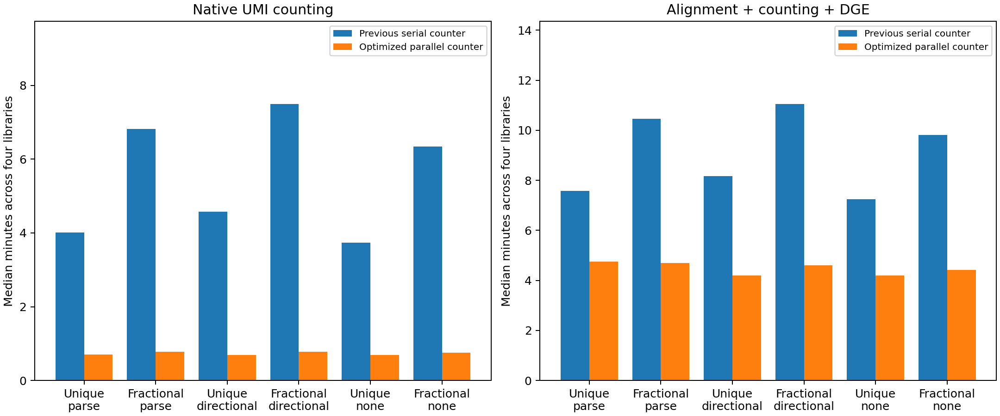

# Parallel kallisto counting: matched four-library benchmark

The optimized counter uses complete-barcode worker shards, cached EC/gene annotations, a singleton shortcut for directional correction, and an ordered disk-backed merge. Parse UMI families retain the installed Parse kernel check. STAR remains the default; the Parse 1.6.4 installation is unchanged.

C1, C2, T1 and T2 each use the exact saved 10-million-pair sample and identical Parse survivors from the previous benchmark. All 36 library runs were repeated with 16 bound cores and four concurrent jobs. The same mature-plus-nascent reference and kallisto executable were reused. Sampling, shared preprocessing, reference construction, and Step 1b validation are outside core time.

Median UMI counting time (minutes), with speedup relative to the serial counter:

| backend | umi_correction | baseline_count_minutes | optimized_count_minutes | count_speedup |
| --- | --- | --- | --- | --- |
| kallisto_unique | parse | 4.01 | 0.701 | 5.72 |
| kallisto_fractional | parse | 6.81 | 0.782 | 8.72 |
| kallisto_unique | directional | 4.58 | 0.692 | 6.61 |
| kallisto_fractional | directional | 7.49 | 0.778 | 9.64 |
| kallisto_unique | none | 3.73 | 0.696 | 5.37 |
| kallisto_fractional | none | 6.34 | 0.753 | 8.42 |

Median core time (minutes), including fresh STAR controls:

| backend | umi_correction | baseline_core_minutes | optimized_core_minutes | core_speedup |
| --- | --- | --- | --- | --- |
| star | parse | 5.44 | 6.29 | 0.865 |
| kallisto_unique | parse | 7.58 | 4.76 | 1.59 |
| kallisto_fractional | parse | 10.5 | 4.7 | 2.23 |
| star | directional | 5.59 | 5.95 | 0.939 |
| kallisto_unique | directional | 8.17 | 4.19 | 1.95 |
| kallisto_fractional | directional | 11.1 | 4.6 | 2.41 |
| star | none | 6.21 | 6.08 | 1.02 |
| kallisto_unique | none | 7.25 | 4.19 | 1.73 |
| kallisto_fractional | none | 9.81 | 4.43 | 2.22 |

All 24 native runs retained byte-identical molecule assignment CSVs and identical scientific QC. All 96 tested count products exactly match their serial reference, ordered cells/features and metadata, including fractional weights. H5AD X and raw count layers agree with their matrices. The checks cover unique and fractional genes with parse, directional and none correction; per-library all-well, unfiltered and filtered matrices; and filtered/unfiltered Step 1b combinations. No tolerance is used for matrix equality. Optional transcript products are covered by serial/parallel regression fixtures.

The saved all-well matrices in 8 baseline products contain CSV round-trip differences in 210 previously restored three-UMI wells (maximum absolute difference 9.37e-17). These are confined to wells omitted before the baseline's metadata repair. Their serial reference was reconstructed from the byte-identical baseline assignments using Python's exact float round-trip parser, the original per-barcode additions, and SQLite SUM order. The new matrices match that reference exactly. All saved baseline files remain untouched; the sample and combined matrices match their saved baseline matrices directly. The equality CSV records both the raw saved-matrix comparison and the strict serial-reference check.

The baseline fractional Parse/directional outputs include the documented whole-UMI metadata repair. Their original core timings are retained. New runs apply whole-UMI cell calling directly. Timing differences include host and shared-filesystem variability; speedups describe this implementation and reference.

[Per-run runtime and counting phases](assets/kallisto_parallel_benchmark_10m/runtime_comparison.csv), [exact equality checks](assets/kallisto_parallel_benchmark_10m/exact_equality.csv), [backend UMI/cell agreement](assets/kallisto_parallel_benchmark_10m/agreement.csv), [per-library yield](assets/kallisto_parallel_benchmark_10m/library_summary.csv).
