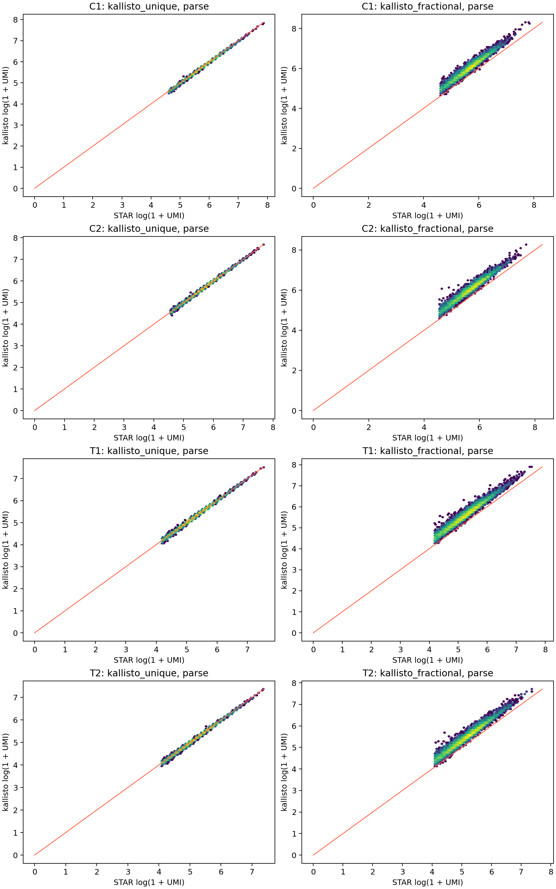
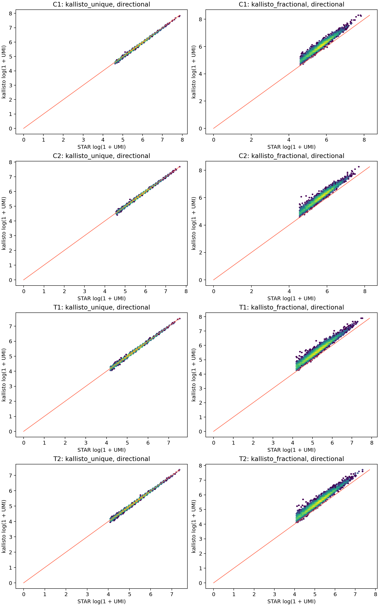
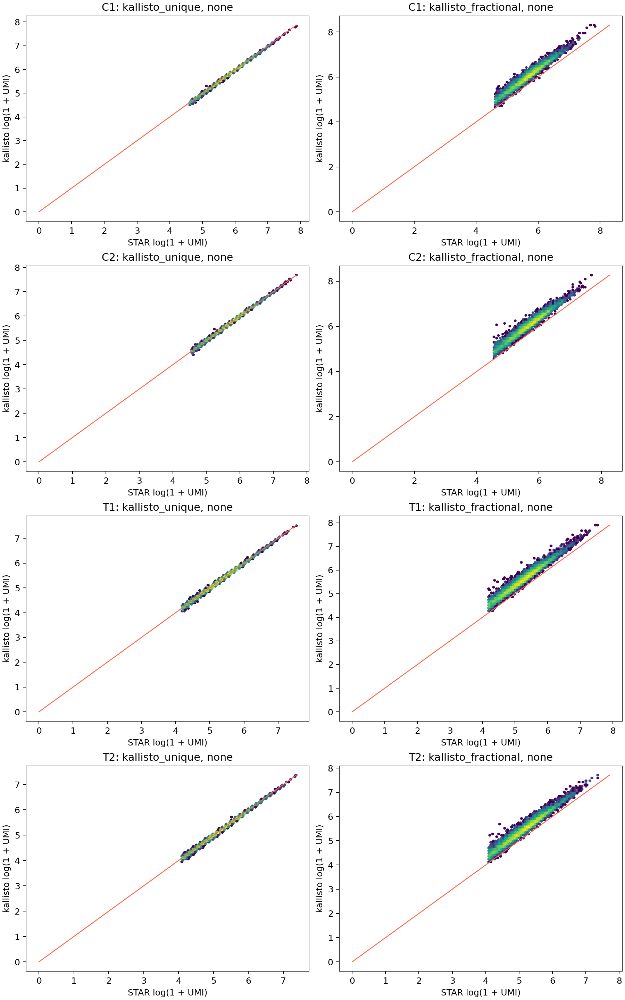
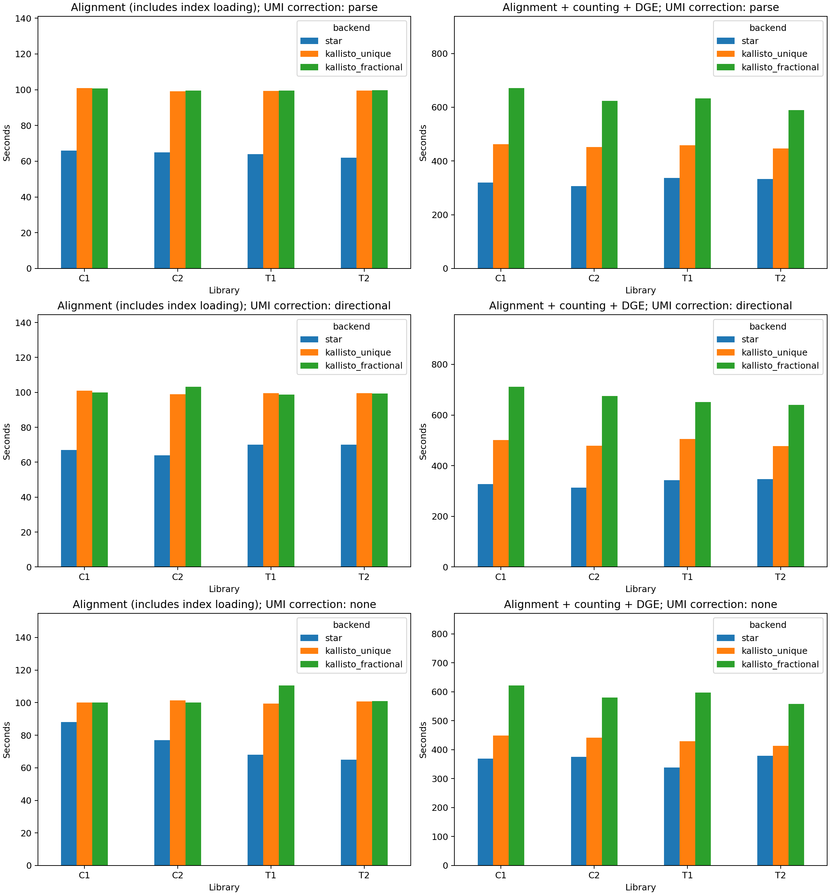

# Four-library kallisto benchmark: 10 million paired reads per library

> **Serial-counter baseline.** These completed 10-million-pair/library results
> describe the earlier counter and all three UMI modes. The v2.0 parallel-counter
> rerun is published separately after exact-count verification. Use the
> [backend guide](KALLISTO_BACKEND.md) and [quick start](QUICKSTART.md) for current
> operation; do not use these timings as the optimized counter's performance.

STAR uses the existing V1.5 alignment, molecule and DGE implementations. Kallisto uses unique and equal-fractional gene assignment. All three paths are run with Parse-default, directional, and no neighboring-UMI correction (nine combinations). All arms receive byte-identical Parse-preprocessed reads and use the same gene annotation. Each arm has 16 allocated CPU slots. Sampling selects balanced deterministic prefixes across source FASTQ pairs.

STAR retains its standard BAM intermediate route; kallisto uses native BUS intermediates in job-local scratch. These timings compare the implemented pipeline paths, including index loading and their respective output work.

Kallisto uses a mature-plus-nascent reference to retain intronic sensitivity. The counter measured here used a sequential Python/SQLite pass, while STAR's Parse molecule stage uses forked workers. The measured core timings therefore describe these implementations; they do not isolate aligner throughput. The runtime CSV separately records kallisto input formatting, alignment, molecule counting and publishing.

The timed core ends at DGE output for all arms: optional clustering and HTML reporting are excluded. Preprocessing is measured once per library and added separately to each core time. Each timed core independently runs alignment and counting; completed Parse-default runs are reused as the baseline. Reference construction, read sampling and Step 1b combination are excluded. All six kallisto combinations passed the actual Step 1b combine and completion checks before this report was generated. One run per arm provides observed wall times, not uncertainty estimates; node scheduling and filesystem cache can affect them. The original Parse-default arrays allowed two concurrent jobs each; the correction-mode extension allowed four. Each individual run retained 16 CPU slots and 8 GB per slot. RSS is the child-process high-water mark reported by getrusage, not summed process-tree memory.

## Overview across four libraries

Cell counts are summed across libraries; UMI and runtime summaries are medians of the four library values.

| arm | called_cells_total | median_library_umis_per_cell | median_core_seconds |
| --- | --- | --- | --- |
| star | 37279 | 234 | 326 |
| kallisto_unique | 37022 | 232 | 455 |
| kallisto_fractional | 36983 | 335 | 628 |
| star_directional | 37267 | 234 | 335 |
| kallisto_unique_directional | 37014 | 232 | 490 |
| kallisto_fractional_directional | 36979 | 334 | 663 |
| star_none | 37279 | 234 | 373 |
| kallisto_unique_none | 37023 | 232 | 435 |
| kallisto_fractional_none | 36986 | 335 | 589 |

## Cell and molecule yield

| library | arm | called_cells | total_umis | median_umis_per_cell | median_genes_per_cell |
| --- | --- | --- | --- | --- | --- |
| C1 | star | 7192 | 2.37e+06 | 292 | 263 |
| C1 | kallisto_unique | 7168 | 2.29e+06 | 283 | 252 |
| C1 | kallisto_fractional | 7178 | 3.39e+06 | 412 | 298 |
| C1 | star_directional | 7189 | 2.36e+06 | 291 | 263 |
| C1 | kallisto_unique_directional | 7167 | 2.29e+06 | 283 | 252 |
| C1 | kallisto_fractional_directional | 7188 | 3.38e+06 | 411 | 298 |
| C1 | star_none | 7192 | 2.37e+06 | 292 | 263 |
| C1 | kallisto_unique_none | 7169 | 2.29e+06 | 283 | 252 |
| C1 | kallisto_fractional_none | 7178 | 3.39e+06 | 412 | 298 |
| C2 | star | 7083 | 2.29e+06 | 286 | 258 |
| C2 | kallisto_unique | 7031 | 2.26e+06 | 284 | 250 |
| C2 | kallisto_fractional | 6996 | 3.34e+06 | 417 | 296 |
| C2 | star_directional | 7082 | 2.29e+06 | 286 | 258 |
| C2 | kallisto_unique_directional | 7028 | 2.26e+06 | 283 | 250 |
| C2 | kallisto_fractional_directional | 6993 | 3.33e+06 | 417 | 296 |
| C2 | star_none | 7083 | 2.29e+06 | 286 | 258 |
| C2 | kallisto_unique_none | 7031 | 2.26e+06 | 284 | 250 |
| C2 | kallisto_fractional_none | 6999 | 3.34e+06 | 417 | 296 |
| T1 | star | 11278 | 2.42e+06 | 183 | 168 |
| T1 | kallisto_unique | 11161 | 2.38e+06 | 182 | 163 |
| T1 | kallisto_fractional | 11199 | 3.43e+06 | 258 | 191 |
| T1 | star_directional | 11274 | 2.41e+06 | 183 | 168 |
| T1 | kallisto_unique_directional | 11160 | 2.38e+06 | 182 | 163 |
| T1 | kallisto_fractional_directional | 11194 | 3.42e+06 | 258 | 191 |
| T1 | star_none | 11278 | 2.42e+06 | 183 | 168 |
| T1 | kallisto_unique_none | 11161 | 2.38e+06 | 182 | 163 |
| T1 | kallisto_fractional_none | 11199 | 3.43e+06 | 258 | 191 |
| T2 | star | 11726 | 2.32e+06 | 169 | 156 |
| T2 | kallisto_unique | 11662 | 2.27e+06 | 166 | 151 |
| T2 | kallisto_fractional | 11610 | 3.22e+06 | 234 | 177 |
| T2 | star_directional | 11722 | 2.32e+06 | 169 | 157 |
| T2 | kallisto_unique_directional | 11659 | 2.27e+06 | 166 | 151 |
| T2 | kallisto_fractional_directional | 11604 | 3.22e+06 | 234 | 177 |
| T2 | star_none | 11726 | 2.32e+06 | 169 | 156 |
| T2 | kallisto_unique_none | 11662 | 2.27e+06 | 166 | 151 |
| T2 | kallisto_fractional_none | 11610 | 3.22e+06 | 234 | 177 |

## Agreement

UMI correlations use the common called-cell cohort. The fixed-cohort UMI ratio uses every cell called by the first arm, retrieving the other arm's counts from its all-well matrix and filling missing barcodes with zero. Expression correlations use log(1 + UMI) across the same genes; per-cell correlations include shared zeros.

| library | first | second | cell_call_jaccard | shared_umi_spearman | fixed_first_cohort_median_umi_ratio | median_cell_expression_log_pearson | common_cell_pseudobulk_log_pearson |
| --- | --- | --- | --- | --- | --- | --- | --- |
| C1 | star | kallisto_unique | 0.99 | 0.999 | 0.969 | 0.945 | 0.99 |
| C1 | star | kallisto_fractional | 0.968 | 0.974 | 1.39 | 0.853 | 0.981 |
| C1 | kallisto_unique | kallisto_fractional | 0.971 | 0.976 | 1.44 | 0.918 | 0.982 |
| C1 | star_directional | kallisto_unique_directional | 0.99 | 0.999 | 0.969 | 0.945 | 0.99 |
| C1 | star_directional | kallisto_fractional_directional | 0.968 | 0.974 | 1.39 | 0.853 | 0.981 |
| C1 | kallisto_unique_directional | kallisto_fractional_directional | 0.971 | 0.976 | 1.44 | 0.918 | 0.982 |
| C1 | star_none | kallisto_unique_none | 0.99 | 0.999 | 0.969 | 0.945 | 0.99 |
| C1 | star_none | kallisto_fractional_none | 0.968 | 0.974 | 1.39 | 0.853 | 0.981 |
| C1 | kallisto_unique_none | kallisto_fractional_none | 0.972 | 0.976 | 1.44 | 0.918 | 0.982 |
| C1 | star | star_directional | 1 | 1 | 1 | 1 | 1 |
| C1 | star | star_none | 1 | 1 | 1 | 1 | 1 |
| C1 | kallisto_unique | kallisto_unique_directional | 1 | 1 | 1 | 1 | 1 |
| C1 | kallisto_unique | kallisto_unique_none | 1 | 1 | 1 | 1 | 1 |
| C1 | kallisto_fractional | kallisto_fractional_directional | 0.998 | 1 | 1 | 1 | 1 |
| C1 | kallisto_fractional | kallisto_fractional_none | 1 | 1 | 1 | 1 | 1 |
| C2 | star | kallisto_unique | 0.989 | 0.999 | 0.987 | 0.945 | 0.991 |
| C2 | star | kallisto_fractional | 0.963 | 0.974 | 1.42 | 0.854 | 0.981 |
| C2 | kallisto_unique | kallisto_fractional | 0.97 | 0.978 | 1.44 | 0.923 | 0.983 |
| C2 | star_directional | kallisto_unique_directional | 0.989 | 0.999 | 0.987 | 0.945 | 0.991 |
| C2 | star_directional | kallisto_fractional_directional | 0.963 | 0.974 | 1.42 | 0.854 | 0.981 |
| C2 | kallisto_unique_directional | kallisto_fractional_directional | 0.97 | 0.978 | 1.44 | 0.923 | 0.983 |
| C2 | star_none | kallisto_unique_none | 0.989 | 0.999 | 0.987 | 0.945 | 0.991 |
| C2 | star_none | kallisto_fractional_none | 0.963 | 0.974 | 1.42 | 0.854 | 0.981 |
| C2 | kallisto_unique_none | kallisto_fractional_none | 0.97 | 0.978 | 1.44 | 0.923 | 0.983 |
| C2 | star | star_directional | 1 | 1 | 1 | 1 | 1 |
| C2 | star | star_none | 1 | 1 | 1 | 1 | 1 |
| C2 | kallisto_unique | kallisto_unique_directional | 1 | 1 | 1 | 1 | 1 |
| C2 | kallisto_unique | kallisto_unique_none | 1 | 1 | 1 | 1 | 1 |
| C2 | kallisto_fractional | kallisto_fractional_directional | 1 | 1 | 0.999 | 1 | 1 |
| C2 | kallisto_fractional | kallisto_fractional_none | 1 | 1 | 1 | 1 | 1 |
| T1 | star | kallisto_unique | 0.986 | 0.998 | 0.988 | 0.939 | 0.991 |
| T1 | star | kallisto_fractional | 0.965 | 0.978 | 1.39 | 0.836 | 0.982 |
| T1 | kallisto_unique | kallisto_fractional | 0.968 | 0.982 | 1.4 | 0.915 | 0.983 |
| T1 | star_directional | kallisto_unique_directional | 0.986 | 0.998 | 0.988 | 0.939 | 0.991 |
| T1 | star_directional | kallisto_fractional_directional | 0.966 | 0.978 | 1.39 | 0.836 | 0.982 |
| T1 | kallisto_unique_directional | kallisto_fractional_directional | 0.969 | 0.982 | 1.4 | 0.915 | 0.983 |
| T1 | star_none | kallisto_unique_none | 0.986 | 0.998 | 0.988 | 0.939 | 0.991 |
| T1 | star_none | kallisto_fractional_none | 0.965 | 0.978 | 1.39 | 0.836 | 0.982 |
| T1 | kallisto_unique_none | kallisto_fractional_none | 0.968 | 0.982 | 1.4 | 0.915 | 0.983 |
| T1 | star | star_directional | 1 | 1 | 1 | 1 | 1 |
| T1 | star | star_none | 1 | 1 | 1 | 1 | 1 |
| T1 | kallisto_unique | kallisto_unique_directional | 1 | 1 | 1 | 1 | 1 |
| T1 | kallisto_unique | kallisto_unique_none | 1 | 1 | 1 | 1 | 1 |
| T1 | kallisto_fractional | kallisto_fractional_directional | 1 | 1 | 1 | 1 | 1 |
| T1 | kallisto_fractional | kallisto_fractional_none | 1 | 1 | 1 | 1 | 1 |
| T2 | star | kallisto_unique | 0.989 | 0.998 | 0.978 | 0.943 | 0.99 |
| T2 | star | kallisto_fractional | 0.962 | 0.979 | 1.35 | 0.837 | 0.981 |
| T2 | kallisto_unique | kallisto_fractional | 0.967 | 0.982 | 1.39 | 0.908 | 0.983 |
| T2 | star_directional | kallisto_unique_directional | 0.989 | 0.998 | 0.978 | 0.943 | 0.99 |
| T2 | star_directional | kallisto_fractional_directional | 0.963 | 0.979 | 1.35 | 0.837 | 0.981 |
| T2 | kallisto_unique_directional | kallisto_fractional_directional | 0.967 | 0.982 | 1.39 | 0.908 | 0.983 |
| T2 | star_none | kallisto_unique_none | 0.989 | 0.998 | 0.978 | 0.943 | 0.99 |
| T2 | star_none | kallisto_fractional_none | 0.962 | 0.979 | 1.35 | 0.837 | 0.981 |
| T2 | kallisto_unique_none | kallisto_fractional_none | 0.967 | 0.982 | 1.39 | 0.908 | 0.983 |
| T2 | star | star_directional | 1 | 1 | 1 | 1 | 1 |
| T2 | star | star_none | 1 | 1 | 1 | 1 | 1 |
| T2 | kallisto_unique | kallisto_unique_directional | 1 | 1 | 1 | 1 | 1 |
| T2 | kallisto_unique | kallisto_unique_none | 1 | 1 | 1 | 1 | 1 |
| T2 | kallisto_fractional | kallisto_fractional_directional | 0.999 | 1 | 1 | 1 | 1 |
| T2 | kallisto_fractional | kallisto_fractional_none | 1 | 1 | 1 | 1 | 1 |

## Runtime

| library | arm | alignment_seconds | core_seconds | preprocess_plus_core_seconds | core_speedup_vs_same_flavor_star | peak_process_rss_gb |
| --- | --- | --- | --- | --- | --- | --- |
| C1 | star | 66 | 320 | 470 | 1 | 18.7 |
| C1 | kallisto_unique | 101 | 463 | 613 | 0.691 | 15.1 |
| C1 | kallisto_fractional | 101 | 671 | 821 | 0.477 | 15.1 |
| C1 | star_directional | 67 | 327 | 478 | 1 | 18.7 |
| C1 | kallisto_unique_directional | 101 | 501 | 651 | 0.654 | 15.1 |
| C1 | kallisto_fractional_directional | 100 | 712 | 862 | 0.46 | 15.1 |
| C1 | star_none | 88 | 370 | 520 | 1 | 18.7 |
| C1 | kallisto_unique_none | 100 | 449 | 600 | 0.823 | 15.1 |
| C1 | kallisto_fractional_none | 100 | 622 | 773 | 0.594 | 15.1 |
| C2 | star | 65 | 307 | 452 | 1 | 18.7 |
| C2 | kallisto_unique | 99.2 | 451 | 596 | 0.68 | 15.1 |
| C2 | kallisto_fractional | 99.4 | 623 | 768 | 0.493 | 15.1 |
| C2 | star_directional | 64 | 313 | 457 | 1 | 18.7 |
| C2 | kallisto_unique_directional | 98.9 | 479 | 624 | 0.653 | 15.1 |
| C2 | kallisto_fractional_directional | 103 | 676 | 820 | 0.463 | 15 |
| C2 | star_none | 77 | 376 | 520 | 1 | 18.7 |
| C2 | kallisto_unique_none | 101 | 441 | 586 | 0.852 | 15.1 |
| C2 | kallisto_fractional_none | 100 | 580 | 724 | 0.648 | 15.1 |
| T1 | star | 64 | 337 | 481 | 1 | 18.7 |
| T1 | kallisto_unique | 99.3 | 459 | 603 | 0.735 | 15.1 |
| T1 | kallisto_fractional | 99.5 | 633 | 777 | 0.532 | 15.1 |
| T1 | star_directional | 70 | 343 | 487 | 1 | 18.7 |
| T1 | kallisto_unique_directional | 99.5 | 505 | 649 | 0.679 | 15.1 |
| T1 | kallisto_fractional_directional | 98.8 | 651 | 795 | 0.527 | 15.1 |
| T1 | star_none | 68 | 338 | 482 | 1 | 18.7 |
| T1 | kallisto_unique_none | 99.4 | 429 | 573 | 0.789 | 15.1 |
| T1 | kallisto_fractional_none | 111 | 597 | 741 | 0.566 | 15 |
| T2 | star | 62 | 333 | 472 | 1 | 18.7 |
| T2 | kallisto_unique | 99.6 | 447 | 586 | 0.745 | 15.1 |
| T2 | kallisto_fractional | 99.7 | 589 | 728 | 0.565 | 15.1 |
| T2 | star_directional | 70 | 346 | 486 | 1 | 18.7 |
| T2 | kallisto_unique_directional | 99.6 | 478 | 617 | 0.725 | 15.1 |
| T2 | kallisto_fractional_directional | 99.4 | 640 | 779 | 0.542 | 15 |
| T2 | star_none | 65 | 378 | 518 | 1 | 18.7 |
| T2 | kallisto_unique_none | 101 | 413 | 553 | 0.916 | 15.1 |
| T2 | kallisto_fractional_none | 101 | 558 | 698 | 0.678 | 15.1 |

Gene resolution and cell-call policies can change counts; these measurements do not establish biological equivalence. Transcript output is disabled in this gene-level comparison. Full-depth scaling remains unmeasured.

The completed Parse/default and directional fractional products were republished to correct floating-point roundoff at whole-molecule cell-calling cutoffs. Gene weights and UMI families were preserved; omitted wells at the all-well minimum were restored from the retained molecule assignments. Original metadata was archived. Core runtimes retain the original alignment/counting measurements; the separate republish pass is recorded as `metadata_republish_seconds` in the runtime CSV and excluded from core timings. The no-correction fractional runs used whole-molecule calling totals directly.
