# Pilot Four-Sublibrary Technical Audit

> **Report scope (v2.0 documentation update).** Results below retain the
> dataset, pipeline version and methods stated in their provenance. For current
> installation and commands, use the [quick start](QUICKSTART.md),
> [configuration reference](CONFIGURATION.md) and [UGER resource guide](UGER_RESOURCES.md).
> Historical counts/timings are not measurements of the new kallisto backend.
> Experiment-specific audit workflows remain in Git history and the local
> UGER archive; their original commands are provenance, not release entry points.

## Executive summary

The finalized pilot contains **37,086 GEX-good human cells** and **31,246
GEX-gRNA-good cells** at the production pair-level threshold of 5 deduplicated
gRNA UMIs. The latter is the intersection with GEX calls; the guide-only product
contains 38,325 threshold-positive barcodes and must not be used as the final
screen-cell denominator.

The current 24-well barcode namespace contains 221,184 combinations. Requiring
at least 10 barcodes per physically loaded cell limits one sublibrary to
**22,118 loaded cells**. A 96-well first round contains 884,736 combinations and
raises the corresponding limit to **88,473 loaded cells**. At either limit,
uniform occupancy still predicts about 9.5% of loaded cells in a barcode shared
with at least one other cell; “10 barcodes per cell” is a minimum, not a
zero-doublet regime.

## Definitions and provenance

- **GEX-good**: `hg38` cells in the finalized `DGE_filtered` cell metadata.
- **GEX-gRNA-good**: a GEX-good cell with at least one complete or inferred
  dual-guide pair passing the stated pair-level threshold.
- Complete pairs pass when `pos1_umi + pos2_umi >= threshold`; half-detected
  pairs pass when the observed arm alone meets the threshold.
- gRNA UMIs are directionally collapsed at Hamming distance 1 with
  `min_reads_per_umi=1`; pre-collapse counts are retained separately.
- Raw sequencing depth is reported as paired-end read pairs. Individual
  R1+R2 reads equal twice the pair count.

Independent FASTQ validation is complete; every R1/R2 pair had matching record counts. AnnData matrix total matched metadata exactly (229,032,073 UMIs).

## Cell recovery and raw sequencing

| Library | Loaded | GEX-good | GEX-gRNA-good T=5 | GEX/load | Final/load | Raw GEX pairs | Raw gRNA pairs | GEX R1+R2 reads | gRNA R1+R2 reads |
| --- | --- | --- | --- | --- | --- | --- | --- | --- | --- |
| C1 | 16,250 | 7,187 | 6,205 | 44.2% | 38.2% | 452,146,811 | 13,892,550 | 904,293,622 | 27,785,100 |
| C2 | 16,250 | 6,994 | 5,936 | 43.0% | 36.5% | 363,646,678 | 32,510,872 | 727,293,356 | 65,021,744 |
| T1 | 18,750 | 11,284 | 9,700 | 60.2% | 51.7% | 440,532,021 | 25,001,193 | 881,064,042 | 50,002,386 |
| T2 | 18,750 | 11,621 | 9,405 | 62.0% | 50.2% | 424,520,644 | 20,313,405 | 849,041,288 | 40,626,810 |
| Combined | 70,000 | 37,086 | 31,246 | 53.0% | 44.6% | 1,680,846,154 | 91,718,020 | 3,361,692,308 | 183,436,040 |

At threshold 5, call composition is:

| Library | Good cells | Singlet | Multiplet | Complete only | Inferred only | Mixed |
| --- | --- | --- | --- | --- | --- | --- |
| C1 | 6,205 | 5,155 | 1,050 | 4,424 | 1,495 | 286 |
| C2 | 5,936 | 4,944 | 992 | 4,102 | 1,507 | 327 |
| T1 | 9,700 | 7,648 | 2,052 | 6,752 | 2,296 | 652 |
| T2 | 9,405 | 7,731 | 1,674 | 6,229 | 2,620 | 556 |
| Combined | 31,246 | 25,478 | 5,768 | 21,507 | 7,918 | 1,821 |

The complete threshold table for 1, 3, 5, and 10 UMIs is in
`assets/pilot_4_sublib_audit/threshold_counts.csv`.

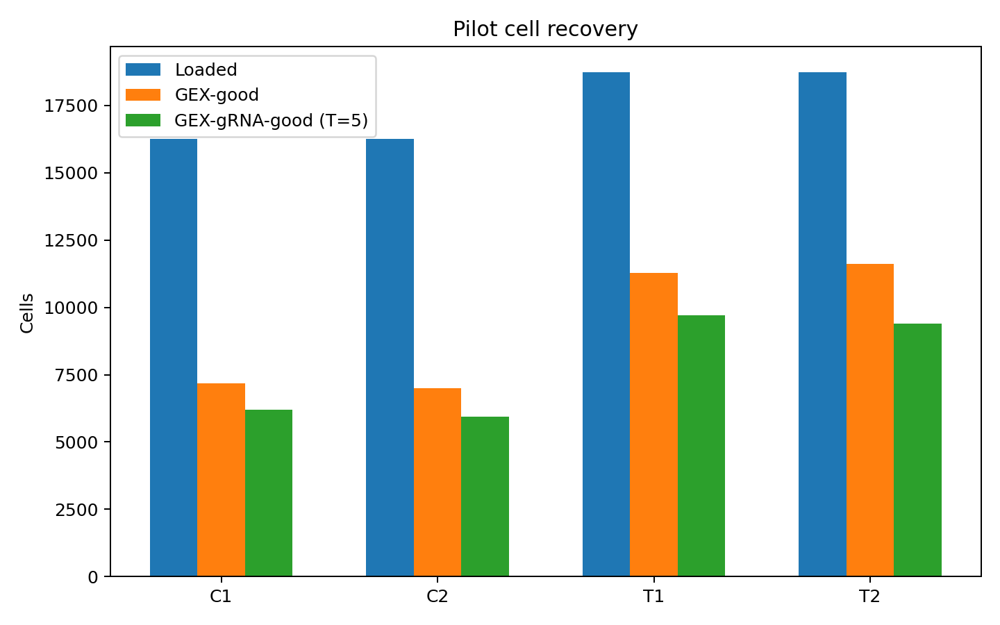

## Stage efficiency and loss

| Library | GEX pairs/GEX-good cell | GEX pairs/GEX-good UMI | GEX barcode pass | GEX transcriptome map | GEX pipeline saturation | GEX-good UMI retention | gRNA pairs/final-good cell | gRNA pairs/final-good UMI | gRNA barcode pass | gRNA structure extracted | gRNA construct matched | gRNA saturation in GEX cells | T5 guide-called/GEX-good |
| --- | --- | --- | --- | --- | --- | --- | --- | --- | --- | --- | --- | --- | --- |
| C1 | 62,912 | 7.56 | 67.9% | 57.0% | 46.6% | 64.0% | 2,239 | 28.76 | 91.6% | 67.5% | 67.0% | 94.2% | 86.3% |
| C2 | 51,994 | 8.15 | 67.2% | 56.4% | 51.4% | 66.5% | 5,477 | 69.15 | 91.6% | 67.9% | 67.5% | 97.6% | 84.9% |
| T1 | 39,040 | 6.36 | 67.1% | 56.9% | 39.1% | 67.6% | 2,577 | 34.95 | 91.7% | 65.2% | 64.8% | 95.1% | 86.0% |
| T2 | 36,530 | 7.67 | 63.7% | 57.5% | 47.4% | 67.6% | 2,160 | 45.85 | 91.9% | 63.6% | 63.1% | 96.1% | 80.9% |
| Combined | 45,323 | 7.34 | 66.5% | 57.0% | 45.9% | 66.4% | 2,935 | 43.43 | 91.7% | 66.1% | 65.7% | 96.1% | 84.3% |

Barcode-pass, transcriptome-map, structure-extraction, and construct-match
percentages use raw read pairs as their denominator. GEX-good UMI retention is
the fraction of all pipeline UMIs assigned to the finalized human-cell cohort.
The last column quantifies loss at threshold-5 guide calling after GEX calling.

## Why is GEX valid-barcode retention lower than gRNA?

| Library | Arm | Valid | Distance 0 | Distance 1 | Distance 2 | No correction | Ambiguous | Too short | Mean barcode Q30 | BC1 perfect | BC2 perfect | BC3 perfect |
| --- | --- | --- | --- | --- | --- | --- | --- | --- | --- | --- | --- | --- |
| C1 | GEX | 67.9% | 64.4% | 2.8% | 12.6% | 20.1% | 0.0% | 0.0% | 94.9% | 65.9% | 81.1% | 90.6% |
| C1 | gRNA | 91.6% | 89.5% | 3.1% | NA | 7.4% | 0.0% | 0.0% | NA | NA | NA | NA |
| C2 | GEX | 67.2% | 63.7% | 2.8% | 12.7% | 20.8% | 0.0% | 0.0% | 94.6% | 65.2% | 80.5% | 91.1% |
| C2 | gRNA | 91.6% | 89.5% | 3.0% | NA | 7.5% | 0.0% | 0.0% | NA | NA | NA | NA |
| T1 | GEX | 67.1% | 63.6% | 3.0% | 13.7% | 19.7% | 0.0% | 0.0% | 94.9% | 65.0% | 82.6% | 90.9% |
| T1 | gRNA | 91.7% | 89.7% | 3.1% | NA | 7.3% | 0.0% | 0.0% | NA | NA | NA | NA |
| T2 | GEX | 63.7% | 60.3% | 2.9% | 14.0% | 22.7% | 0.0% | 0.0% | 95.1% | 61.7% | 81.8% | 90.9% |
| T2 | gRNA | 91.9% | 89.8% | 3.0% | NA | 7.1% | 0.0% | 0.0% | NA | NA | NA | NA |

Across the four libraries, mean valid-barcode
retention was **66.5% for
GEX** versus **91.7% for
gRNA**. This is unlikely to be explained by generally poor GEX base calls:
the three GEX barcode segments averaged
**94.9% Q30**, ambiguous calls
were below 0.01%, and no reads were reported too short. It is also not simply
that gRNA uses a looser correction threshold: the dedicated gRNA Step-2
configuration allows distance 1, while the split-pipe-equivalent GEX decoder
evaluates distance 2 with empirical combination support.

The stronger clue is barcode identity. GEX placed
**20.8%** of reads
in the no-correction bin and
**13.3%** in the
distance-2 bin. Its pipeline-reported perfect fraction was lowest for BC1
(64.5%) compared with BC2
(81.5%) and BC3
(90.9%). The leading
hypothesis is therefore round-1 barcode/library-structure or molecule-
composition loss, not global read quality. High Q scores do not by themselves
prove whitelist identity, so
the completed harmonized raw-R2 replay below provides the decisive test.

The distance bins above are the native pipeline summaries, not interchangeable
counterfactual rescue counts. In particular, a distance-2 read can still fail
because its nearest barcode is ambiguous or its corrected three-round
combination lacks empirical support. `barcode_validity_diagnostic.csv` retains
the exact counts and denominators.

### Observed bounded raw-R2 replay

The configured Step-1a/Step-2 exact contract check
**FAILED**, while the canonical Step-1a mappings
are **a valid subset** of the
configured runtime:

| Library | Runtime stage | Round | Step-1a sequences | Step-2 sequences | Step-2-only sequences | Sequence sets | Mappings | Kit | Chemistry | Coordinates | Canonical subset | Allowed BC1 winds |
| --- | --- | --- | --- | --- | --- | --- | --- | --- | --- | --- | --- | --- |
| C1 | pilot_step2_runtime | 1 | 96 | 141 | 45 | FAIL | FAIL | pass | pass | pass | pass | 24 |
| C1 | pilot_step2_runtime | 2 | 96 | 96 | 0 | pass | pass | pass | pass | pass | pass | 24 |
| C1 | pilot_step2_runtime | 3 | 96 | 96 | 0 | pass | pass | pass | pass | pass | pass | 24 |
| C2 | pilot_step2_runtime | 1 | 96 | 141 | 45 | FAIL | FAIL | pass | pass | pass | pass | 24 |
| C2 | pilot_step2_runtime | 2 | 96 | 96 | 0 | pass | pass | pass | pass | pass | pass | 24 |
| C2 | pilot_step2_runtime | 3 | 96 | 96 | 0 | pass | pass | pass | pass | pass | pass | 24 |
| T1 | pilot_step2_runtime | 1 | 96 | 141 | 45 | FAIL | FAIL | pass | pass | pass | pass | 24 |
| T1 | pilot_step2_runtime | 2 | 96 | 96 | 0 | pass | pass | pass | pass | pass | pass | 24 |
| T1 | pilot_step2_runtime | 3 | 96 | 96 | 0 | pass | pass | pass | pass | pass | pass | 24 |
| T2 | pilot_step2_runtime | 1 | 96 | 141 | 45 | FAIL | FAIL | pass | pass | pass | pass | 24 |
| T2 | pilot_step2_runtime | 2 | 96 | 96 | 0 | pass | pass | pass | pass | pass | pass | 24 |
| T2 | pilot_step2_runtime | 3 | 96 | 96 | 0 | pass | pass | pass | pass | pass | pass | 24 |

The configured Step-2 collection contains **45 additional
round-1 sequences per library**. They are auxiliary primer barcodes absent from
the persisted normal-use-case Step-1a contract. The production gate now
restricts `BCInfo` to the persisted contract and revalidates exact parity before
reading a FASTQ; it does not process under the superset silently.

Native rejection outcomes across the two deterministic windows are:

| Arm | Native outcome | Reads | Fraction |
| --- | --- | --- | --- |
| GEX | ambiguous_nearest_whitelist | 182,021 | 3.79% |
| GEX | no_whitelist_neighbor_d2 | 1,007,249 | 20.98% |
| GEX | outside_allowed_bc1_namespace | 433 | 0.01% |
| GEX | unsupported_corrected_combination | 422,845 | 8.81% |
| GEX | valid_native | 3,187,452 | 66.41% |
| gRNA | ambiguous_nearest_whitelist | 209,245 | 4.36% |
| gRNA | no_whitelist_neighbor_d2 | 85,487 | 1.78% |
| gRNA | outside_allowed_bc1_namespace | 1,538 | 0.03% |
| gRNA | unique_only_beyond_native_distance | 59,841 | 1.25% |
| gRNA | unsupported_corrected_combination | 43,307 | 0.90% |
| gRNA | valid_native | 4,400,582 | 91.68% |

Barcode-segment quality was:

| Arm | Segment | Rejected-read Q30 | Valid-read Q30 | Rejected minus valid Q30 |
| --- | --- | --- | --- | --- |
| GEX | BC1 | 89.7% | 96.5% | -6.7 pp |
| GEX | BC2 | 88.7% | 97.3% | -8.6 pp |
| GEX | BC3 | 93.5% | 97.2% | -3.7 pp |
| GEX | UMI | 93.4% | 96.4% | -3.0 pp |
| gRNA | BC1 | 87.9% | 98.0% | -10.1 pp |
| gRNA | BC2 | 89.2% | 98.6% | -9.4 pp |
| gRNA | BC3 | 91.0% | 98.3% | -7.3 pp |
| gRNA | UMI | 91.8% | 97.7% | -5.9 pp |

The harmonized correction-policy comparison is:

| Policy | GEX accepted | gRNA accepted | gRNA minus GEX | Gap change vs native (pp) |
| --- | --- | --- | --- | --- |
| Native arm-specific | 66.4% | 91.7% | 25.3% | +0.0 pp |
| Step-1a whitelist, GEX calibration, distance 2 | 66.4% | 94.8% | 28.4% | +3.1 pp |
| Step-1a whitelist, gRNA calibration, distance 1 | 63.5% | 91.7% | 28.2% | +2.9 pp |
| Step-1a whitelist, exact only | 63.0% | 89.6% | 26.7% | +1.4 pp |

The dominant GEX rejection category was `no_whitelist_neighbor_d2`. Rejected GEX
barcode segments differed from valid reads by an average of
**-5.5 Q30 percentage points**. Under the same GEX
calibration and distance-2 rule, the remaining gRNA-minus-GEX acceptance gap
was **28.4 percentage points**. Only
**0.026%** of native accepted reads used a BC1 wind
outside the Step-1a 24-well namespace. These counterfactual changes are
non-additive because edit distance, empirical support, and raw-arm composition
interact.

The native validity gap was **25.3 percentage points**.
No harmonized policy reduced it: the smallest harmonized gap was
**26.7 points**. Switching gRNA from the
configured Step-2 superset to the Step-1a whitelist changed acceptance by only
**+0.000 points**, and namespace enforcement changed
either arm by at most **0.032 points**. Thus the
observed gap attributable to stricter GEX edit-distance, calibration,
whitelist, or namespace policy is effectively zero in this replay.

Read quality is contributory but insufficient as a full explanation. Overall
barcode/UMI-segment Q30 was **95.0% in GEX** and
**97.5% in gRNA**. Yet the GEX reads with no whitelist
neighbor through distance 2 still averaged **90.3%
Q30**, and **83.1%** of those failures first
occurred at BC1. The evidence therefore points most strongly to an arm-specific
BC1 identity/library-structure or molecule-composition problem, with lower
base quality increasing rejection at the margin.

**Interpretation:** exact configured whitelist parity is
**unsupported**, while canonical mapping
compatibility is **supported**; namespace inflation is
**unsupported**; generic
base-quality loss is **contributory but not primary**; strict correction and
calibration policy is **unsupported** as the cause of the arm gap;
and an arm-specific barcode/molecule-composition effect is
**supported**.
All sampled native rates were within 3 percentage points of their full-run summaries.

Detailed aggregate tables are stored under
`output/pilot_4_sublib_audit/barcode_rejection/` (local run output);
the documentation asset directory contains only the two report-facing plots
below. Independent product reconciliation status: **passed**.

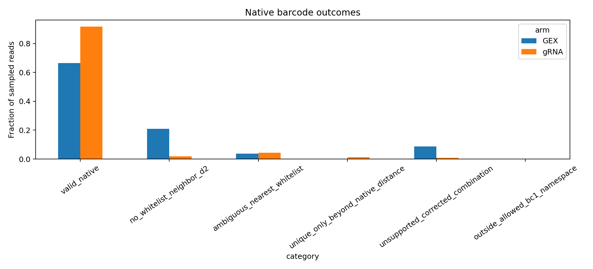

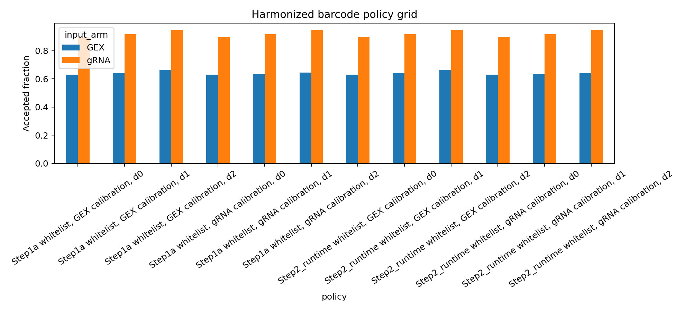

### Paired decoder-crossover and linker audit

For each sublibrary, the audit streamed GEX and gRNA R2 through record six
million, built the native calibration products, and selected exactly 500,000
records per arm from the disjoint 4–6M interval with a stable seeded reservoir.
Every decoder below processed the identical sampled records. Brackets are
binomial 95% Wilson intervals for each 500,000-read sample.

| Library | Input R2 | Step 1a native | Historical Step 2 | Future Step 2 |
| --- | --- | --- | --- | --- |
| C1 | GEX | 67.90% [67.77, 68.03] | 65.03% [64.90, 65.16] | 65.01% [64.88, 65.15] |
| C1 | gRNA | 94.80% [94.74, 94.87] | 91.67% [91.60, 91.75] | 91.64% [91.56, 91.72] |
| C2 | GEX | 67.31% [67.18, 67.44] | 64.45% [64.32, 64.58] | 64.44% [64.30, 64.57] |
| C2 | gRNA | 94.82% [94.76, 94.89] | 91.66% [91.58, 91.73] | 91.62% [91.54, 91.70] |
| T1 | GEX | 66.94% [66.81, 67.07] | 64.03% [63.90, 64.16] | 64.01% [63.88, 64.14] |
| T1 | gRNA | 94.80% [94.73, 94.86] | 91.73% [91.65, 91.80] | 91.70% [91.62, 91.78] |
| T2 | GEX | 63.78% [63.64, 63.91] | 60.92% [60.79, 61.06] | 60.90% [60.76, 61.03] |
| T2 | gRNA | 94.94% [94.88, 95.00] | 91.87% [91.79, 91.95] | 91.84% [91.76, 91.92] |

The unweighted four-library means and 95% Student-t CIs are:

| Input R2 | Decoder | Four-library mean | 95% t CI lower | 95% t CI upper | Library minimum | Library maximum |
| --- | --- | --- | --- | --- | --- | --- |
| GEX | Step 1a native | 66.48% | 63.54% | 69.42% | 63.78% | 67.90% |
| GEX | Future Step 2 | 63.59% | 60.66% | 66.52% | 60.90% | 65.01% |
| GEX | Historical Step 2 | 63.61% | 60.68% | 66.53% | 60.92% | 65.03% |
| gRNA | Step 1a native | 94.84% | 94.73% | 94.95% | 94.80% | 94.94% |
| gRNA | Future Step 2 | 91.70% | 91.54% | 91.86% | 91.62% | 91.84% |
| gRNA | Historical Step 2 | 91.73% | 91.58% | 91.89% | 91.66% | 91.87% |

Because calls are paired read by read, the decoder changes can also be stated
as percentage-point changes and exact discordant-read counts:

| Input R2 | Comparison | Mean change | 95% t CI lower | 95% t CI upper | Left-only reads | Right-only reads | Both valid, different call |
| --- | --- | --- | --- | --- | --- | --- | --- |
| GEX | Future Step 2 minus Step 1a native | -2.89 pp | -2.94 pp | -2.85 pp | 58,044 | 181 | 0 |
| GEX | Historical Step 2 minus Step 1a native | -2.87 pp | -2.92 pp | -2.83 pp | 57,837 | 351 | 49 |
| GEX | Future Step 2 minus Historical Step 2 | -0.02 pp | -0.03 pp | -0.01 pp | 381 | 4 | 0 |
| gRNA | Future Step 2 minus Step 1a native | -3.14 pp | -3.23 pp | -3.06 pp | 64,134 | 1,317 | 1 |
| gRNA | Historical Step 2 minus Step 1a native | -3.11 pp | -3.19 pp | -3.03 pp | 63,511 | 1,324 | 1 |
| gRNA | Future Step 2 minus Historical Step 2 | -0.03 pp | -0.04 pp | -0.02 pp | 639 | 9 | 0 |

Decoder-specific independent per-round mapping rates (before the empirical
three-round combination-support gate) are:

| Input R2 | Decoder | Round | Unique nearest mean | 95% t CI lower | 95% t CI upper |
| --- | --- | --- | --- | --- | --- |
| GEX | Step 1a native | BC1 | 76.92% | 74.54% | 79.29% |
| GEX | Step 1a native | BC2 | 89.06% | 87.88% | 90.25% |
| GEX | Step 1a native | BC3 | 94.63% | 94.32% | 94.94% |
| GEX | Future Step 2 | BC1 | 67.02% | 64.17% | 69.88% |
| GEX | Future Step 2 | BC2 | 83.31% | 81.78% | 84.84% |
| GEX | Future Step 2 | BC3 | 92.67% | 92.31% | 93.02% |
| GEX | Historical Step 2 | BC1 | 67.50% | 64.70% | 70.30% |
| GEX | Historical Step 2 | BC2 | 83.31% | 81.78% | 84.84% |
| GEX | Historical Step 2 | BC3 | 92.67% | 92.31% | 93.02% |
| gRNA | Step 1a native | BC1 | 95.06% | 94.93% | 95.19% |
| gRNA | Step 1a native | BC2 | 98.26% | 98.19% | 98.33% |
| gRNA | Step 1a native | BC3 | 97.74% | 97.67% | 97.80% |
| gRNA | Future Step 2 | BC1 | 93.85% | 93.80% | 93.91% |
| gRNA | Future Step 2 | BC2 | 95.14% | 94.97% | 95.30% |
| gRNA | Future Step 2 | BC3 | 96.85% | 96.72% | 96.97% |
| gRNA | Historical Step 2 | BC1 | 93.85% | 93.79% | 93.92% |
| gRNA | Historical Step 2 | BC2 | 95.14% | 94.97% | 95.30% |
| gRNA | Historical Step 2 | BC3 | 96.85% | 96.72% | 96.97% |

Independent fixed-slice mapping by barcode round gives:

| Input R2 | Round | Exact | Corrected d1/d2 | No neighbor ≤2 | Ambiguous | Contains N | Too short |
| --- | --- | --- | --- | --- | --- | --- | --- |
| GEX | BC1 | 64.51% | 12.41% | 17.37% | 5.71% | 0.00% | 0.00% |
| GEX | BC2 | 81.60% | 7.46% | 8.80% | 2.14% | 0.00% | 0.00% |
| GEX | BC3 | 90.92% | 3.71% | 3.35% | 2.02% | 0.00% | 0.00% |
| gRNA | BC1 | 91.82% | 3.24% | 1.46% | 3.48% | 0.00% | 0.00% |
| gRNA | BC2 | 93.89% | 4.37% | 0.88% | 0.86% | 0.00% | 0.00% |
| gRNA | BC3 | 95.44% | 2.29% | 0.72% | 1.54% | 0.00% | 0.00% |

BC1 reference evidence—separating intended A1–B12 wells from canonical
C1–D12 sequences and the historical runtime-only auxiliary collection—is:

| Input R2 | Fixed-slice BC1 evidence | Four-library mean | 95% t CI lower | 95% t CI upper |
| --- | --- | --- | --- | --- |
| GEX | Ambiguous nearest | 7.34% | 6.79% | 7.89% |
| GEX | Canonical C1-D12 exact | 0.02% | 0.02% | 0.02% |
| GEX | Intended A1-B12 corrected d1/d2 | 4.05% | 3.90% | 4.21% |
| GEX | Intended A1-B12 exact | 64.49% | 61.52% | 67.46% |
| GEX | No neighbor ≤2 | 14.20% | 12.49% | 15.91% |
| GEX | Outside-reference proximity d1/d2 | 9.84% | 9.15% | 10.53% |
| GEX | Runtime-only auxiliary exact | 0.05% | 0.01% | 0.09% |
| gRNA | Ambiguous nearest | 3.80% | 3.54% | 4.05% |
| gRNA | Canonical C1-D12 exact | 0.12% | 0.09% | 0.15% |
| gRNA | Intended A1-B12 corrected d1/d2 | 2.27% | 2.09% | 2.44% |
| gRNA | Intended A1-B12 exact | 91.70% | 91.53% | 91.88% |
| gRNA | No neighbor ≤2 | 1.24% | 1.19% | 1.29% |
| gRNA | Outside-reference proximity d1/d2 | 0.87% | 0.69% | 1.05% |
| gRNA | Runtime-only auxiliary exact | 0.01% | 0.00% | 0.01% |

Only exact (`d0`) matches are evidence that a read actually carries a
non-A1–B12 or auxiliary sequence. Their mean combined rate was
**0.071% in GEX** and
**0.121% in gRNA**.
The larger distance-1/2 outside-reference proximity
(9.84% GEX;
0.87% gRNA) is a nearest-neighbor
classification of erroneous fixed slices, not evidence that those physical
wells were used.

The semiglobal linker diagnostic required a unique jointly consistent L23/L12
pair at edit distance ≤2 and treated distance 3 as sensitivity-only. Rescue was
credited only when that primary pair re-anchored a fixed-slice BC1 failure to a
unique intended A1–B12 barcode:

| Input R2 | Primary unique linker pair | Position-shift signature | Intact-position linker damage | Distance-3-only linker pair | Fixed BC1 failures rescued | All reads rescued |
| --- | --- | --- | --- | --- | --- | --- |
| GEX | 68.33% | 3.60% | 17.11% | 4.83% | 8.19% | 2.57% |
| gRNA | 82.75% | 4.09% | 49.15% | 9.34% | 52.13% | 3.14% |

| Potential explanation | Assessment | Observed diagnostic |
| --- | --- | --- |
| Decoder strictness causes arm gap | unsupported as a major explanation | differential profile effect 0.24 pp |
| Combination calibration contributes | suggestive | largest differential arm-gap effect 1.95 pp |
| True wrong-well/auxiliary BC1 | unsupported as a major explanation | largest exact-match library/arm fraction 0.142% |
| N-containing BC1 | unsupported as a major explanation | largest library/arm fraction 0.00% |
| Lower recognizable linker structure | supported | GEX primary-pair deficit vs gRNA 14.42 pp |
| Position shift causes GEX gap | unsupported as a major explanation | absolute GEX/gRNA shifted-pair difference 0.49 pp |
| Lower BC1 sequencing quality | suggestive | GEX BC1 Q30 deficit 2.66 pp; GEX no-neighbor BC1 still 89.76% Q30 |
| Persistent input-arm composition | supported | same-decoder gRNA-minus-GEX gap +28.36 pp |

**Integrated interpretation.** Applying the same Step-1a decoder to both arms
left a **28.36-point** gRNA-minus-GEX gap
(66.48% versus
94.84%). Historical Step 2
changed acceptance by
-2.87 points on GEX input and
-3.11 points on gRNA input, so its stricter
profile slightly **narrows**, rather than creates, the arm gap. The 141-sequence
historical collection and the future contract-aligned profile differed by only
0.019 points on GEX input and
0.032 points on gRNA input.

The discrepancy localizes most strongly to BC1: under the distance-2 Step-1a
profile, independently mappable BC1 was 76.92% in GEX versus 95.06% in gRNA,
whereas the fixed-slice exact rates were
64.51% and
91.82%. GEX BC1 quality was
lower (94.56% versus
97.21% Q30), so base quality contributes, but the
GEX no-neighbor class still averaged 89.76% Q30.

Recognizable primary linker pairs were
68.33% in GEX versus
82.75% in gRNA, which
supports a genuine arm-specific R2-structure difference. In contrast, primary
position-shift signatures were similar
(3.60% versus
4.09%), and
linker anchoring rescued only
2.57% of all
GEX reads versus
3.14% of all
gRNA reads. Thus simple positional displacement is not the main GEX failure
mode; loss/degradation of recognizable linker/BC1 structure or another
arm-specific molecule-composition effect is more consistent with the data.

**Paired-read follow-up.** A second bounded scan retained complete, identifier-free
150-nt R1/R2 sequences for representative reads having exact BC2/BC3 but
invalid BC1. L12 is composite: `TCCAAC` is coupled to BC2, whereas `CACCTC`
is supplied by the Round-1 probe before BC1. All eight top-frequency examples
retained `TCCAAC` but lacked the following `CACCTC`. Five of nine selected
examples had supported mate overlap; four ordinary examples reconstructed
242–264-nt inserts without a ≥12-nt TSO or Illumina-adapter match. In
particular, example 2 had a perfect 36-nt mate overlap and a 264-nt reconstructed
insert, demonstrating that its sequence after `TCCAAC` continues into the
physical insert rather than adapter. The apparent intact-linker control was a
different short-fragment artifact: both mates reached adapter at base 79, the
insert reconstructed to 79 nt, and it contained exact reverse-complement Split
TSO plus Illumina Read-2 adapter. These observations support loss of the
BC1-side Round-1 structure in the dominant examples, not a missing barcode
reference.

This experiment attributes effects to decoder behavior versus input-read
composition; a linker-associated rescue supports positional displacement but
does not by itself distinguish molecular damage, PCR artifacts, or sequencing
indels. The Step-1a 58-nt and historical Step-2 50-nt R2 gates were evaluated
separately; the paired-read follow-up above evaluates R1 overlap and TSO/adapter
read-through independently.

Detailed aggregate tables and run manifests are stored only under
`output/pilot_4_sublib_audit/barcode_crossover/` (local run output).
Complete representative sequences, reconstructed inserts, and BLAST-ready
FASTA are under
`output/pilot_4_sublib_audit/bc1_examples/` (local run output).
The documentation asset directory contains only the three report-facing plots.
Independent reconciliation status: **passed**.
 All native sampled rates were within 3 percentage points of their full-run summaries.

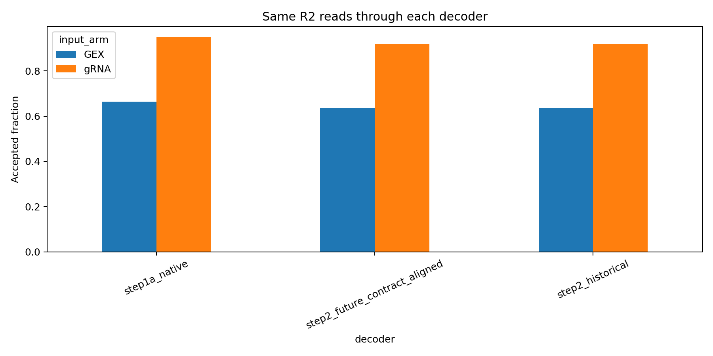

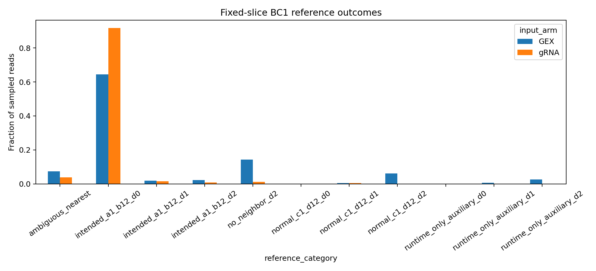

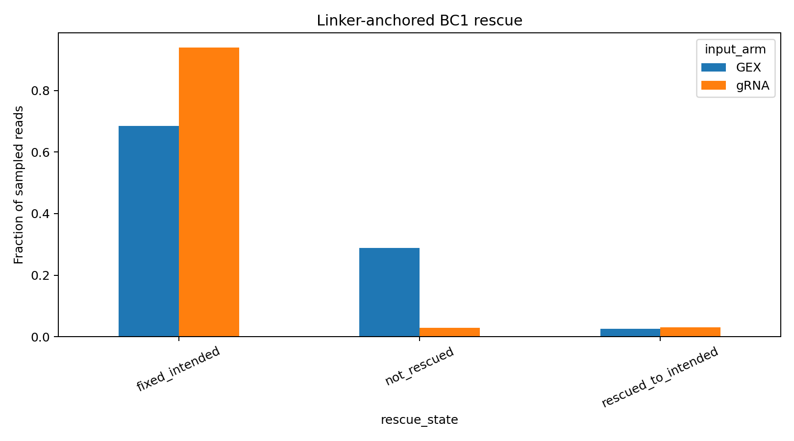

### Diagnostic design and decision rules

The lightweight audit uses four bound UGER tasks, one per sublibrary, and
examines both arms within each task. It reuses the barcode decoder and
calibration logic in `qc_gex_grna_contamination.py` and evaluates:

| Hypothesis | Diagnostic | Decision rule |
| --- | --- | --- |
| Generic sequencing/base-call quality | Per-cycle R2 Q30, N fraction, and mean quality in UMI/BC3/BC2/BC1 segments. | Supported if GEX-only quality loss co-localizes with the failing barcode segment. |
| Strict correction policy | Apply one harmonized exact/distance-1/distance-2 whitelist and identical combination-support rule to both arms. | Supported if the GEX–gRNA valid-rate gap largely closes under the same rule. |
| High-quality off-whitelist molecules | Among invalid reads, separate N/low-quality, no whitelist neighbor through distance 2, ambiguous neighbor, and unsupported corrected combination. | Supported if GEX failures remain high quality but have no unique whitelist-compatible barcode. |
| Round-specific chemistry/capture | Compare exact/perfect and correction-failure rates independently for BC1, BC2, and BC3. | Supported if loss is concentrated in one round, especially BC1, rather than distributed by cycle quality. |
| Wrong first-round namespace | Repeat calls with the intended 24-well BC1 namespace and the full 48-well kit namespace. | Supported if full-kit acceptance materially inflates gRNA validity; current guide-UMI groups outside wells 1–24 are <0.1%. |

Use deterministic read windows and publish only cycle/segment summaries,
failure counts, and correction-policy grids. Never publish read sequences or
identifiers. The primary comparison must apply the same whitelist, intended
first-round namespace, empirical-combination calibration, and maximum edit
distance to GEX and gRNA; otherwise “valid barcode” remains an arm-specific
pipeline statistic rather than a chemistry comparison.

## UMI recovery

| Library | GEX UMI total: GEX-good | GEX mean | GEX median | GEX UMI total: final-good | Final GEX mean | Final GEX median | gRNA UMI total: GEX-good | GEX-good gRNA mean | GEX-good gRNA median | gRNA UMI total: final-good | gRNA mean | gRNA median | Assignment-support UMI total | Assignment-support median |
| --- | --- | --- | --- | --- | --- | --- | --- | --- | --- | --- | --- | --- | --- | --- |
| C1 | 59,825,762 | 8,324.2 | 7,388.0 | 53,140,982 | 8,564.2 | 7,581.0 | 488,262 | 67.9 | 44.0 | 483,125 | 77.9 | 54.0 | 424,276 | 47.0 |
| C2 | 44,624,910 | 6,380.5 | 5,673.0 | 39,394,282 | 6,636.5 | 5,888.5 | 479,730 | 68.6 | 46.0 | 470,134 | 79.2 | 56.0 | 352,077 | 40.5 |
| T1 | 69,237,485 | 6,135.9 | 5,248.5 | 61,742,092 | 6,365.2 | 5,422.5 | 724,813 | 64.2 | 41.0 | 715,418 | 73.8 | 51.0 | 603,756 | 42.0 |
| T2 | 55,343,916 | 4,762.4 | 4,086.0 | 47,134,272 | 5,011.6 | 4,303.0 | 454,009 | 39.1 | 26.0 | 443,030 | 47.1 | 33.0 | 360,883 | 27.0 |
| Combined | 229,032,073 | 6,175.7 | 5,259.0 | 201,411,628 | 6,446.0 | 5,478.0 | 2,146,814 | 57.9 | 37.0 | 2,111,707 | 67.6 | 46.0 | 1,740,992 | 37.0 |

“gRNA UMI total” includes every construct-matched, collapsed guide UMI in the
cohort. “Assignment-support” sums the passing pair rows and can count evidence
more than once in multiplet cells; it is therefore a call-support metric rather
than a unique-molecule total.

Pre-collapse and directionally collapsed guide totals are:

| Library | Pre-collapse UMIs: GEX-good | Collapsed UMIs: GEX-good | Pre-collapse UMIs: final-good | Collapsed UMIs: final-good | Assignment-support UMIs |
| --- | --- | --- | --- | --- | --- |
| C1 | 577,080 | 488,262 | 571,645 | 483,125 | 424,276 |
| C2 | 675,377 | 479,730 | 664,960 | 470,134 | 352,077 |
| T1 | 875,362 | 724,813 | 865,280 | 715,418 | 603,756 |
| T2 | 565,629 | 454,009 | 553,532 | 443,030 | 360,883 |
| Combined | 2,693,448 | 2,146,814 | 2,655,417 | 2,111,707 | 1,740,992 |

## Barcode capacity and cell-loading limits

| Library | R1 wells | Barcode space | Operational max load | Expected final-good at max | Literal final-good-ratio max load | Loaded-cell collision fraction |
| --- | --- | --- | --- | --- | --- | --- |
| C1 | 24 | 221,184 | 22,118 | 8,445 | 57,923 | 9.5% |
| C2 | 24 | 221,184 | 22,118 | 8,079 | 60,548 | 9.5% |
| T1 | 24 | 221,184 | 22,118 | 11,442 | 42,753 | 9.5% |
| T2 | 24 | 221,184 | 22,118 | 11,094 | 44,094 | 9.5% |
| C1 | 96 | 884,736 | 88,473 | 33,783 | 231,698 | 9.5% |
| C2 | 96 | 884,736 | 88,473 | 32,318 | 242,197 | 9.5% |
| T1 | 96 | 884,736 | 88,473 | 45,770 | 171,017 | 9.5% |
| T2 | 96 | 884,736 | 88,473 | 44,378 | 176,381 | 9.5% |

The operational maximum uses barcode space divided by physically loaded cells
and is the collision-safe planning constraint. The larger “literal” maximum
instead divides barcode space by projected final-good cells and is shown only
to answer that alternative interpretation; cells lost during QC still occupied
barcodes and contributed collision risk.

Required loading and independent barcode namespaces:

| Library | Final-good target | Load point | Load +20% | R1 wells | Namespaces point | Namespaces +20% |
| --- | --- | --- | --- | --- | --- | --- |
| C1 | 10,000 | 26,189 | 31,427 | 24 | 2 | 2 |
| C1 | 10,000 | 26,189 | 31,427 | 96 | 1 | 1 |
| C1 | 25,000 | 65,472 | 78,567 | 24 | 3 | 4 |
| C1 | 25,000 | 65,472 | 78,567 | 96 | 1 | 1 |
| C1 | 50,000 | 130,943 | 157,132 | 24 | 6 | 8 |
| C1 | 50,000 | 130,943 | 157,132 | 96 | 2 | 2 |
| C1 | 100,000 | 261,886 | 314,264 | 24 | 12 | 15 |
| C1 | 100,000 | 261,886 | 314,264 | 96 | 3 | 4 |
| C2 | 10,000 | 27,376 | 32,852 | 24 | 2 | 2 |
| C2 | 10,000 | 27,376 | 32,852 | 96 | 1 | 1 |
| C2 | 25,000 | 68,439 | 82,127 | 24 | 4 | 4 |
| C2 | 25,000 | 68,439 | 82,127 | 96 | 1 | 1 |
| C2 | 50,000 | 136,877 | 164,253 | 24 | 7 | 8 |
| C2 | 50,000 | 136,877 | 164,253 | 96 | 2 | 2 |
| C2 | 100,000 | 273,754 | 328,505 | 24 | 13 | 15 |
| C2 | 100,000 | 273,754 | 328,505 | 96 | 4 | 4 |
| T1 | 10,000 | 19,330 | 23,196 | 24 | 1 | 2 |
| T1 | 10,000 | 19,330 | 23,196 | 96 | 1 | 1 |
| T1 | 25,000 | 48,325 | 57,990 | 24 | 3 | 3 |
| T1 | 25,000 | 48,325 | 57,990 | 96 | 1 | 1 |
| T1 | 50,000 | 96,650 | 115,980 | 24 | 5 | 6 |
| T1 | 50,000 | 96,650 | 115,980 | 96 | 2 | 2 |
| T1 | 100,000 | 193,299 | 231,959 | 24 | 9 | 11 |
| T1 | 100,000 | 193,299 | 231,959 | 96 | 3 | 3 |
| T2 | 10,000 | 19,937 | 23,925 | 24 | 1 | 2 |
| T2 | 10,000 | 19,937 | 23,925 | 96 | 1 | 1 |
| T2 | 25,000 | 49,841 | 59,810 | 24 | 3 | 3 |
| T2 | 25,000 | 49,841 | 59,810 | 96 | 1 | 1 |
| T2 | 50,000 | 99,682 | 119,619 | 24 | 5 | 6 |
| T2 | 50,000 | 99,682 | 119,619 | 96 | 2 | 2 |
| T2 | 100,000 | 199,363 | 239,236 | 24 | 10 | 11 |
| T2 | 100,000 | 199,363 | 239,236 | 96 | 3 | 3 |

## Sequencing-depth analysis for future screens

The sequencing unit used for planning is a paired-end read pair (one cluster
with one R1 and one R2 record). “R1+R2 reads” counts the two records
individually and is exactly twice the number of read pairs. UMIs are recovered
molecules, not sequencing reads; they cannot be known before sequencing, so
future orders should be specified from input-cell counts and the empirical
read-pair-per-loaded-cell rates below.

### Observed GEX depth

| Library | Raw read pairs | R1+R2 reads | Pairs/loaded | Pairs/GEX-good | Pairs/final-good | Pairs/final GEX UMI | Final-cohort GEX UMIs | Mean UMIs/final-good | Median UMIs/final-good |
| --- | --- | --- | --- | --- | --- | --- | --- | --- | --- |
| C1 | 452,146,811 | 904,293,622 | 27,824 | 62,912 | 72,868 | 8.51 | 53,140,982 | 8,564.2 | 7,581.0 |
| C2 | 363,646,678 | 727,293,356 | 22,378 | 51,994 | 61,261 | 9.23 | 39,394,282 | 6,636.5 | 5,888.5 |
| T1 | 440,532,021 | 881,064,042 | 23,495 | 39,040 | 45,416 | 7.14 | 61,742,092 | 6,365.2 | 5,422.5 |
| T2 | 424,520,644 | 849,041,288 | 22,641 | 36,530 | 45,138 | 9.01 | 47,134,272 | 5,011.6 | 4,303.0 |

### Observed gRNA depth

| Library | Raw read pairs | R1+R2 reads | Pairs/loaded | Pairs/GEX-good | Pairs/final-good | Pairs/final gRNA UMI | Final-cohort collapsed UMIs | Mean UMIs/final-good | Median UMIs/final-good | Median assignment support |
| --- | --- | --- | --- | --- | --- | --- | --- | --- | --- | --- |
| C1 | 13,892,550 | 27,785,100 | 855 | 1,933 | 2,239 | 28.76 | 483,125 | 77.9 | 54.0 | 47.0 |
| C2 | 32,510,872 | 65,021,744 | 2,001 | 4,648 | 5,477 | 69.15 | 470,134 | 79.2 | 56.0 | 40.5 |
| T1 | 25,001,193 | 50,002,386 | 1,333 | 2,216 | 2,577 | 34.95 | 715,418 | 73.8 | 51.0 | 42.0 |
| T2 | 20,313,405 | 40,626,810 | 1,083 | 1,748 | 2,160 | 45.85 | 443,030 | 47.1 | 33.0 | 27.0 |

### Four-library means and uncertainty

| Metric | Four-library mean (95% CI) | Observed range |
| --- | --- | --- |
| GEX-good cells expected per 10k loaded | 5,236 (3,627–6,845) | 4,304–6,198 |
| GEX-gRNA-good cells expected per 10k loaded | 4,415 (3,158–5,672) | 3,653–5,173 |
| GEX raw read pairs per loaded cell | 24,085 (20,046–28,124) | 22,378–27,824 |
| gRNA raw read pairs per loaded cell | 1,318 (530–2,106) | 855–2,001 |
| GEX raw read pairs per GEX-good cell | 47,619 (28,140–67,098) | 36,530–62,912 |
| gRNA raw read pairs per GEX-good cell | 2,636 (480–4,793) | 1,748–4,648 |
| GEX raw read pairs per GEX-gRNA-good cell | 56,171 (34,780–77,561) | 45,138–72,868 |
| gRNA raw read pairs per GEX-gRNA-good cell | 3,113 (589–5,637) | 2,160–5,477 |
| GEX pipeline sequencing saturation | 46.1% (38.0–54.3%) | 39.1–51.4% |
| gRNA saturation in GEX-good cells | 95.8% (93.4–98.1%) | 94.2–97.6% |
| Mean GEX UMIs per GEX-gRNA-good cell | 6,644 (4,315–8,974) | 5,012–8,564 |
| Mean collapsed gRNA UMIs per GEX-gRNA-good cell | 69 (45–94) | 47–79 |
| Recommended GEX read pairs per loaded cell | 21,676 (18,041–25,311) | 20,140–25,042 |
| Recommended gRNA read pairs per loaded cell | 412 (0–827) | 256–800 |
| Recommended GEX read pairs per GEX-gRNA-good cell | 50,554 (31,302–69,805) | 40,624–65,581 |
| Recommended gRNA read pairs per GEX-gRNA-good cell | 1,006 (0–2,268) | 515–2,191 |

These are unweighted means across C1, C2, T1, and T2. Parentheses show a
two-sided 95% Student-t confidence interval for the mean with 3 degrees of
freedom; physically impossible negative lower limits are bounded at zero.
With only four sublibraries, these intervals describe uncertainty in the pilot
mean and are not prediction intervals guaranteeing the performance of a new
library.

### Saturation-calibrated recommendation

| Library | GEX fraction | gRNA fraction | GEX target median UMI | gRNA target support median | GEX pairs/loaded cell | gRNA pairs/loaded cell |
| --- | --- | --- | --- | --- | --- | --- |
| C1 | 90% | 30% | 6,822.9 | 42.3 | 25,042 | 256 |
| C2 | 90% | 40% | 5,299.7 | 36.5 | 20,140 | 800 |
| T1 | 90% | 20% | 4,880.2 | 37.8 | 21,146 | 267 |
| T2 | 90% | 30% | 3,872.7 | 24.3 | 20,377 | 325 |

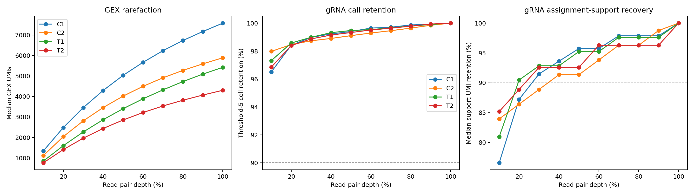

Across the four sublibraries, the saturation-adjusted
point estimate is **21,676 GEX read pairs per loaded
cell** (95% CI 18,041–25,311)
and **412 gRNA read pairs per loaded cell** (bounded
95% CI 0–827).
GEX saturation averaged 46.1%, whereas guide
saturation averaged 95.8%; the guide libraries
were therefore much more deeply sequenced relative to their recoverable
molecule complexity.

For one common depth specification that covers the most demanding observed
sublibrary, use approximately **25,042 GEX** and
**800 gRNA read pairs per physically loaded cell**. A
separate 20% operational reserve raises these to approximately
**30,051 GEX** and
**961 gRNA read pairs per loaded cell**.
The corresponding R1+R2 individual-read counts are twice these values.

### Expected cells and sequencing orders

### Projection from a known input-cell load

| Loaded cells | Expected GEX-good (95% CI) | Expected final-good (95% CI) | Recommended GEX pairs (95% CI) | Recommended gRNA pairs (95% CI) |
| --- | --- | --- | --- | --- |
| 10,000 | 5,236 (3,627–6,845) | 4,415 (3,158–5,672) | 216,762,341 (180,411,117–253,113,565) | 4,121,098 (0–8,266,669) |
| 22,118 | 11,580 (8,022–15,139) | 9,765 (6,985–12,546) | 479,434,947 (399,033,310–559,836,584) | 9,115,045 (0–18,284,218) |
| 88,473 | 46,322 (32,088–60,556) | 39,062 (27,939–50,186) | 1,917,761,463 (1,596,151,280–2,239,371,646) | 36,460,593 (0–73,137,699) |

### Projection from a desired final-good-cell target

| Target final-good | Expected loaded cells (95% CI) | Recommended GEX pairs (95% CI) | Recommended gRNA pairs (95% CI) |
| --- | --- | --- | --- |
| 10,000 | 23,207 (16,583–29,832) | 505,536,315 (313,024,033–698,048,597) | 10,064,705 (0–22,675,329) |
| 25,000 | 58,019 (41,458–74,580) | 1,263,840,787 (782,560,082–1,745,121,493) | 25,161,763 (0–56,688,322) |
| 50,000 | 116,037 (82,915–149,160) | 2,527,681,575 (1,565,120,163–3,490,242,987) | 50,323,526 (0–113,376,644) |
| 100,000 | 232,075 (165,830–298,320) | 5,055,363,150 (3,130,240,326–6,980,485,973) | 100,647,052 (0–226,753,289) |

All projections scale the four-library mean rates. The 24- and 96-well rows
correspond to the collision-safe caps of 22,118 and 88,473 physically loaded
cells. Values in parentheses are 95% CIs for the mean rate; they do not include
the separate 20% operational reserve.

### Explicit median-UMI targets

| Arm | Median UMI target | Libraries supported | Mean pairs/loaded (95% CI) | Maximum observed pairs/loaded | Unsupported libraries |
| --- | --- | --- | --- | --- | --- |
| GEX | 3,000 | 4/4 | 10,658 (6,760–14,556) | 13,585 | none |
| GEX | 5,000 | 3/4 | NA | 21,146 | T2 |
| GEX | 7,500 | 1/4 | NA | 27,824 | C2,T1,T2 |
| GEX | 10,000 | 0/4 | NA | NA | C1,C2,T1,T2 |
| gRNA | 5 | 4/4 | 132 (53–211) | 200 | none |
| gRNA | 10 | 4/4 | 132 (53–211) | 200 | none |
| gRNA | 20 | 4/4 | 132 (53–211) | 200 | none |
| gRNA | 40 | 3/4 | NA | 1,801 | T2 |

A confidence interval is reported only when all four libraries reached the
target within the measured rarefaction range. The conservative empirical
budget for an all-four-supported target is the maximum observed pairs per
loaded cell, not the upper confidence limit for the mean. In this pilot, a
3,000-median-GEX-UMI target and guide assignment-support targets through 20
median UMIs were supported in all four libraries. A 5,000-median-GEX-UMI target
was not reached by T2 even at full depth, so additional sequencing alone is not
pilot-supported as a universal solution.

Targets of 3k/5k/7.5k/10k median GEX UMIs and 5/10/20/40 median
assignment-supporting gRNA UMIs are evaluated in
`assets/pilot_4_sublib_audit/target_depth_grid.csv`. Targets above the observed
pilot curve are marked unsupported rather than extrapolated. Scenario-specific
read budgets are in `sequencing_scenarios.csv`; the CI source values and future
projections are in `four_library_ci_summary.csv`,
`future_input_cell_projection.csv`, and `future_final_cell_projection.csv`.

## From Raw Reads to Final Cells: Typical-Run Flow and Missing-Guide Diagnosis

### Worked example: 1,000 loaded cells

The example begins with **20,000,000 GEX read pairs**
and **1,000,000 gRNA read pairs** in one sublibrary.
Each stage is first estimated independently from C1, C2, T1, and T2 after
normalizing absolute measured depth by the number of physically loaded cells.
The table reports their unweighted mean and 95% Student-t CI. Cell calling is
fixed to the full-depth pilot cohort: these calculations do not claim that
split-pipe cell calling was rerun at the hypothetical depth.

| Arm | Stage | Unit | Four-library estimate, mean (95% CI) | Interpolation status |
| --- | --- | --- | --- | --- |
| GEX | requested raw read pairs | read_pairs | 20,000,000 (20,000,000–20,000,000) | requested_budget |
| GEX | pilot supported raw read pairs used | read_pairs | 20,000,000 (20,000,000–20,000,000) | interpolated_within_measured_depth |
| GEX | valid barcode pairs | read_pairs | 13,295,000 (12,695,452–13,894,548) | interpolated_within_measured_depth |
| GEX | transcriptome mapped usable pairs | read_pairs | 7,570,560 (7,289,885–7,851,235) | interpolated_within_measured_depth |
| GEX | mapped reads in gex good cells | read_pairs | 5,153,695 (5,034,030–5,273,360) | interpolated_within_measured_depth |
| GEX | all barcode umis | umis | 4,420,582 (3,623,104–5,218,060) | interpolated_within_measured_depth |
| GEX | gex good umis | umis | 2,946,092 (2,423,411–3,468,772) | interpolated_within_measured_depth |
| GEX | final good umis | umis | 2,591,034 (2,077,403–3,104,665) | interpolated_within_measured_depth |
| GEX | expected gex good cells fixed cohort | cells | 524 (363–684) | full_depth_cell_yield_fixed |
| GEX | expected final good cells fixed cohort | cells | 442 (316–567) | full_depth_cell_yield_fixed |
| gRNA | requested raw read pairs | read_pairs | 1,000,000 (1,000,000–1,000,000) | requested_budget |
| gRNA | pilot supported raw read pairs used | read_pairs | 963,732 (848,309–1,079,154) | capped_at_full_depth, interpolated_within_measured_depth |
| gRNA | valid barcode pairs | read_pairs | 883,778 (777,260–990,296) | capped_at_full_depth, interpolated_within_measured_depth |
| gRNA | structurally extracted reads | reads | 635,936 (567,315–704,557) | capped_at_full_depth, interpolated_within_measured_depth |
| gRNA | construct matched reads | reads | 631,914 (563,312–700,516) | capped_at_full_depth, interpolated_within_measured_depth |
| gRNA | matched reads in gex good cells | reads | 575,580 (509,091–642,070) | capped_at_full_depth, interpolated_within_measured_depth |
| gRNA | precollapse umis all barcodes | umis | 48,146 (36,280–60,011) | capped_at_full_depth, interpolated_within_measured_depth |
| gRNA | collapsed umis all barcodes | umis | 41,785 (29,956–53,615) | capped_at_full_depth, interpolated_within_measured_depth |
| gRNA | precollapse umis gex good | umis | 34,455 (24,721–44,189) | capped_at_full_depth, interpolated_within_measured_depth |
| gRNA | collapsed umis gex good | umis | 28,567 (18,931–38,202) | capped_at_full_depth, interpolated_within_measured_depth |
| gRNA | final good umis | umis | 28,155 (18,474–37,836) | capped_at_full_depth, interpolated_within_measured_depth |
| gRNA | assignment supporting umis | umis | 24,087 (14,788–33,385) | capped_at_full_depth, interpolated_within_measured_depth |
| gRNA | expected t5 guide positive cells | cells | 440 (314–567) | capped_at_full_depth, interpolated_within_measured_depth |

For C1, 1,000,000 requested gRNA pairs for 1,000 loaded cells exceeds the scaled pilot depth. Its downstream estimate is capped at 854,926 pairs and marked `capped_at_full_depth`; this conservative value is right-censored, not extrapolated.

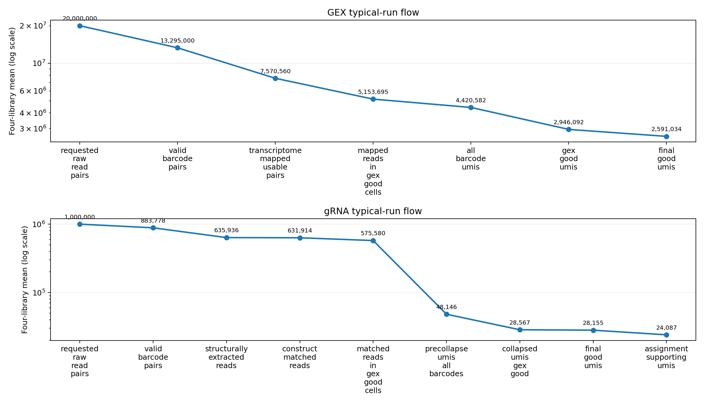

The detailed four-library values and interpolation status are in
`assets/pilot_4_sublib_audit/typical_run_read_flow.csv`. Read stages count
paired records until a stage explicitly says reads; UMI stages count recovered
molecules. Because library UMIs are unknown before sequencing, this flow should
be used in the forward direction: choose an input-cell count, order reads from
the empirical pairs-per-loaded-cell budget, and use the saturation/rarefaction
curves to estimate recoverable UMIs.

### Integrated missing-guide cell diagnostic

At the ≥1 collapsed-UMI evidence level, all 37,086 GEX-good cells partition as:

| Guide evidence | Cells | Fraction | Mapped GEX reads, median (IQR) | GEX UMIs, median (IQR) |
| --- | --- | --- | --- | --- |
| both_positions_detected | 32,507 | 87.65% | 10,271 (6,850–15,068) | 5,466 (3,668–7,941) |
| neither_position | 209 | 0.56% | 5,377 (3,841–7,218) | 2,807 (2,084–3,917) |
| position_1_only | 224 | 0.60% | 5,698 (4,032–8,786) | 2,997 (2,216–4,736) |
| position_2_only | 4,146 | 11.18% | 7,441 (5,039–11,192) | 3,964 (2,677–5,864) |

At the production threshold of 5 pair-supporting UMIs, the mutually exclusive
cell categories are:

| Production category | Cells | Fraction | Median mapped GEX reads |
| --- | --- | --- | --- |
| complete_singlet | 19,687 | 53.08% | 9,929 |
| inferred_pos1_missing_singlet | 4,431 | 11.95% | 8,603 |
| inferred_pos2_missing_singlet | 1,360 | 3.67% | 9,410 |
| multiplet | 5,768 | 15.55% | 14,646 |
| no_guide_call | 209 | 0.56% | 5,377 |
| subthreshold_evidence | 5,631 | 15.18% | 7,743 |

“Position 1 only” means position 2 is missing, while “position 2 only” means
position 1 is missing. Missing-guide cells have less GEX material on average,
including within each sublibrary:

| Library | Missing evidence | N | Median ratio vs both | Rank-biserial effect | BH-adjusted P |
| --- | --- | --- | --- | --- | --- |
| C1 | position_2_only | 779 | 0.811 | -0.237 | 7.48e-27 |
| C1 | position_1_only | 44 | 0.602 | -0.583 | 3.17e-11 |
| C1 | neither_position | 43 | 0.504 | -0.643 | 4.65e-13 |
| C2 | position_2_only | 655 | 0.696 | -0.361 | 6.34e-52 |
| C2 | position_1_only | 14 | 0.526 | -0.640 | 3.54e-05 |
| C2 | neither_position | 15 | 0.404 | -0.846 | 1.57e-08 |
| T1 | position_2_only | 1,124 | 0.742 | -0.302 | 1.08e-61 |
| T1 | position_1_only | 62 | 0.529 | -0.546 | 1.59e-13 |
| T1 | neither_position | 47 | 0.603 | -0.552 | 7.18e-11 |
| T2 | position_2_only | 1,588 | 0.748 | -0.285 | 1.08e-73 |
| T2 | position_1_only | 104 | 0.614 | -0.470 | 2.3e-16 |
| T2 | neither_position | 104 | 0.568 | -0.575 | 8.68e-24 |

The Mann–Whitney tests compare each missing-evidence category with cells where
both positions were detected. Negative rank-biserial effects mean lower values
in the missing category; P values are Benjamini–Hochberg corrected across the
reported within-library tests. This is evidence of correlation, not proof that
low starting material caused guide dropout. A low-material cell can reduce GEX
and guide capture together, but guide-specific expression, cassette integrity,
matching, and recombination can produce the same observed pattern.

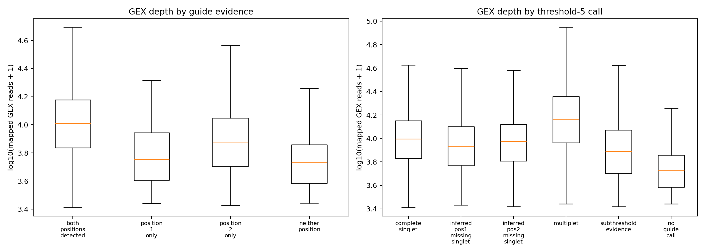

Guide-level expected-position dropout, restricted to guides with at least 20
evaluable complete/inferred singlets and accompanied by Wilson intervals, is in
`guide_position_dropout.csv`.

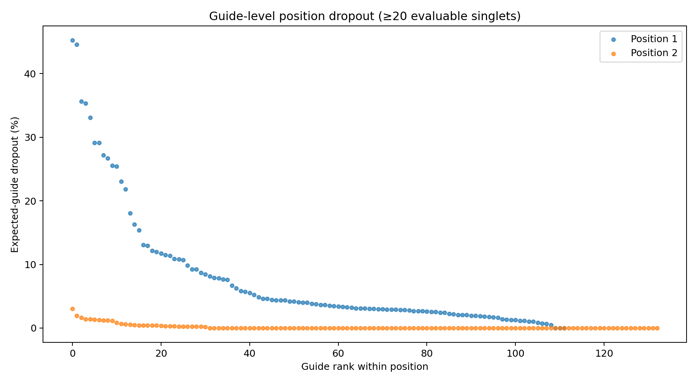

### Targeted raw-read replay and existing QC

The raw diagnostic deterministically selected at most 500 GEX-good cells per
production category and sublibrary, streamed each Step-2 barcode TSV once, and
reused the production Step-3 extraction decision and failure classifier.
Published outputs contain only aggregate counts and rates—no barcode, read ID,
or sequence.

| Library | Cell category | Selected cells | Diagnostic reads | Extraction-pass reads | Extraction-pass rate |
| --- | --- | --- | --- | --- | --- |
| C1 | complete_singlet | 500 | 860,127 | 672,899 | 78.2% |
| C1 | inferred_pos1_missing_singlet | 500 | 517,491 | 433,133 | 83.7% |
| C1 | inferred_pos2_missing_singlet | 266 | 255,311 | 171,763 | 67.3% |
| C1 | multiplet | 500 | 1,430,995 | 1,124,448 | 78.6% |
| C1 | no_guide_call | 43 | 235 | 9 | 3.8% |
| C1 | subthreshold_evidence | 500 | 135,103 | 95,550 | 70.7% |
| C2 | complete_singlet | 500 | 2,150,492 | 1,721,035 | 80.0% |
| C2 | inferred_pos1_missing_singlet | 500 | 1,216,319 | 1,012,477 | 83.2% |
| C2 | inferred_pos2_missing_singlet | 258 | 568,663 | 396,298 | 69.7% |
| C2 | multiplet | 500 | 3,662,878 | 2,930,972 | 80.0% |
| C2 | no_guide_call | 15 | 28 | 12 | 42.9% |
| C2 | subthreshold_evidence | 500 | 438,175 | 323,516 | 73.8% |
| T1 | complete_singlet | 500 | 948,298 | 739,604 | 78.0% |
| T1 | inferred_pos1_missing_singlet | 500 | 519,936 | 406,162 | 78.1% |
| T1 | inferred_pos2_missing_singlet | 382 | 408,476 | 279,979 | 68.5% |
| T1 | multiplet | 500 | 1,784,813 | 1,367,893 | 76.6% |
| T1 | no_guide_call | 47 | 869 | 420 | 48.3% |
| T1 | subthreshold_evidence | 500 | 177,915 | 129,906 | 73.0% |
| T2 | complete_singlet | 500 | 887,081 | 660,446 | 74.5% |
| T2 | inferred_pos1_missing_singlet | 500 | 474,688 | 370,733 | 78.1% |
| T2 | inferred_pos2_missing_singlet | 454 | 427,250 | 276,090 | 64.6% |
| T2 | multiplet | 500 | 1,535,937 | 1,160,168 | 75.5% |
| T2 | no_guide_call | 104 | 3,087 | 1,410 | 45.7% |
| T2 | subthreshold_evidence | 500 | 162,414 | 113,632 | 70.0% |

Existing construct and assignment QC contributes the following independent
evidence:

| Existing QC evidence | Estimate |
| --- | --- |
| Q1 construct intact rate | 74.92% |
| Q1 position-1 deletion rate | 2.20% |
| Q1 position-2 deletion rate | 2.34% |
| Q2 threshold-5 iBAR-decoupled evidence | 0.84% |
| Q2 threshold-5 cells with decoupling evidence | 1.38% |
| Q2 fitted dropout parameter d | 10.95% |
| Q2 fitted silencing parameter s | 15.71% |
| Q2 fitted recombination parameter r | 16.53% |

### Cause-evidence matrix

| Candidate cause | Assessment | Evidence |
| --- | --- | --- |
| Low cell material | supported | Missing-position cells have lower within-library GEX mapped-read distributions; this is an association, not a causal test. |
| Insufficient guide sequencing depth | unsupported | Pilot gRNA saturation and rarefaction retain most threshold-5 calls at substantially reduced depth; deeper reads cannot restore absent molecules. |
| Position-specific expression or capture | supported | Position 1 was missing in 4,146 evidence-level cells versus position 2 in 224. |
| Guide-specific performance | supported | Expected-guide dropout rates vary across guide identities after requiring at least 20 evaluable singlets. |
| Extraction or construct matching failure | suggestive | Targeted raw-read replay compares structural pass/failure signatures by cell category; global Step-3 losses establish opportunity but not causality. |
| iBAR decoupling | unsupported | Q2 threshold-5 decoupled evidence was 0.84%. |
| Construct deletion or recombination | supported | Q1 construct-intact rate averaged 74.9%; Q1/Q2 also observed deletion/recombination signatures. |
| Transcriptional silencing | not distinguishable | The pilot has no direct cassette-expression assay independent of capture and sequencing. |
| Antibiotic escape | not distinguishable | Selection survival was observed, but survival does not prove that both guide cassettes remained intact, expressed, captured, and matchable. |
| Barcode collision | suggestive | Barcode occupancy predicts a non-zero shared-barcode fraction, but this audit cannot link individual missing-guide cells to physical collisions. |

Antibiotic survival does **not** prove that both guide cassettes remained
intact, expressed, captured, and matchable. The data support a low-cell-material
association and position/guide-specific effects, while direct separation of
silencing from capture failure or antibiotic escape requires an orthogonal
cassette-expression or construct-integrity assay.

## Technical limitations

- Barcode occupancy assumes uniform and independent use of all combinations;
  barcode imbalance raises collision risk.
- Loading recovery is based on one pilot realization per sublibrary. The 20%
  reserve is an operational margin, not a statistical confidence interval.
- GEX rarefaction fixes the full-depth GEX-good cohort and measures UMI
  coverage; it does not rerun split-pipe cell calling at each depth.
- Read-depth recommendations preserve pilot library quality and chemistry.
  Changes in viability, library complexity, guide design, or sequencing cycle
  configuration require a new pilot calibration.

<!-- BEGIN FULL-RAW GEX RRNA AUDIT -->
## Full-Raw GEX rRNA Burden and Barcode Failure

This census classifies all 1,680,846,154 raw GEX read
pairs. The headline rRNA definition is based on the cDNA mate (R1: at least 50
aligned bases at at least 95% identity) and is applied before barcode status is
used. Every rejected R2 is analyzed separately for mate support and junction
structure. Confidence intervals on each read fraction are Wilson intervals;
the four-library mean uses a Student-t interval and describes uncertainty in
this pilot mean, not a future-library prediction.

| Sublibrary | Raw pairs | R1 rRNA | All raw | Valid-BC rRNA | Rejected-BC rRNA |
|---|---:|---:|---:|---:|---:|
| C1 | 452,146,811 | 149,325,804 | 33.0% | 30.2% | 39.0% |
| C2 | 363,646,678 | 121,621,234 | 33.4% | 30.9% | 38.6% |
| T1 | 440,532,021 | 143,593,650 | 32.6% | 28.9% | 40.2% |
| T2 | 424,520,644 | 133,270,520 | 31.4% | 27.9% | 37.6% |
| **Combined** | **1,680,846,154** | **547,811,208** | **32.6%** | **29.5%** | **38.8%** |

Across the four libraries, 547,811,208 pairs
(32.6%) are R1 rRNA-positive. The unweighted
library mean is 32.6% (95% Student-t CI
31.2%–34.0%).
Barcode-rejected reads contribute
39.9% of all R1 rRNA
reads. Barcode failure occurs in
39.9% of rRNA reads versus
30.4% of non-rRNA reads
(risk ratio 1.31). This association
supports rRNA as a contributor to barcode loss but does not, on its own, prove
misligation.

The leading rRNA families/regions are 18S 66.9%, 28S 20.5%, MT-RNR2 9.2%, MT-RNR1 3.2%, ITS 0.1%, ETS 0.0%. Among rejected reads, the
strict direct L12-side junction category contains
8,519,813 pairs, including
8,313,745 with concordant
R1 rRNA support. These strict boundary calls are reported separately from
general rRNA association.

In the deterministic barcode-valid reconciliation sample, 96.0% of reads that would exceed the production STAR three-locus limit are explicitly rRNA-compatible.

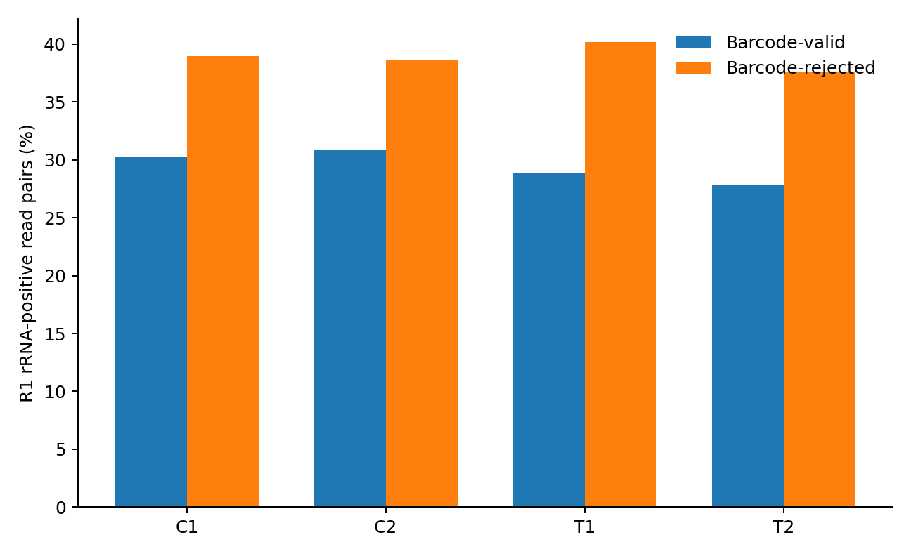

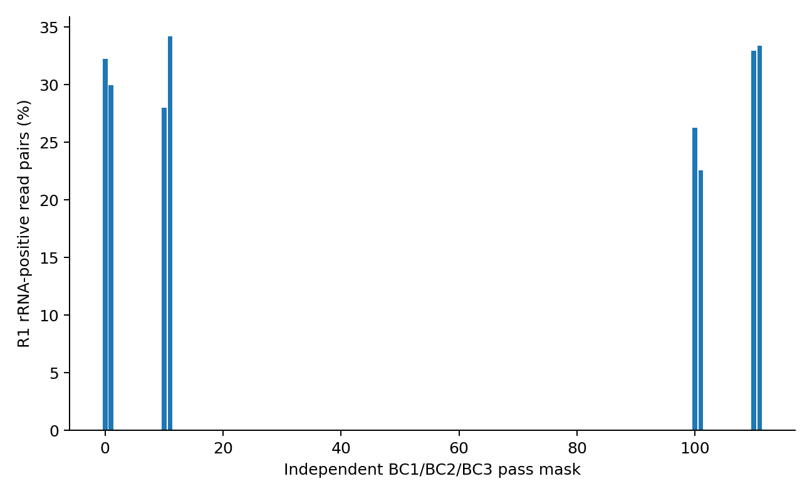

### Depletion decision model

The primary opportunity calculation uses the all-raw R1 rRNA fraction, not
only barcode-valid reads. Under 90% rRNA depletion and 95% non-rRNA retention,
the estimated read-pair budget for the same non-rRNA yield is
70.8% of the current
budget, a saving of approximately 490,146,870
pairs across these four libraries. Pre-RT depletion can reduce both rRNA
capture and abnormal ligation; post-barcoding depletion can reduce sequencing
waste but cannot repair barcode failures. The break-even coefficient is the
reported read-pair saving multiplied by the local sequencing price per read
pair; depletion is cost-saving only when its incremental preparation cost is
below that value.

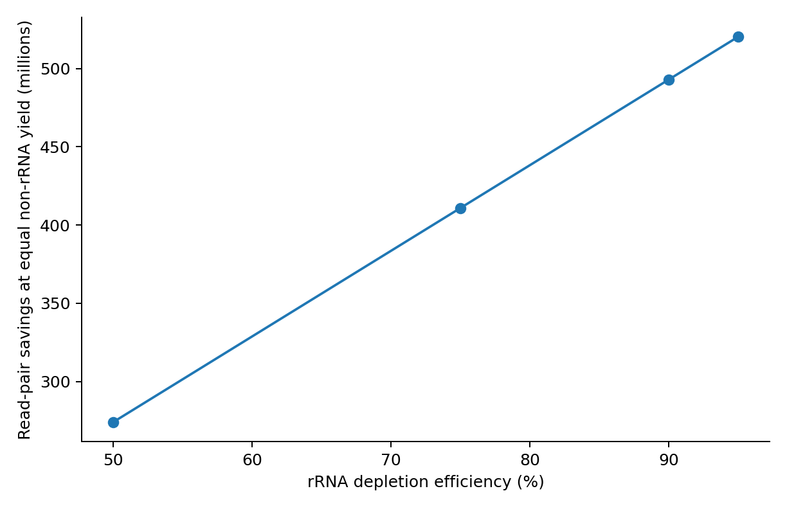

Detailed reconciled tables are stored under
`output/pilot_4_sublib_audit/rrna_barcode_diagnostic/aggregate/`; only the small
report-facing tables and plots are copied into `docs/assets`.
<!-- END FULL-RAW GEX RRNA AUDIT -->
