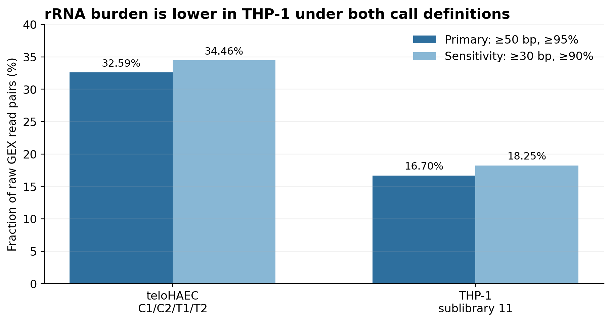
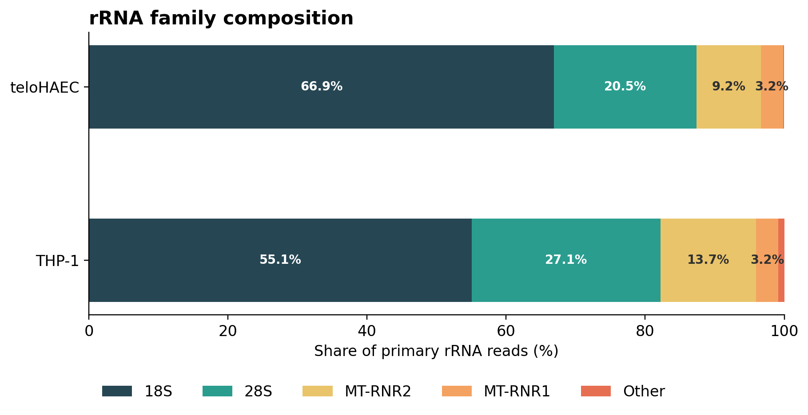
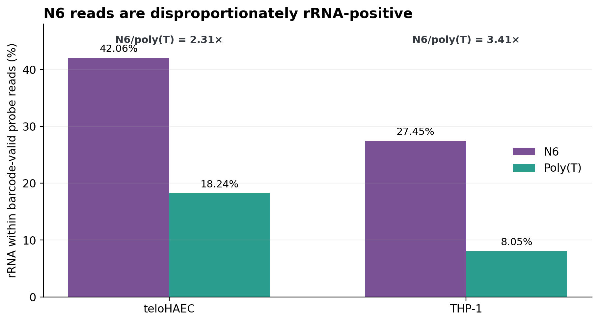

# GEX rRNA Burden and Barcode Recovery

> **Report scope (v2.0 documentation update).** Results below retain the
> dataset, pipeline version and methods stated in their provenance. For current
> installation and commands, use the [quick start](QUICKSTART.md),
> [configuration reference](CONFIGURATION.md) and [UGER resource guide](UGER_RESOURCES.md).
> Historical counts/timings are not measurements of the new kallisto backend.
> The maintained read-recovery and rRNA entry points are
> `submit/submit_gex_grna_read_recovery.sh` and `submit/submit_gex_rrna_audit.sh`.
> Earlier one-use wrappers are [archived](../archive/audit_workflows/2026_pilot/README.md).
> Raw barcode–UMI recovery is a molecule proxy; it is not automatically
> a gene-resolved expression UMI count under the Step 1a correction/assignment policy.

## Comparative audit of teloHAEC and THP-1 libraries

**Team report · 30 July 2026**

This report compares two complete raw-read censuses:

- teloHAEC pilot: C1, C2, T1, and T2, totaling 1,680,846,154 GEX read pairs.
- THP-1: sublibrary 11 across 16 FASTQ lane pairs, totaling 1,294,325,137
  GEX read pairs.

Both audits completed their internal reconciliation checks. Counts are raw
paired-end records; rRNA status is determined from the GEX R1 cDNA mate.

## Executive summary

1. **The teloHAEC libraries have the larger rRNA burden.** High-confidence
   rRNA represents 32.59% of teloHAEC raw pairs versus 16.70% in THP-1.
   The permissive sensitivity tier gives the same ordering: 34.46% versus
   18.25%.
2. **Random-hexamer capture is the dominant rRNA source in barcode-valid
   reads.** N6 reads are 2.31-fold more likely than poly(T) reads to be rRNA in
   teloHAEC and 3.41-fold more likely in THP-1.
3. **rRNA and barcode failure are not coupled consistently across projects.**
   rRNA is associated with greater barcode failure in teloHAEC but slightly
   lower barcode failure in THP-1. rRNA depletion should therefore be assessed
   primarily as a sequencing-efficiency intervention, not as a guaranteed
   barcode-rescue strategy.
4. **The theoretical sequencing opportunity differs materially.** With perfect
   rRNA removal and no non-rRNA loss, the upper-bound raw read-pair savings are
   approximately 32.6% for teloHAEC and 16.7% for THP-1.

## 1. Audit definitions and comparability

| Property | teloHAEC C1/C2/T1/T2 | THP-1 sublibrary 11 |
|---|---|---|
| Raw GEX pairs | 1,680,846,154 | 1,294,325,137 |
| Input grouping | Four sublibraries | One sublibrary, 16 lane pairs |
| R1 length | 150 nt | 54 nt |
| R2 use for headline rRNA | Excluded | Excluded; technical amplicon only |
| Primary rRNA call | ≥50 aligned bases at ≥95% identity | ≥50 aligned bases at ≥95% identity |
| Sensitivity call | ≥30 aligned bases at ≥90% identity | ≥30 aligned bases at ≥90% identity |
| Barcode reference | Pilot Step 1a contract | Parse WT-mega v3, all A1–H12 wells |

The primary criterion is the same absolute rule in both audits. It is
fractionally stricter for the 54-nt THP-1 R1 because at least 50 of 54 bases
must align. Consequently, the primary rates are not perfectly read-length
matched. However, the sensitivity-tier result also remains much lower in
THP-1, indicating that read length alone is unlikely to explain most of the
difference. A definitive length-controlled comparison would truncate a
deterministic teloHAEC R1 sample to 54 nt and realign it.

The rRNA reference contains mature nuclear and mitochondrial rRNAs,
pre-rRNA regions, and an rRNA-pseudogene sensitivity panel. Ribosomal-protein
mRNAs are excluded.

## 2. rRNA burden

| Population | teloHAEC rRNA pairs | teloHAEC fraction | THP-1 rRNA pairs | THP-1 fraction |
|---|---:|---:|---:|---:|
| All raw, primary | 547,811,208 | 32.59% | 216,123,680 | 16.70% |
| All raw, sensitivity | 579,243,804 | 34.46% | 236,214,453 | 18.25% |
| Barcode-valid, primary | 329,224,928 | 29.45% | 154,668,036 | 17.44% |
| Barcode-rejected, primary | 218,586,280 | 38.82% | 61,455,644 | 15.08% |

Under the primary definition, THP-1 has approximately 49% fewer rRNA reads as
a fraction of raw sequencing than teloHAEC. Relaxing the call adds 1.87
percentage points in teloHAEC and 1.55 points in THP-1; it does not close the
between-project gap.

### rRNA family composition

| Family | teloHAEC share of rRNA | THP-1 share of rRNA |
|---|---:|---:|
| 18S | 66.91% | 55.07% |
| 28S | 20.48% | 27.14% |
| MT-RNR2 | 9.23% | 13.74% |
| MT-RNR1 | 3.19% | 3.19% |
| Other annotated regions | 0.18% | 0.86% |

Both projects are dominated by mature ribosomal species. THP-1 has a smaller
18S share and larger 28S and mitochondrial shares.

## 3. Round-1 probe type and rRNA capture

Probe comparisons are restricted to barcode-valid pairs whose Round-1 BC1
resolves to a recorded probe type. The apparent capture rate is the fraction
of reads assigned to that probe type whose R1 is rRNA-positive; it can reflect
reverse transcription, amplification, and sequencing biases in addition to
biochemical capture.

| Metric | teloHAEC | THP-1 |
|---|---:|---:|
| N6 barcode-valid pairs | 526,165,581 | 429,315,153 |
| Poly(T) barcode-valid pairs | 591,606,940 | 457,170,630 |
| N6 rRNA pairs | 221,321,072 | 117,851,444 |
| Poly(T) rRNA pairs | 107,903,856 | 36,780,699 |
| rRNA rate within N6 | 42.06% | 27.45% |
| rRNA rate within poly(T) | 18.24% | 8.05% |
| N6/poly(T) rRNA rate ratio | 2.31× | 3.41× |
| Relative N6 increase | 130.62% | 241.21% |
| N6 share of barcode-valid rRNA | 67.22% | 76.20% |

N6 and poly(T) contribute broadly similar barcode-valid read counts, but N6
contributes most barcode-valid rRNA in both projects. This makes N6 fraction
or N6 chemistry a logical experimental variable, although reducing N6 can
also remove useful non-polyadenylated transcript coverage.

## 4. Barcode recovery and its relationship to rRNA

| Metric | teloHAEC | THP-1 |
|---|---:|---:|
| Production barcode-valid | 66.50% | 68.51% |
| Independent BC1 pass | 76.99% | 80.57% |
| Independent BC2 pass | 89.09% | 87.14% |
| Independent BC3 pass | 94.69% | 88.43% |
| Barcode failure among rRNA | 39.90% | 28.44% |
| Barcode failure among non-rRNA | 30.40% | 32.10% |
| Failure risk ratio, rRNA/non-rRNA | 1.31× | 0.89× |

The direction of association reverses between projects. In teloHAEC, rRNA
reads are enriched among barcode failures; in THP-1, they are modestly
depleted among failures. These data do not support a universal model in which
rRNA capture causes barcode failure. Project-specific probe chemistry,
ligation behavior, sample preparation, and barcode contracts remain relevant.

## 5. Implications for experimental design

### rRNA depletion

- The maximum sequencing fraction recoverable under ideal depletion is bounded
  by the observed raw rRNA burden: approximately 32.6% in teloHAEC and 16.7%
  in THP-1.
- Actual savings will be smaller if depletion is incomplete or removes
  non-rRNA material.
- Pre-RT depletion could reduce both rRNA capture and any upstream molecular
  interference. Post-barcoding depletion can reduce sequencing waste but
  cannot repair molecules whose barcode structure was already lost.

### N6 optimization

- N6 is the majority source of barcode-valid rRNA in both projects.
- A reduction or redesign of N6 capture may be more targeted than global
  depletion, but its effect on useful non-polyadenylated RNA and gene recovery
  must be measured.
- The stronger N6/poly(T) rate ratio in THP-1 does not imply that THP-1 has
  more total rRNA; both N6 and poly(T) rRNA rates are lower than in teloHAEC.

### Recommended experiment

Use a matched split-sample design containing:

1. Current protocol.
2. Pre-RT rRNA depletion.
3. Reduced N6 fraction.
4. Combined depletion and reduced N6, if cell input permits.

Sequence all arms to a common initial depth and compare raw rRNA fraction,
barcode-valid fraction, GEX-good recovery, median GEX UMIs, genes per cell,
sequencing saturation, and non-rRNA reads retained per input cell. The decision
criterion should be usable GEX molecules gained per added preparation cost,
not rRNA removal alone.

## 6. Limitations

- This is an across-project comparison, not a randomized protocol experiment.
- Cell type, sample preparation, library construction, read length, barcode
  namespace, and sequencing run differ.
- The identical 50-base primary threshold is relatively stricter for THP-1's
  54-nt R1 than for teloHAEC's 150-nt R1.
- THP-1 R2 is only 61 nt and contains essentially the Parse technical
  amplicon, so paired-mate rRNA confirmation was disabled.
- Probe-specific rates are read-pair observations, not direct estimates of
  molecule-level reverse-transcription efficiency.
- rRNA association does not establish a molecular cause for barcode failure.

## Source audits

- [`PILOT_4_SUBLIB_RRNA_BARCODE_REPORT.md`](PILOT_4_SUBLIB_RRNA_BARCODE_REPORT.md)
- [`THP_1_sublib11_RRNA_AUDIT.md`](../output/THP_1_sublib11/rrna_barcode_diagnostic/THP_1_sublib11_RRNA_AUDIT.md)

Both source audits report completed reconciliation, raw = valid + rejected,
and rRNA partitioning by barcode status.
