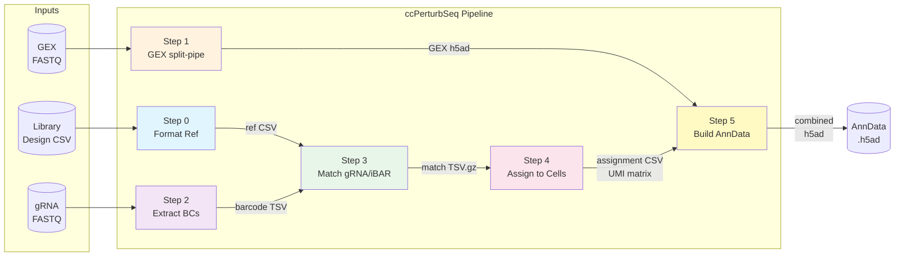
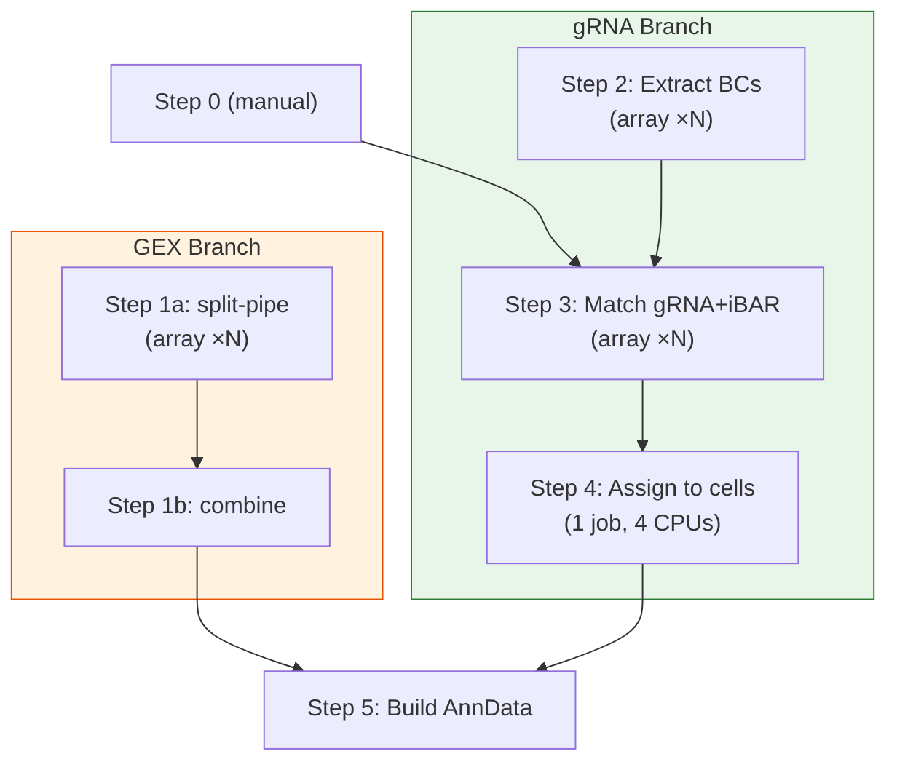
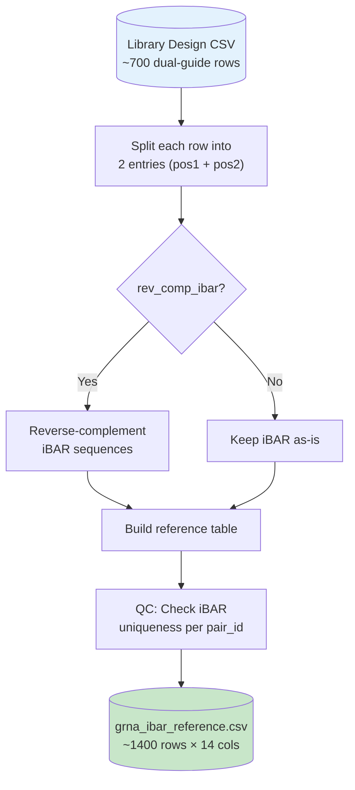
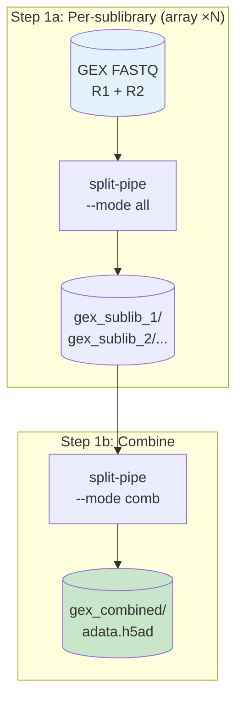
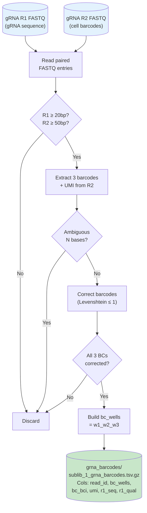
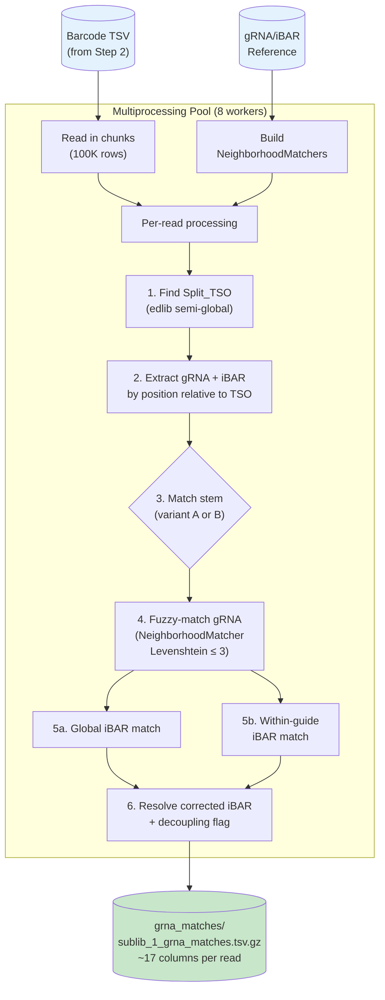
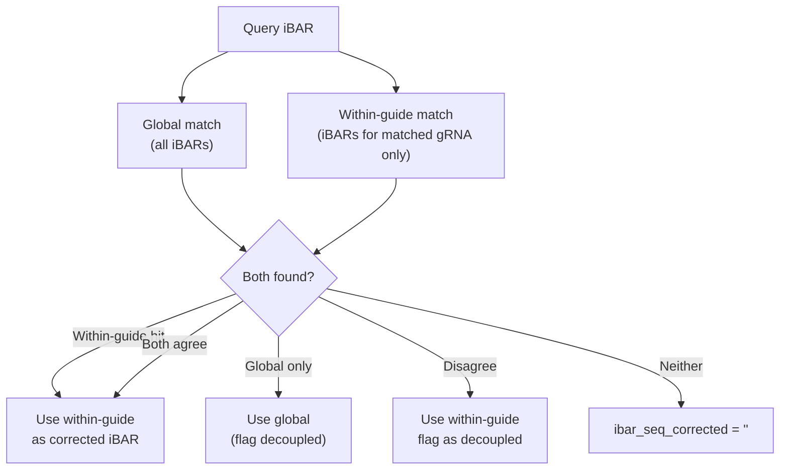
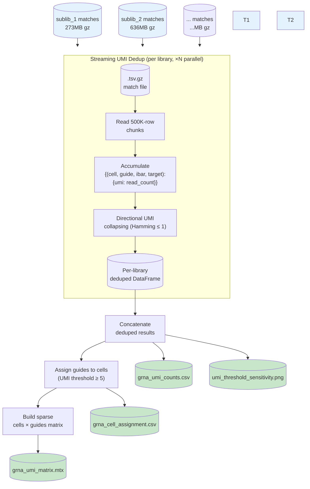
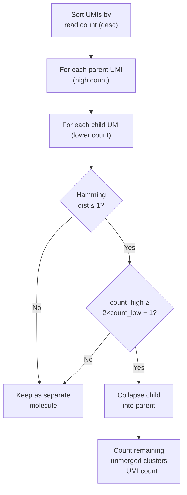
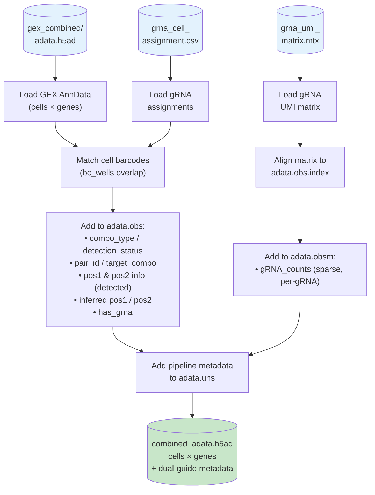

# CSM ccPerturbSeq Pipeline — Full Walkthrough

## Pipeline Overview

A 6-step pipeline for processing CROPseq-multi (CSM) dual-guide Perturb-seq data from Parse Biosciences, from raw FASTQ to analysis-ready AnnData.



---

## Quick Start

### 1. Prerequisites

#### Parse Biosciences split-pipe (v1.6.4)

The GEX processing step (Step 1) requires the Parse Biosciences `split-pipe` pipeline.
Download from Parse Biosciences and extract into the project directory:

```
CSM_ccperturbseq/
└── ParseBiosciences-Pipeline.1.6.4/
    ├── split-pipe                          # Main executable
    ├── splitpipe/                          # Python package
    ├── setup.py                            # pip-installable
    ├── install_dependencies_conda.sh       # System deps (conda)
    └── install_dependencies.sh             # System deps (apt/sudo)
```

#### Conda environment setup

split-pipe v1.6.4 requires **Python ≥ 3.12.8**. Create a dedicated conda environment:

```bash
# 1. Create environment with required Python version
conda create -n splitpipe python=3.12.8
conda activate splitpipe

# 2. Install system-level dependencies via the Parse conda script
#    (samtools ≥1.16, STAR ≥2.7, gcc ≥15, numba, libxcrypt, libxml2, pigz)
cd ParseBiosciences-Pipeline.1.6.4/
bash install_dependencies_conda.sh --install --yes

# 3. Install split-pipe and its Python dependencies
#    (numpy ≥2.0, pandas ≥2.2, scipy, matplotlib, scanpy ≥1.8, anndata,
#     h5py, pysam ≥0.20.0, leidenalg, python-igraph, natsort, jinja2,
#     psutil, indexed_gzip, python-calamine, Cython)
pip install .

# 4. Install additional pipeline-specific dependencies
pip install pyyaml edlib
```

> [!IMPORTANT]
> Use **either** `install_dependencies_conda.sh` (no sudo, recommended for HPC) **or** `install_dependencies.sh` (requires sudo, for Ubuntu/AWS). Do **not** run both — the scripts check for each other's log file and will refuse to run if the other was used.

> [!NOTE]
> `edlib` (≥1.3) provides C-accelerated bit-parallel Levenshtein alignment used in Steps 2–3 for TSO finding and gRNA matching (~50× faster than the pure-Python fallback). The pipeline will still run without it, but gRNA matching will be **significantly slower**.

#### STAR genome reference

A pre-built STAR genome reference is required for Step 1. Build once with:

```bash
split-pipe --mode mkref \
    --genome_name GRCh38 \
    --fasta /path/to/genome.fa \
    --genes /path/to/genes.gtf \
    --output_dir /path/to/parse_refdata-gex-GRCh38/
```
> [!NOTE]
> I used the reference genome and GTF file from 10X (version 2024A) `refdata-gex-GRCh38-2024-A`.

Set the paths in `config.yaml` under `paths.splitpipe_dir` and `paths.genome_dir`.

#### UGER / UGE cluster access

The submission scripts target the Broad Institute UGER cluster (`-q broad`). You need:
- Access to the `broad` queue
- `qsub` available in your `$PATH`
- A writable log directory (configurable via `paths.log_dir` in `config.yaml`)

### 2. Directory Structure

```
CSM_ccperturbseq/
├── config.yaml                          # All pipeline parameters
├── pipeline_overview.md                 # This document
├── ParseBiosciences-Pipeline.1.6.4/     # split-pipe installation
├── references/
│   ├── grna_ibar_reference.csv          # Generated by Step 0
│   └── example_grna_ibar_reference.csv  # Example showing expected format
├── scripts/
│   ├── 00_format_reference.py           # Step 0: Design → reference
│   ├── 02_extract_grna_barcodes.py      # Step 2: R2 barcode extraction
│   ├── 03_match_grna_ibar.py            # Step 3: gRNA + iBAR matching
│   ├── 04_assign_grna_to_cells.py       # Step 4: UMI dedup + assignment
│   ├── 05_build_anndata.py              # Step 5: Build AnnData
│   └── splitpipe_wrapper.py             # Wrapper fixing split-pipe comb bugs
├── submit/
│   ├── submit_pipeline.sh               # Master orchestration script
│   ├── submit_step1a_gex_array.sh       # Step 1a: GEX per-sublibrary
│   ├── submit_step1b_gex_combine.sh     # Step 1b: Combine GEX
│   ├── submit_step2_barcodes.sh         # Step 2: Barcode extraction
│   ├── submit_step3_match.sh            # Step 3: gRNA matching
│   ├── submit_step4_assign.sh           # Step 4: Assignment
│   └── submit_step5_anndata.sh          # Step 5: AnnData builder
├── fastq/                               # Raw FASTQ files
└── output/                              # All pipeline outputs
```

### 3. Configuration

Edit `config.yaml` to match your experiment:

1. **Paths** — Set `project_dir`, `fastq_dir`, `splitpipe_dir`, `genome_dir`, `output_dir`, and `grna_reference`.
2. **Libraries** — Define each sublibrary with `sublibrary_name`, `gex_prefix`, `grna_prefix`, and `sample_name`. Sublibraries sharing a `sample_name` (e.g., "Control") will be merged in Step 1b.
   - **Important:** The pipeline searches for your FASTQ files using the shell pattern `*{prefix}*_R1_*.fastq.gz` (and `_R2_`). To verify that your prefix correctly matches the intended files, you can test it by running: 
   ```bash
   find /path/to/fastq -name "*<your_prefix>*_R1_*.fastq.gz"
   ```
3. **Design** (optional) — If you have a CSM design file from the [CROPseq-multi](https://github.com/rtwalton/CROPseq-multi) package, set `design.design_file` and run Step 0 to auto-generate the reference.

### 4. Running on UGER

#### Full pipeline (all steps, with dependency chaining)

```bash
conda activate splitpipe
bash submit/submit_pipeline.sh
```

This automatically:
- Detects the number of sublibraries from `config.yaml`
- Submits Steps 1a → 1b → 2 → 3 → 4 → 5 with `qsub -hold_jid` dependency chains
- Array jobs run in parallel across sublibraries

#### Selective steps

```bash
# Run only Steps 4 and 5 (e.g., after re-tuning UMI threshold)
bash submit/submit_pipeline.sh --step 4,5

# Dry run — show qsub commands without executing
bash submit/submit_pipeline.sh --dry-run

# Custom config path
bash submit/submit_pipeline.sh --config /path/to/my_config.yaml
```

#### Step 0 (run locally, not on cluster)

Step 0 is fast and runs locally — it converts the CSM design file to the pipeline reference format:

```bash
python scripts/00_format_reference.py --config config.yaml
```

#### Monitoring jobs

```bash
qstat -u $(whoami)                       # View running/queued jobs
cat <log_dir>/step1a_gex.*.log           # Check Step 1a logs (log_dir from config.yaml)
```

### 5. Output

After the pipeline completes, the primary output is:

| File | Location | Description |
|------|----------|-------------|
| `combined_adata.h5ad` | `output/gex_combined/` | Final AnnData with GEX + gRNA |
| `grna_pair_assignment.csv` | `output/grna_assignment/` | Per-cell dual-guide pair calls |
| `grna_umi_matrix.mtx` | `output/grna_assignment/` | Sparse UMI count matrix |
| `qc_stats.yaml` | `output/grna_assignment/` | Pipeline QC metrics |

### 6. Notes for Single-Guide Mode

By default the pipeline expects dual_targart guide design with iBARs. To run the pipeline on a single-guide library (where a guide unit is simply `gRNA-stem-iBAR` or `gRNA-stem`):

1. **Update `config.yaml`**: 
   - Set `single_guide_mode: true` under `grna_structure`.
   - If your library also lacks an iBAR, set `ibar_length: 0`.  
2. **Library Design CSV**: 
   - Provide a simple design CSV with columns `sgRNA_ID`, `spacer`, and `target` (and optionally `iBAR` if `ibar_length > 0`). 
   - Run Step 0 with:
    ```bash
    conda activate splitpipe
    python scripts/00_format_reference.py --config config.yaml
    ```
    The script will automatically resolve `mode` from the provided config file, but you can also manually specify `--mode single` when running this step.
3. **Verify Read Structure**: 
The pipeline locates gRNA(spacer) and iBAR from R1 of the gRNA library assuming the following read structure: 
`variable_length`-`TSO(fixed_seq_1)`-`spacer`-`stem(fixed_seq_2/3)`-`iBAR`-`tracr(fixed_seq_4/5)`
If you are not using the standard CROP-seq-multi vector, carefully check the R1 FASTQ from your gRNA library manually to:
   - Verify that the gRNA sequence (spacer) is correctly bounded by the **TSO** (upstream) and the **stem** (downstream).
   - If using iBARs, verify that the iBAR is correctly bounded by the **stem** (upstream) and the **tracr** (downstream).
   - Update `fixed_seq_1` (TSO), `fixed_seq_2` (stem), and `fixed_seq_4` (tracr) in `config.yaml` with the exact sequences observed in your R1 reads. `fixed_seq_3` and `fixed_seq_5` will not be used in the single-guide mode and you may leave them empty. 

## UGER Job Dependency Chain



> [!TIP]
> GEX and gRNA branches run in **parallel** — they only merge at Step 5. 
> You can test guide extraction and assignment with different parameters by re-runing Step 3, 4 and 5 with modified `config.yaml`.

---

## Step 0: Format Reference

**Script**: [00_format_reference.py](file:///medpop/rgupta/Jiahao/TIMI/CSM_ccperturbseq/scripts/00_format_reference.py)  
**Run**: Manual (one-time)

Converts the dual-guide library design file into the gRNA/iBAR reference lookup used by downstream steps.



| Input column | Output (Position 1) | Output (Position 2) |
|---|---|---|
| `spacer_1` | `grna_seq` | — |
| `spacer_2` | — | `grna_seq` |
| `iBAR_1` | `ibar_seq` (rev-comp) | — |
| `iBAR_2` | — | `ibar_seq` (rev-comp) |
| `target` | `target_combo` | `target_combo` |
| — | `stem_variant = A` | `stem_variant = B` |

#### Reference overlap check

When run with `--config`, Step 0 automatically checks whether the configured `max_lev_dist` and `max_lev_dist_ibar` could cause **ambiguous matching** in Step 3. The check computes all pairwise Levenshtein distances between gRNA sequences and between iBARs within each gRNA, classifying pairs into three zones:

| Zone | Condition | Impact |
|------|-----------|--------|
| **CRITICAL** | d(A,B) ≤ max_lev_dist | A read from ref A with ≤max_lev_dist errors matches ref B equally → **guaranteed ambiguity**. Read is **discarded** (not mis-assigned). |
| **WARNING** | max_lev_dist < d(A,B) ≤ 2×max_lev_dist | Error balls partially overlap — some error-prone reads may fall in the overlap region and be lost. |
| **SAFE** | d(A,B) > 2×max_lev_dist | No overlap possible. |

The check reports the minimum pairwise distance and a **safe limit** for each parameter (the largest distance that guarantees no overlap: `⌊(min_dist - 1) / 2⌋`).

To run the overlap check on an existing reference without reformatting:

```bash
# Using config distances
python scripts/00_format_reference.py --check-only references/grna_ibar_reference.csv --config config.yaml

# With custom distances
python scripts/00_format_reference.py --check-only references/grna_ibar_reference.csv --max-lev-dist 2 --max-lev-dist-ibar 2
```

> [!NOTE]
> Step 3's `NeighborhoodMatcher` always returns the **unique best match**. When multiple references tie at the same best distance, the read is marked **ambiguous** and discarded — there is no risk of wrong assignment, only data loss. Users can safely proceed with overlapping references if they accept some ambiguous-read loss (visible in Step 3 QC as "% ambiguous").

> [!TIP]
> The overlap check computes **O(n²)** pairwise Levenshtein distances in pure Python. For a typical library (~700 constructs, ~1400 sequences) this takes ~10–30 seconds. For large libraries (>5000 constructs) it may take several minutes. **Run Step 0 on an interactive node** rather than submitting via `qsub`:
> ```bash
> qrsh -q interactive -l h_vmem=4G
> conda activate splitpipe
> python scripts/00_format_reference.py --config config.yaml
> ```

---

## Step 1: GEX Processing (split-pipe)

**Script**: [01_run_gex_splitpipe.sh](file:///medpop/rgupta/Jiahao/TIMI/CSM_ccperturbseq/scripts/01_run_gex_splitpipe.sh)  
**UGER**: Step 1a (array ×N) → Step 1b (combine), 64GB RAM, 16 threads

Standard Parse Biosciences split-pipe processing of gene expression libraries.
The array size N scales automatically based on the number of sublibraries in `config.yaml`.



---

## Step 2: Extract gRNA Barcodes

**Script**: [02_extract_grna_barcodes.py](file:///medpop/rgupta/Jiahao/TIMI/CSM_ccperturbseq/scripts/02_extract_grna_barcodes.py)  
**UGER**: Array ×N, 32GB RAM, 8 processes

Extracts cell barcodes from gRNA library R2 using Parse Biosciences barcode correction logic, producing a TSV linking each read to its cell identity.



---

## Step 3: Match gRNA + iBAR

**Script**: [03_match_grna_ibar.py](file:///medpop/rgupta/Jiahao/TIMI/CSM_ccperturbseq/scripts/03_match_grna_ibar.py)  
**UGER**: Array ×N, 64GB RAM, 8 processes (multiprocessing)

The most complex step — locates the gRNA and iBAR within each R1 read, then fuzzy-matches against the reference.



### R1 Read Structure

```
┌──────────────────────────────────────────────────────────┐
│ ~7bp │ Split_TSO (30bp) │ gRNA (20-21bp) │ stem (19bp) │ iBAR (7bp) │ tracr │
│ var  │ AAGCAGT...GAATGGG │   <variable>  │ GTTTGAGAG.. │  <7bp>     │ GACT  │
│ off  │                   │               │     or      │            │  or   │
│      │                   │               │ GTTTCAGAG.. │            │ AACA  │
└──────────────────────────────────────────────────────────┘
```

### Dual iBAR Matching Logic


> [!IMPORTANT]
> **iBAR correction requires unique-best matching by design.** The within-guide iBAR match (`_match_ibar_within_guide`) finds the single closest reference iBAR (by Levenshtein distance) among the iBARs associated with the resolved gRNA. If two or more reference iBARs tie at the same best distance, the match is rejected — no correction is applied. This conservative approach is intentional: since each iBAR is unique to a specific construct (pair_id), an ambiguous correction could silently assign reads to the wrong construct, introducing noise into downstream analysis. It is better to leave a read uncorrected (and flag it as decoupled) than to guess.

> [!NOTE]
> **Shared gRNA disambiguation also requires unique-best iBAR matching.** When a gRNA sequence is shared across positions (e.g., control guides), disambiguation tries iBAR matching per candidate. If exactly one candidate's iBAR set contains a unique-best match, that candidate is chosen. If multiple candidates match (both have an iBAR within the edit distance threshold), disambiguation falls back to stem variant identity. This prevents false assignment when the short iBAR length (7bp) and permissive edit distance threshold create overlapping Hamming balls across candidates.

---

## Step 4: Assign gRNAs to Cells

**Script**: [04_assign_grna_to_cells.py](file:///medpop/rgupta/Jiahao/TIMI/CSM_ccperturbseq/scripts/04_assign_grna_to_cells.py)  
**UGER**: 1 job, 32GB RAM, 4 CPUs (parallelized per library)

Collapses read-level matches to cell-level gRNA assignments via **streaming UMI deduplication**.



### UMI Directional Collapsing Algorithm

Uses the UMI-tools directional method (Smith et al., 2017). A child UMI is only collapsed into a parent if its read count is consistent with being a PCR error offspring — i.e., the parent's count is at least 2× the child's count minus 1. This prevents over-collapsing of genuinely distinct molecules that happen to be close in sequence space.



### Cell Assignment Logic (Dual Guide Mode)

In dual-guide mode (`dual_guide_mode: true`), the pipeline determines pair completion rather than independent guides.

1.  **Pair Grouping**: Reads are assigned to a reference `pair_id` via the detected `pos1` or `pos2` guide and their associated `ibar_seq`.
2.  **iBAR Inference**: If a cell has reads for `pos1` but not `pos2`, the pipeline uses the detected `pos1_ibar` to infer the missing expected `pos2` guide based on the dual-guide library design. (Or vice versa for observed `pos2`).
3.  **Thresholding** (two-tier):
    -   **Complete pairs** (both positions detected): `pos1_umi + pos2_umi >= min_umi_threshold` (pair-level sum). Example: pos1=3, pos2=3 → sum=6 ≥ 5 → **passes**.
    -   **Half-detected pairs** (one position only): `single_position_umi >= min_umi_threshold` (guide-level). Example: pos1=3, pos2=undetected → 3 < 5 → **fails**.
4.  **Classification**:
    -   `combo_type` (**cell-level**, each cell counted once):
        -   **`singlet`**: Cell contains exactly one unique guide pair above threshold.
        -   **`multiplet`**: Cell contains >1 unique guide pair above threshold (could indicate true multiplet infection, or potential recombination).
    -   `detection_status` (**per pair-assignment**, one row per pair):
        -   **`complete`**: Both `pos1` and `pos2` gRNAs were explicitly detected.
        -   **`inferred`**: Only one position was detected; the partner is inferred via iBAR mapping from the known pair design.

---

## Step 5: Build Combined AnnData

**Script**: [05_build_anndata.py](file:///medpop/rgupta/Jiahao/TIMI/CSM_ccperturbseq/scripts/05_build_anndata.py)  
**UGER**: 1 job, 16GB RAM

Merges GEX expression data with gRNA assignments into a single analysis-ready AnnData.

> [!NOTE]
> **Split-Pipe Combine Fixes (Wrapper Script)**
> The `split-pipe` tool has two bugs/limitations when combining sublibraries:
> 1. It initializes an empty well list with `[] * 3` instead of `[[], [], []]`, causing an `IndexError` when merging mismatching sublibrary setups.
> 2. Re-defining sample pools (e.g. pooling C1 and C2 into "Control") normally requires a complete 24h rerun of Step 1a.
> 
> The pipeline bypasses both issues using the [splitpipe_wrapper.py](file:///medpop/rgupta/Jiahao/TIMI/CSM_ccperturbseq/scripts/splitpipe_wrapper.py) script. This wrapper dynamically patches `run_proc_def.json` files on the fly to sync sample names with `config.yaml`, and then monkey-patches `spsamp.SpSamp.__init__` in memory before launching `split-pipe`, saving roughly 24 hours of re-computation.



### AnnData Structure

| Layer | Content |
|---|---|
| `adata.X` | GEX count matrix (cells × genes) |
| `adata.obs` | Dual-guide metadata: `target_combo`, `pair_id`, `combo_type`, `detection_status`, `pos1_grna`, `pos2_grna`, `inferred_pos*_grna`, `has_grna` |
| `adata.obs` | Sublibrary metadata: `sublib_index` (Parse combinatorial ID), `sublibrary` (e.g., C1/T1/C2), `sample_specific` |
| `adata.obsm['gRNA_counts']` | Sparse UMI count matrix (cells × independent gRNAs) |
| `adata.uns['gRNA_names']` | Guide name list matching matrix columns |
| `adata.uns['guide_annotations']` | Design-level annotations per individual guide |
| `adata.uns['ccperturbseq_pipeline']` | Pipeline parameters snapshot |

---

## Configuration Reference

Key sections of [config.yaml](file:///medpop/rgupta/Jiahao/TIMI/CSM_ccperturbseq/config.yaml):

| Section | Key Parameters |
|---|---|
| `grna_structure` | `fixed_seq_1` (TSO), `fixed_seq_2/3` (stems), `grna_lengths: [20, 21]`, `ibar_length: 7` |
| `grna_matching` | `max_lev_dist: 3`, `max_lev_dist_ibar: 3` |
| `guide_assignment` | `dual_guide_mode: true`, `min_umi_threshold: 5`, `umi_dedup_ibar: true`, `max_umi_edits: 1` |
| `barcode_extraction` | `bc_max_edit_dist: 1`, `n_processes: 8` |
| `libraries` | 4 sublibraries: C1, C2, T1, T2 (2 Control + 2 Treatment) |

## UGER Resource Allocations

| Step | Memory | CPUs | Runtime | Job Type |
|---|---|---|---|---|
| 1a (GEX) | 64GB | 16 | 24h | Array ×N |
| 1b (Combine) | 64GB | 16 | 6h | Single |
| 2 (Barcodes) | 32GB | 8 | 12h | Array ×N |
| 3 (Matching) | 64GB | 8 | 12h | Array ×N |
| 4 (Assignment) | 32GB | 4 | 4h | Single |
| 5 (AnnData) | 16GB | 1 | 1h | Single |

---

## Release Notes

### v0.2 — Shared gRNA Disambiguation (2026-03-04)

> [!IMPORTANT]
> This release fixes a critical bug where gRNA sequences shared across positions (e.g., TLNRD1_TF vs CCM2_TLNRD1) were silently mis-assigned due to `NeighborhoodMatcher.exact` dict using last-write-wins.

**Problem**: `NeighborhoodMatcher.exact` stored `seq → single_index`, silently overwriting earlier entries for duplicate sequences. Exact matches for shared gRNAs returned an arbitrary position based on reference row order. This also caused false decoupling detection and inflated `cross_swap` rates in Q3.

**Fix — Three-layer disambiguation:**

| Layer | Signal | Method |
|---|---|---|
| 1. Exact combined lookup | `(grna_seq, ibar_seq)` | Already unique — resolves ~60-70% of reads |
| 2. iBAR-based (fuzzy path) | Within-guide iBAR match | For each candidate `grna_name`, try iBAR match against its iBAR set. 0 iBAR overlaps across positions → exactly one candidate matches |
| 3. Stem+tracr variant (fallback) | Combined stem+tracr Hamming | `extract_grna_ibar()` now scores all 4 stem+tracr combos jointly; filter by `position == variant` |

**Changes:**

- **`NeighborhoodMatcher`**: `exact` dict stores lists of indices; `match()` returns `list[str]` for position-ambiguous matches
- **`extract_grna_ibar()`**: Combined stem+tracr anchor scoring (`score = stem_mm + tracr_mm`); reports `anchor_combo` (A/B/cross) for QC stats
- **`_process_rows()`**: Uses `_resolve_shared_grna()` — tries iBAR disambiguation first, falls back to stem variant
- **`00_format_reference.py`**: Detects shared gRNA sequences across positions, checks iBAR uniqueness
- **`config.yaml`**: `fixed_seq_max_mismatches` documented as combined stem+tracr threshold (safe limit: ≤ `⌊(combined_hamming - 1) / 2⌋ = 2`)

**New Step 3 stats:**

| Stat | Description |
|---|---|
| `anchor_combo_A` / `_B` / `_cross` | Stem+tracr pairing distribution |
| `shared_grna_hit` | Reads matching a shared gRNA sequence |
| `shared_grna_ibar_resolved` | Resolved via iBAR disambiguation |
| `shared_grna_variant_resolved` | Resolved via stem variant fallback |
| `shared_grna_unresolved` | Could not be disambiguated (expected ~0) |

### v0.3 — Robust Matching (2026-03-10)

**Changes:**
- **Ambiguous Stem Handling**: When reads have equally good matches to both stem variants (`score_A == score_B`), they are now explicitly flagged as `AMBIGUOUS`. Previously, they arbitrarily tie-broke to `pos1`.
- **Strict Disambiguation**: For shared gRNAs, if the stem is `AMBIGUOUS` and `iBAR` cannot resolve it, the read is now marked unresolved (preventing silent mis-assignment).
- **Case-Insensitive Reference**: The pipeline now robustly handles user-provided reference CSVs (`grna_ibar_reference.csv`) containing lowercase sequences. All reference and query sequences are internally normalized to uppercase during extraction.

### v0.4 — iBAR Unresolved Handling (2026-03-16)

**Changes:**
- **Retaining Unresolved iBARs**: For gRNAs where `ibar_seq_corrected` could not be resolved, the pipeline now keeps the raw iBAR sequence in a new mutually exclusive column `ibar_seq_unresolved`.
- **Accurate UMI Deduplication**: UMI deduplication now groups reads utilizing both `ibar_seq_corrected` and `ibar_seq_unresolved`. This ensures that reads with distinct, unresolved raw iBAR sequences are correctly maintained as separate molecules rather than being falsely collapsed together into an empty iBAR bin, thus retaining quantitative accuracy.
- **Output Format Update**: The `grna_umi_counts.csv` post-deduplication output file format is now saved directly as `grna_umi_counts.csv.gz` to improve storage efficiency across large single-cell datasets.

### v1.0 — Single-Guide & No-iBAR Modes (2026-03-17)

**Changes:**
- **Single-Guide Mode**: Added robust support for single-guide libraries via `single_guide_mode: true` under `grna_structure` in `config.yaml`. The pipeline safely bypasses dual-specific matching steps (stem2, tracr2, inferred pairing) and employs a streamlined `assign_single_guides()` assignment algorithm. 
- **Optional iBAR Support**: The pipeline now seamlessly supports processing libraries without iBARs. Setting `ibar_length: 0` natively skips all iBAR-based extraction, fuzzy matching, disambiguation, and UMI grouping logic.
- **Consolidated Metadata**: The final AnnData builder (`05_build_anndata.py`) intelligently aligns detection semantics between dual and single mode, populating compatible `combo_type`, `n_guides`, and unified single-guide metadata mappings.
- **Revised UGER Submission Wrapper**: Now support custom conda environment names, which can be set under the `environment` section in `config.yaml`.

### v1.1 — Multi-FASTQ Support (2026-03-19)

**Changes:**
- **Graceful Multi-FASTQ Handling**: Added native support for processing multiple lane FASTQ files corresponding to a single sublibrary. Users can now provide a `gex_prefix` or `grna_prefix` that utilizes standard shell wildcard globbing (e.g., `library_S*_L00*` to match `L001`, `L002` lane files simultaneously). The pipeline locates matching files using the pattern `*{prefix}*_R1_*.fastq.gz`. To verify your pattern works, test it with: `find /path/to/fastq_dir -name "*<prefix>*_R1_*.fastq.gz"`. The pipeline aggregates all matched files seamlessly without overwriting outputs.
- **Step 1a (split-pipe) Update**: Replaced `head -1` discovery. Step 1a now groups the full list of matched GEX `_R1_` and `_R2_` FASTQ files and passes them simultaneously into the `split-pipe` execution command.
- **Step 2 (Barcode Extraction) Update**: Refactored the internal file loop. The script now establishes a single `.tsv.gz` writable stream per sublibrary and continuously appends the barcode extraction data across all matching gRNA FASTQ pairs, eliminating catastrophic overwrites.