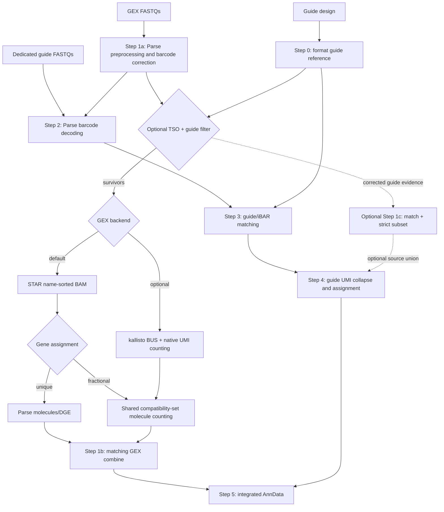

# v2.0 architecture and data flow

Start with the [quick start](docs/QUICKSTART.md) for setup. The
[configuration reference](docs/CONFIGURATION.md) and [execution runbook](docs/RUNNING.md)
cover both self-contained installations and the optional shared Broad setup.
Parse split-pipe 1.6.4 remains required; its source distribution is obtained
separately and kept pristine.

## Production stages

Step 0 and expression-reference construction are preparation tasks. The Broad
master submits Steps 1–5; its Step 2 dependency waits for Step 1a when both are
requested. After Step 1a, Step 1b and the guide branch can progress independently
until integration. Array indices follow the configured `libraries` list.
The same workers can be invoked inside another scheduler's allocation with
explicit task and CPU environment variables.

## GEX backend boundary

Parse owns kit/chemistry definitions, preprocessing, barcode correction,
RT/barcode-index identity, sample masks and the cell-calling algorithm. Kallisto
changes the transcriptomic alignment and molecule quantification within Step 1a.
It uses a transcript/target reference, not a BAM projection into Parse gene
counting. `paths.genome_dir` still supplies Parse annotation and initialization.

`gex_alignment.umi_correction` selects `parse` (default), `directional`, or
`none` on either backend. Native counting holds complete corrected-barcode
groups within workers and aggregates physical wells after UMI collapse.
Parallel shards merge in original barcode order to preserve fractional sums.
Unique STAR's alternative correction modes use an in-memory function override; vendor
source files are unchanged.

Both aligners support `gex_alignment.gene_assignment: unique|fractional`.
Fractional STAR and kallisto share the molecule/output core. Native unique STAR
retains the Parse path. Transcript-target output is a kallisto option.
[Counting choices and Parse/Tony settings](docs/GEX_COUNTING.md). Step 1b dispatches to the matching combine implementation, preserving
feature order and fractional counts. Step 5 validates expression provenance and
aligns dedicated/combined guide products to the called cells.
[Full semantics and limits](docs/KALLISTO_BACKEND.md).

## GEX gRNA carry-over and optional guide recovery

Universal reverse transcription produces long poly(A)-primed cDNA and short
gRNA-probe products together. Size selection separates the GEX and dedicated
gRNA fractions, but a small amount of guide material can remain in GEX. The
filter introduced in v1.4 removes a read only with a full/fuzzy TSO near the GEX
R1 start and a complete reference-supported guide. TSO alone is insufficient.
Survivors receive the configured full-TSO/fallback trim before either backend.

The filter also writes compact, valid corrected-barcode evidence. Optional
Step 1c matches those rows and applies stricter guide/iBAR acceptance before
Step 4 source union. It never rescans all GEX FASTQs or recalibrates barcodes
from rejected reads. Removal does not imply identity can be recovered: short
GEX reads may contain the full guide but not the dual-guide iBAR.

Dedicated-only, GEX-only and combined guide products remain distinguishable.
Source union occurs before Step 4 read-depth filtering and its existing gRNA
UMI collapse. That guide correction policy is independent of GEX transcriptomic
`umi_correction`. The circularization-capture N7 prefix belongs to the dedicated
gRNA fraction; it is not required on GEX carry-over.
[Operating guide](docs/GEX_DECONTAMINATION_V1_4.md).

## Validation and downstream boundary

Kallisto reference and completion manifests protect annotation/settings and
output identity; STAR policy markers prevent mixing new GEX UMI modes. GEX
filter and Step 1c evidence have separate provenance contracts. A new output
namespace is used for backend/reference/policy comparisons.

Separate carry-over QC uses raw scans, controlled full/short54 **STAR** arms and
historical BAM audits. Those experiments retain their original backend scope;
they are not required intermediates of a kallisto production run.
[QC documentation](docs/README.md#qc-guides).

This repository owns FASTQ-to-AnnData processing and count validation.
`analysis/` is a separate Git submodule for downstream inference and is not
required to execute Steps 0–5. Published historical reports remain evidence
with their original definitions; the [documentation index](docs/README.md)
separates them from current operating instructions.
