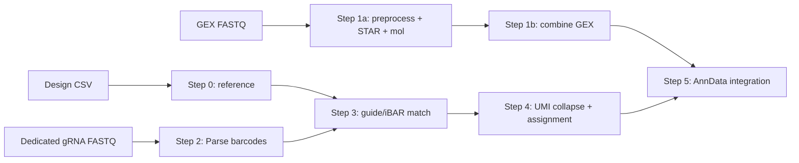
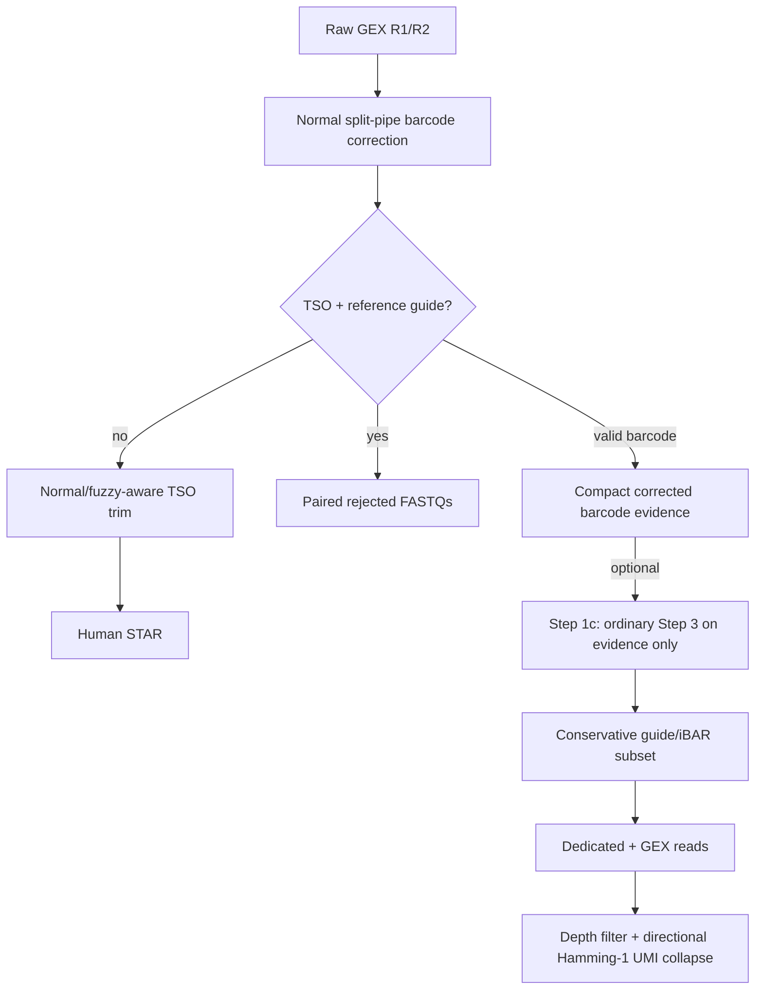

# Pipeline architecture and data flow

For installation, configuration, UGER submission, monitoring, output paths,
and v1.4 migration, start with the [README](README.md). This page describes
the processing architecture only.

The repository expects a Parse Biosciences-provided split-pipe 1.6.4 source
tree at `paths.splitpipe_dir`; it does not provide that vendor distribution.
The supplied submission wrappers are designed for the Broad Institute's UGER
cluster. An example project layout, including a locally obtained Parse copy, is
available at `/medpop/rgupta/Jiahao/TIMI/CSM_ccperturbseq` for Broad users with
access. Other schedulers require an adapted submission layer.

## Production data flow

Array dimensions come from `libraries`, so the same wrappers handle one,
four, twelve, or more sublibraries. FASTQ resolution supports multiple lanes,
token-bounded prefixes, and explicit pairs.

## v1.4 pre-STAR branch

Universal reverse transcription uses poly(A) probes for long cDNA and gRNA
probes for short guide products. The two products are separated by size before
library construction. A small amount of short gRNA material can remain in the
GEX fraction; it can be problematic when STAR assigns it to a transcript whose
true expression is similarly low.

The filter is installed as a checksum-validated in-memory overlay; the vendor
Parse 1.6.4 source remains unchanged. Step 1c never rescans the full GEX FASTQ
and never performs rejected-only barcode calibration. Dedicated-only, GEX-only,
and combined guide products remain distinct and auditable.

## QC architecture

The GEX carry-over QC is a separate workflow. It measures raw prevalence and
barcode/UMI families, benchmarks the production decision at 54 nt, writes
synchronized artifacts, runs controlled full/short54 alignments against the
same genome with the same STAR parameters, audits the historical BAM, and can
quantify both expression burden and guide-matrix changes.

In the completed C2 controlled experiment, none of 10,559 full-length
contaminants mapped, while 8,113 mapped after 54-nt truncation and 4,008 became
false gene-assigned reads. Of these, 2,431 were assigned to the guide's intended
target, and all target-concordant events were captured by the production
filter. The historical annotated BAM is only a supplementary cross-check
because the default split-pipe STAR output omits unmapped reads.

The random N7 found before the TSO in the dedicated gRNA library is introduced
by circularization-capture amplification. It is not expected on gRNA molecules
that escaped size selection into GEX, so the GEX filter does not require N7.

See [docs/GEX_GRNA_CONTAMINATION_QC.md](docs/GEX_GRNA_CONTAMINATION_QC.md)
for the step-by-step QC contract and C2 results.
